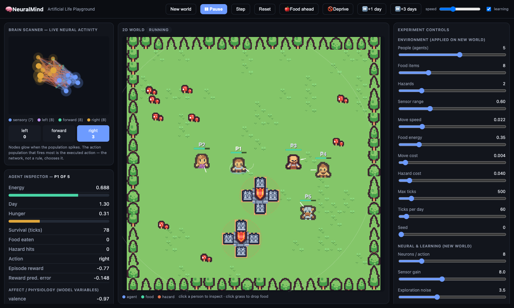

# NeuralMind — Artificial Life Playground

**A local-first lab where little pixel-art people are controlled by real spiking
neural networks.** You can watch them forage, learn, avoid hazards and starve,
and look inside their brains while it happens. Everything runs on your laptop:
no GPU, no API key.



> **What this is:** a computational model with explicitly defined mechanisms —
> leaky integrate-and-fire neurons, reward-modulated plasticity, a reward
> prediction error, and a small set of affect variables.
>
> **What this is not:** a human brain, a conscious system, or evidence of real
> feelings. "Hunger", "valence" or "threat" are model variables. See
> [`docs/research/SCIENTIFIC_EVIDENCE.md`](docs/research/SCIENTIFIC_EVIDENCE.md)
> for which parts are established science, hypotheses, or engineering shortcuts.

---

## Quickstart

```bash
git clone https://github.com/sitta07/AgentGraph.git && cd AgentGraph
python3 -m venv .venv && source .venv/bin/activate      # Windows: .venv\Scripts\activate
pip install -r requirements-neuralmind.txt -r requirements-server.txt

python -m neuralmind.server          # then open http://127.0.0.1:8000
```

Run the tests (85 tests, ~20 s):

```bash
python -m pytest tests/ -q                 # everything
python -m pytest tests/ -q -m "not slow"   # skip the training test (~4 s)
```

## Things to try in the Playground

| Try this | How |
|---|---|
| **Watch a brain drive behaviour** | Press **Play**. The Brain Scanner glows with the selected person's spikes; the action population that fires most (left / forward / right) is the move they make. |
| **Add more people** | Set **People (agents)** (1–8) → **New world**. Each person has their own brain and they compete for the same food. Click a person to inspect them. |
| **Feed someone** | Click the grass to drop a mushroom, or press **🍎 Food ahead** to put one in front of the selected person. |
| **Starvation experiment** | Press **🚫 Deprive** (removes all food), then **⏩ +1 day / +3 days**. The day-by-day timeline shows energy, hunger, affect and neural firing for each simulated day. |
| **Does learning help?** | Press **Train 40 episodes**, then **Compare vs untrained**. Toggle **learning** off for a no-plasticity control. |
| **Change the world** | Adjust food, hazards, sensor range, costs, learning rate, exploration noise… then **New world**. |
| **Save results** | **Save episode** stores config + metrics in a local SQLite file. |

## How a decision is made (the causal chain)

```
world ──► egocentric sensors ──► input currents ──► LIF spiking network
 ▲          (food & threat in        (nA)            sensory → 3 action populations
 │           3 directions + hunger)                  with lateral inhibition
 │                                                          │
 │                                              most active population = action
 │                                                          ▼
 └── weights change ◄── reward-modulated ◄── reward prediction ◄── move / eat / get hurt
                        Hebbian learning        error (TD)
```

The physics only moves bodies and does the energy bookkeeping. **It never picks
an action**: the choice comes from the neural network. Reward is *shaped*
(points for turning toward food). That shaping is an engineering choice, not a
claim about biology.

## What the evidence says (so far)

| Experiment | Result | Status |
|---|---|---|
| Foraging: trained vs untrained agent, 60 held-out worlds | 4.85 vs 3.45 food per episode on average (≈ +40%); trained agent was better in 36 of 60 worlds | real effect, noisy per world |
| Learning curves (3 training seeds) | food/episode rises with training (e.g. 0.6 → 6.3) | real effect |
| Starvation (no food) | energy falls and hunger rises each day; agents eventually die | mechanical, as designed |
| Discrete reward task (`reward_learning`) | chance ≈ 0.5 → 0.8–0.95 correct choices | validated (qualitative) |
| Pavlovian threat conditioning (`threat_avoidance`) | paired ≫ unpaired | validated (qualitative) |
| `pain_response`, `forgetting` | dose-response; catastrophic interference | exploratory |

Bugs found during development and how they were fixed are listed in the commit
history and [`docs/IMPLEMENTATION_STATUS.md`](docs/IMPLEMENTATION_STATUS.md).
One example: an STDP sign issue inverted the learned food→turn mapping.

## Command-line tools

```bash
python -m neuralmind.cli list                              # experiments
python -m neuralmind.cli run reward_learning --seed 0      # with learning
python -m neuralmind.cli run reward_learning --no-learning # baseline
python -m neuralmind.cli visualize --out examples/brain_viewer.html   # 3D brain viewer
python -m neuralmind.cli search "spike timing"             # search the docs, with citations
python -m neuralmind.bench --sizes 50 100 200 400          # runtime + memory
```

## Project layout

```
neuralmind/
  core/          LIF neurons, synapses, STDP / eligibility traces, SpikingNetwork
  affect/        reward prediction error (TD), affect state
  world.py       2D world + Agent (sensors → brain → action → reward → learning)
  server.py      FastAPI backend (the browser only renders backend state)
  webui/         Playground frontend (vanilla JS + canvas, Kenney CC0 pixel art)
  experiments/   reward_learning, threat_avoidance, pain_response, forgetting
  persistence/   SQLite experiment store
  knowledge/     local document search with source citations
  recorder.py, viz.py, bench.py, cli.py
docs/            research report, reuse matrix, scientific evidence, ADRs, status
tests/           pytest suite
```

## Known limitations

- Agents compete for food but **cannot see or respond to each other** yet (no social behaviour).
- A "day" is a simulation unit (`ticks_per_day`, default 60), not a real day.
- Point-neuron LIF model; small networks (31 neurons per agent). TVB, Brian2 and NEST were studied for reference only. All three are copyleft.
- Learning gains vary a lot between worlds. Judge them by multi-seed averages, not a single run.

## Licence & credits

MIT (see `LICENSE`). Pixel art from **Kenney** (Tiny Town, Tiny Dungeon), released under CC0.
Details in [`THIRD_PARTY_NOTICES.md`](THIRD_PARTY_NOTICES.md).

---

<details>
<summary><b>Legacy project: AgentGraph (original LLM multi-agent app — needs a Novita API key)</b></summary>

This repository started as **AgentGraph**, a LangGraph/Streamlit multi-agent
architecture consultant. Its code (`app.py`, `main.py`, `src/`, `evals/`) is kept
unchanged and is independent of NeuralMind.

## AgentGraph: AI Architecture Consultant

<div align="center">

[](https://github.com/sitta07/AgentGraph)
[](https://langchain-ai.github.io/langgraph/)
[](https://smith.langchain.com/)
[](https://streamlit.io/)
[](https://www.python.org/)
[](LICENSE)

</div>

A multi-agent system for real-time system design, security evaluation, and architecture optimization using **Meta Llama 3.3 70B** and **LangGraph**. Generates Mermaid diagrams, identifies vulnerabilities, and iteratively improves designs for cost-effectiveness and security.

> [!NOTE]
> **Learning Project**: This repository is an active learning playground for mastering advanced Agentic AI patterns. It serves as a hands-on exploration of:
> - **LangGraph** — Multi-agent orchestration and state management
> - **LangSmith** — LLM observability, tracing, and prompt management
>
> The project is continuously evolving as I deepen my understanding of production-grade agent architectures. Contributions and feedback are welcome!

---

## Features

### Multi-Agent System
- **4 Specialized Agents** working in a coordinated loop:
  - **Architect** — Generates system architecture with cost estimates
  - **Security** — Identifies vulnerabilities and mitigation strategies
  - **Evaluator** — Scores designs on security (40%), feasibility (30%), cost-effectiveness (30%)
  - **Mermaid Validator** — Ensures diagram syntax correctness

### Professional UI/UX
- **Minimal Aesthetic Streamlit UI** — Clean, modern interface with real-time agent outputs
- **Vertical Mermaid Diagrams** — `graph TD` layout for better readability (prevents horizontal compression)
- **Executive Session Summary** — AI-generated chronological narrative of the entire design session

### Engineering Best Practices
- **Prompt Registry Pattern** — Clean separation of prompt logic from agent implementation (`src/prompts/`)
- **Dynamic LangSmith Tracing** — Runtime-configurable with dynamic UUIDs for each session
- **Loop Prevention** — Convergence detection via similarity tracking, feedback deduplication, and score stagnation detection
- **Robust Error Handling** — Specific exception handling for JSON parsing and validation errors
- **Full English Localization** — Professional English throughout (no mixed languages)

### Cost-Conscious Design
- Budget-aware architecture recommendations in **Thai Baht (฿)**
- Pragmatic MVP-first approach (80% users, 20% features)
- Small team feasibility assessment (3-5 engineers)

---

## Installation

### Prerequisites

- Python 3.8 or higher
- `pip` package manager
- Novita API key (for Meta Llama 3.3 70B access)

### Setup

1. Clone the repository:
```bash
git clone https://github.com/sitta07/AgentGraph.git
cd AgentGraph
```

2. Create a Python virtual environment:
```bash
python3 -m venv venv
source venv/bin/activate  # On Windows: venv\Scripts\activate
```

3. Install dependencies:
```bash
pip install -r requirements.txt
```

4. Configure environment variables:
```bash
# Create .env file in project root
echo "NOVITA_API_KEY=your_api_key_here" > .env
```

---

## Quick Start

### Web Interface (Streamlit)

```bash
streamlit run app.py
```

Then open your browser to `http://localhost:8501`.

Define your system requirements in the sidebar and set a monthly operating budget. The system will automatically:
1. Generate an initial architecture design
2. Run security validation
3. Evaluate against multiple criteria
4. Refine iteratively until passing (score ≥ 9.5/10)
5. Display Mermaid diagrams for each iteration
6. Generate an Executive Session Summary

### CLI Execution

```bash
python main.py
```

The CLI outputs detailed logs from each agent and saves diagrams to the `/diagrams` directory.

---

## Configuration

### Environment Variables

| Variable | Required | Description |
|----------|----------|-------------|
| `NOVITA_API_KEY` | ✅ | Your API key for Llama 3.3 70B access via Novita |
| `LLM_BASE_URL` | ❌ | API base URL (default: `https://api.novita.ai/v3/openai`) |
| `MODEL_NAME` | ❌ | Model identifier (default: `meta-llama/llama-3.3-70b-instruct`) |
| `MODEL_TEMPERATURE` | ❌ | LLM temperature (default: `0.2`) |
| `DEFAULT_BUDGET_THB` | ❌ | Default monthly budget in THB (default: `5000.0`) |
| `LANGSMITH_PROMPT_NAME` | ❌ | LangSmith prompt name (default: `agentgraph-architect`) |

### Agent Tuning

Key parameters in `src/graph/nodes.py`:

| Parameter | Value | Description |
|-----------|-------|-------------|
| **Model** | `meta-llama/llama-3.3-70b-instruct` | Via Novita API |
| **Temperature** | `0.2` | Low randomness for consistency |
| **Passing Threshold** | `≥ 9.5/10.0` | Near-perfect score required |
| **Max Revisions** | `3` | Iterations before stopping |
| **Output Similarity** | `≥ 90%` | Loop prevention threshold |
| **Feedback Repetition** | `≥ 85%` | Loop prevention threshold |

---

## Project Structure

```
AgentGraph/
├── app.py                          # Streamlit web UI with final summary generation
├── main.py                         # Graph builder & CLI execution
├── requirements.txt                # Python dependencies
├── .env                           # Environment variables (not in repo)
├── src/
│   ├── graph/
│   │   ├── state.py               # GraphState TypedDict & EvaluationRubric
│   │   ├── nodes.py               # 4 agent nodes + routing logic
│   │   └── __init__.py
│   ├── prompts/                   # 🆕 Prompt Registry
│   │   ├── __init__.py
│   │   ├── architect_prompts.py   # Architect agent prompts
│   │   ├── security_prompts.py   # Security agent prompts
│   │   └── evaluator_prompts.py  # Evaluator agent prompts + session summary
│   └── utils/
│       ├── convergence_utils.py    # Loop prevention functions
│       ├── cost_utils.py           # Cost calculation utilities
│       ├── diagram_generator.py    # Mermaid extraction & rendering
│       └── __init__.py
├── diagrams/                       # Generated architecture diagrams (PNG)
├── evals/                          # Evaluation rubrics & reports
└── README.md
```

---

## How It Works

```
┌─────────────┐     ┌─────────────────┐     ┌─────────────┐
│  Architect  │────▶│ Mermaid Validator│────▶│   Security  │
└─────────────┘     └─────────────────┘     └─────────────┘
      ▲                                             │
      │                                             ▼
      │                                        ┌─────────────┐
      │                                        │  Evaluator  │
      │                                        └─────────────┘
      │                                               │
      │◀────────────────── feedback (if failed) ◀────┘
```

1. **Architect** → Generates initial `graph TD` Mermaid diagram with cost breakdown
2. **Mermaid Validator** → Checks syntax; returns to Architect if invalid
3. **Security** → Identifies vulnerabilities and pragmatic mitigations
4. **Evaluator** → Scores 0-10.0 based on security, feasibility, cost; requires ≥ 9.5 to pass
5. **Loop Prevention** → Stops iteration if converged, repeated feedback, or stagnant scores

---

## Dependencies

| Package | Purpose |
|---------|---------|
| `langgraph` | Multi-agent orchestration framework |
| `langchain-core` | Message types and output parsing |
| `langchain-openai` | OpenAI-compatible LLM interface |
| `langsmith` | LLM observability and tracing |
| `streamlit` | Web UI framework |
| `python-dotenv` | Environment variable management |
| `requests` | HTTP requests for Mermaid API |
| `pydantic` | Data validation |

See `requirements.txt` for pinned versions.

---

## Contributing

We welcome contributions! Please:

1. Fork the repository
2. Create a feature branch (`git checkout -b feature/your-feature`)
3. Make focused changes with clear commit messages
4. Ensure Python compiles without errors (`python3 -m py_compile src/**/*.py`)
5. Submit a pull request with a description of your changes

### Areas for Contribution

- Additional agent types (e.g., Cost Optimizer, Performance Analyst)
- Enhanced Mermaid syntax support
- Alternative LLM providers (OpenAI, Anthropic, local models)
- Additional evaluation criteria
- Improved loop prevention heuristics
- Multi-language localization

---

## License

MIT License (2026) — See [LICENSE](LICENSE) file for details

---

**Built with**: LangGraph + Llama 3.3 70B + LangSmith + Streamlit

**Questions?** Review agent prompts in `src/prompts/` or check the conversation history in the UI.

</details>
