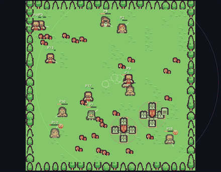
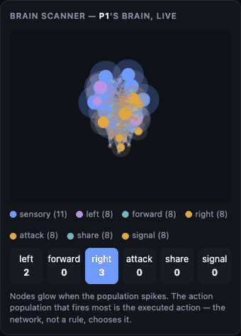
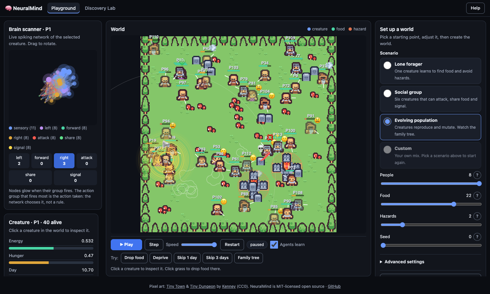
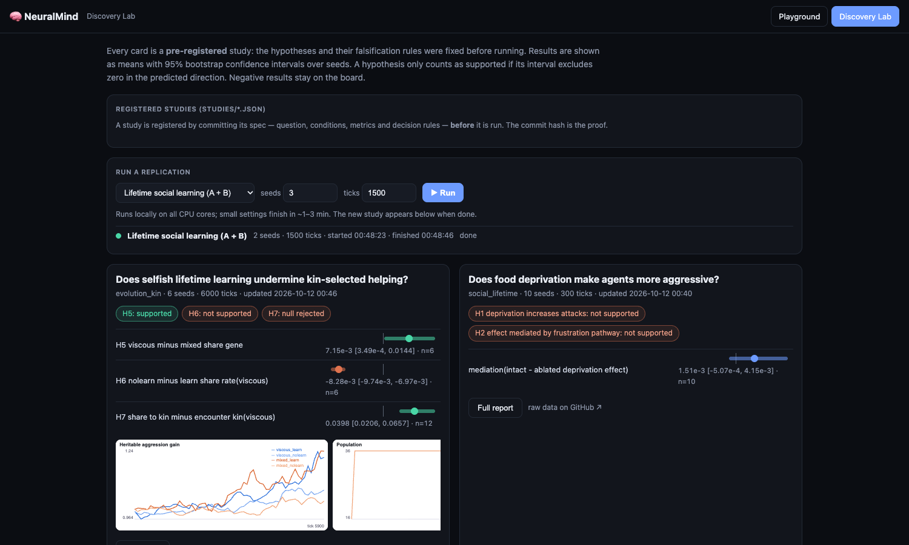

<h1 align="center">🧠 NeuralMind — an open Artificial-Life Lab</h1>

<p align="center">
  <b>Pixel-art creatures whose brains are real spiking neural networks.</b><br>
  They forage, learn, fight, share, signal, reproduce and evolve.<br>
  You can watch every neuron, run pre-registered experiments, and plug in your own RL agents.
</p>

<p align="center">
  <a href="https://github.com/sitta07/NeuralMind/actions/workflows/tests.yml"></a>
  
  
  
  
  
</p>

<p align="center">
  
  &nbsp;
  
</p>
<p align="center"><sub>
  ① An evolving population, recorded from the app. Families share a sprite; 😠 marks a
  frustration-driven aggression drive and 😫 marks hunger. ② One individual's brain, live.
  The action population that fires most is the move it makes — the network chooses, not a rule.
</sub></p>

---

## 🔓 Open for you to build on

NeuralMind is **MIT-licensed**. It is designed to be forked, extended and cited:

| You want to… | Use |
|---|---|
| **Test a MARL algorithm** in a rich social world | the **PettingZoo `ParallelEnv`** (passes the official API test). RL agents can live *alongside* spiking-brain agents. |
| **Ask a new scientific question** without writing simulator code | a **declarative study spec** (`studies/*.json`): commit it, then run it. The commit hash is your pre-registration. → [`docs/ADDING_A_STUDY.md`](docs/ADDING_A_STUDY.md) |
| **Check or extend our results** | the committed raw data in [`results/`](results/) and auto-generated reports with bootstrap CIs |
| **Teach** neurons, plasticity, reinforcement learning or evolution | the interactive Playground: click any creature to see its brain |
| **Build on the engine** | `pip install` it: small, dependency-light NumPy code with 120+ tests and CI |

If you use it in research, please cite it ([`CITATION.cff`](CITATION.cff)). PRs
and new studies are welcome; see [`CONTRIBUTING.md`](CONTRIBUTING.md).

> **What this is:** a computational model with explicitly defined mechanisms:
> leaky integrate-and-fire neurons, reward-modulated plasticity, reward
> prediction error, and bounded affect variables.
>
> **What this is not:** a human brain, a conscious system, or evidence of real
> feelings. See
> [`docs/research/SCIENTIFIC_EVIDENCE.md`](docs/research/SCIENTIFIC_EVIDENCE.md),
> which separates evidence, hypotheses and engineering shortcuts.

---

## 🚀 Quickstart

```bash
git clone https://github.com/sitta07/NeuralMind.git && cd NeuralMind
python3 -m venv .venv && source .venv/bin/activate      # Windows: .venv\Scripts\activate
pip install -r requirements-neuralmind.txt -r requirements-server.txt -r requirements-research.txt

python -m neuralmind.server     # Playground → http://127.0.0.1:8000   ·   Lab → http://127.0.0.1:8000/lab
python -m pytest tests/ -q      # full test suite
```

Or install it as a package, for use in your own project:

```bash
pip install "neuralmind[server,research] @ git+https://github.com/sitta07/NeuralMind"
neuralmind-server --port 8000          # Playground + Lab (results/ and studies/ live in the current folder)
neuralmind-study studies/my_study.json # run a registered study
```

## 🎮 The Playground



| Try this | How |
|---|---|
| **Watch a brain drive behaviour** | Press **Play**. The Brain Scanner shows the selected creature's spikes, and the winning action population is the move it makes. |
| **Scan anyone's brain** | Click any creature. The scanner loads *that individual's* current learned weights and live spikes. |
| **Social life** | Tick **Social**. Creatures see each other and can **attack** (steal energy 💢), **share** (the recipient gets 2× 💚) or **signal** (📢). Each is a neural population competing in the same winner-take-all. |
| **Evolution** | Tick **Evolution**. Well-fed creatures reproduce, and children inherit a mutated *innate* brain plus an aggression gene (✨ birth, 💀 death). |
| **Family tree** | Press **🌳 Family tree** for a live phylogeny of every individual that ever lived. Each line is one life, colour shows its aggression gene, and you can see which founder lineages take over and which die out. |
| **Starvation experiment** | **🚫 Deprive**, then **⏩ +1 / +3 days**. A day-by-day table shows energy, hunger, affect and neural firing. |
| **Feed someone** | Click the grass, or press **🍎 Food ahead**. |
| **Does learning help?** | **Train 40 episodes**, then **Compare vs untrained**. |

## 🔬 The Discovery Lab (`/lab`)



- Every study is **pre-registered**: its JSON spec is committed before the run.
- Every hypothesis has a stated falsifier. Results are shown with 95%
  bootstrap CIs, and negative results stay on the board.
- You can re-run any registered study from the browser.

### What we have found so far

| Study | Result | Status |
|---|---|---|
| **Can spiking agents learn aggression or cooperation within one lifetime?** ([write-up](docs/research/FINDINGS_SOCIAL.md)) | **No.** None of the 4 pre-registered hypotheses were supported. Attacks are untargeted, which points to an exploration bottleneck. An ablation also showed that an apparent 12.7% "aggression" came from a modelling artifact. | completed |
| **Does selfish lifetime learning undermine kin-selected helping?** (evolution, [C](docs/research/FINDINGS_EVOLUTION_KIN.md), [C2](docs/research/FINDINGS_C2.md)) | Selfish learning *doubled* sharing, the opposite of our prediction. The pre-registered follow-up then **ruled out crowding** as the cause, and J later traced the rise to locomotion weights weakening, not to learned sharing. Help reached relatives above chance **without any kin-recognition sensor**, and this replicated. The early "viscosity raises the innate share gene" result did **not** replicate. | completed |
| **Does spatial structure prevent extinction?** (F + F2, [write-up](docs/research/FINDINGS_F.md)) | **It delays extinction; it does not prevent it.** F found 9/12 vs 1/12 extinctions, but half of those seeds repeated exploratory runs. The independent replication F2 (16 fresh seeds) found 13/16 vs 7/16, which missed the registered threshold (p = 0.066 two-sided). Well-mixed populations did die ~3100 ticks sooner. The proposed boom-bust mechanism was confounded and does not hold up before collapse. | completed |
| **Is learned sharing a reciprocity loop driven by gift rewards?** (G, [write-up](docs/research/FINDINGS_G.md)) | **Only partly.** Removing the gift reward cut the learning effect by ~22%, and the rest remains. The learning effect itself replicated a third time. Two independent runs reproduced each other's numbers exactly. | completed |
| **Does learning strengthen every social action, rewarded or not?** (I, [write-up](docs/research/FINDINGS_I.md)) | **Partly.** Learning raised signalling ~3.5× even though signalling only costs energy. Crediting only the executed action removed about half of that rise and ~40% of the sharing rise, but none of the attack rise. Every input weight fell over a lifetime, and locomotion fell the most. | completed |
| **Is the "learned" social behaviour a side effect of weaker locomotion?** (J, [write-up](docs/research/FINDINGS_J.md)) | **Yes, as far as tested.** With locomotion inputs frozen and social inputs still learning, attack, signal and share rates fell to no-learning levels (attacks 0.013 vs 0.013; learning alone gave 0.112). The rise in sharing and aggression seen since C comes from locomotion learning, not social learning. | completed |
| **Is it the *weakening* of locomotion, or other foraging changes?** (K, [write-up](docs/research/FINDINGS_K.md)) | **The weakening.** Locomotion still learned but its total drive was held fixed, and 80–95% of the learned rise in attacking, signalling and sharing disappeared. Exploratory probe and literature: the scalar reward critic leaves the known R-STDP bias term (Frémaux et al. 2010), which depresses the busiest pathways. | completed |
| **Do negative reward errors drive it?** (P, [write-up](docs/research/FINDINGS_P.md)) | **Yes.** Ignoring negative RPEs reversed the drift (locomotion +73%) and dropped social actions to or below no-learning levels. Not pre-registered: learning agents ate **~31% less** than non-learning ones. | completed |
| **Does a per-state critic remove the side effect?** (R, [write-up](docs/research/FINDINGS_R.md)) | **Mostly.** Keeping the reward expectation per sensor state (the correction from Frémaux et al. 2010) stopped locomotion weakening and removed 58–76% of the learned rise in attacks, signals and sharing. Foraging improved by about half the gap, but learners still ate ~15% less than non-learners. | completed |
| **What happens before well-mixed populations collapse?** (L, [write-up](docs/research/FINDINGS_L.md)) | Before any extinction, well-mixed populations had a **lower birth rate** and more starvation deaths. Killing is the main cause of death everywhere (58–67%). Third replication of earlier extinction in well-mixed worlds (−3900 ticks). | completed |
| **Does viscosity help through kinship or density?** (Q, [write-up](docs/research/FINDINGS_Q.md)) | **Inconclusive** by the pre-registered rule: no survival or birth-rate test supported. Not pre-registered: newborns placed beside a non-relative went extinct in 11/12 runs vs 3/12 beside their parent (Fisher p = 0.003), so local density alone does not protect. Points toward kinship. | completed |
| **Do signals evolve meaning?** (M, [write-up](docs/research/FINDINGS_M.md)) | **No.** Signals carry ~0.0002 bits about food whether or not anyone can hear them. Deaf controls are just as "significant" (12/12 G-tests), so significance came from shared sensory input, not communication. | completed |
| **Do signals gain meaning when food needs a partner?** (S, [write-up](docs/research/FINDINGS_S.md)) | **No.** With a partner rule and directional hearing, signals still carried ~0.0002 bits about food, the same as deaf controls. In viscous populations a partner was usually nearby already, so the rule probably did not bind. A failed test design, recorded as such. | completed |
| **Lamarckian vs Darwinian inheritance** (N, [write-up](docs/research/FINDINGS_N.md)) | The environment-shift test failed its manipulation check. Not pre-registered: Lamarckian populations attacked 2–3× more and went extinct in 9/16 vs 2/16 runs, consistent with inherited learning bias. **N2 replicated this as a pre-registered test** ([write-up](docs/research/FINDINGS_N2.md)): 9/12 vs 1/12 extinct (p = 0.003). The per-state critic from R did not prevent it. | completed |
| **Can Q-learners invade an SNN population?** (O, [write-up](docs/research/FINDINGS_O.md)) | **No advantage either way.** A one-seed pilot had suggested otherwise. Not pre-registered: Q-learner lineages always ended fixed or lost (12/12 vs 4/12 for neutral labels), so fate was all-or-nothing. | completed |
| **Does an aggression gene evolve under scarcity?** (D + D2, [write-up](docs/research/FINDINGS_D.md)) | **No.** D's apparent rise (+0.75) did not replicate in D2, where the gene did not differ from a neutral marker. Attack behaviour never changed. The first result was chance or drift. | completed |
| **Baldwin effect vs hiding effect** (E, [write-up](docs/research/FINDINGS_E.md)): does learning speed up or shield the evolution of innate ability? | **Hiding effect.** Without learning, evolution more than doubled innate foraging (+5.5 [3.3, 7.6]). With learning, innate ability stayed near founder level (−4.4 [−7.0, −1.5] vs no learning), even across more generations. | completed |
| Foraging: trained vs untrained agent, 60 held-out worlds | 4.85 vs 3.45 food per episode (≈ +40%). Single agent only; in evolving populations learning *lowered* foraging (P). | real but noisy |

How C–R fit together (learned social behaviour as a side effect of the
learning rule) is summarised in
[`docs/research/SYNTHESIS_LEARNING_SIDE_EFFECT.md`](docs/research/SYNTHESIS_LEARNING_SIDE_EFFECT.md).

The full ranked agenda of open questions is in
[`docs/research/RESEARCH_AGENDA.md`](docs/research/RESEARCH_AGENDA.md).

## 🧩 How a decision is made

```
world ──► egocentric sensors ──► input currents ──► LIF spiking network
 ▲     food/threat ×3, hunger,      (nA)            sensory → action populations
 │     others ×3, heard signal                       (move / attack / share / signal)
 │                                                    with lateral inhibition
 │                                         most active population = action
 │                                                          ▼
 └── weights change ◄── reward-modulated ◄── reward prediction ◄── eat / hurt / steal / give
     (and genomes        Hebbian learning     error (TD)
      mutate across
      generations)
```

- The physics only moves bodies and does the energy bookkeeping. **It never
  picks an action.**
- Reward shaping is an explicit engineering choice.
- Affect is computed from the primary reward only.

## 🤖 For RL researchers

```python
from neuralmind.envs import parallel_env
env = parallel_env(n_rl=4, n_snn=4, config={"social": True}, max_cycles=500)
obs, infos = env.reset(seed=0)
while env.agents:
    obs, rewards, terms, truncs, infos = env.step(
        {a: env.action_space(a).sample() for a in env.agents})
```

- **Observations:** the sensor vector the SNN agents use.
- **Actions:** `Discrete` over move, plus attack / share / signal when social.
- **Rewards:** the same reward the SNN agents learn from.

## 🛠 Command-line tools

```bash
python -m neuralmind.research.spec studies/E_baldwin_vs_hiding.json   # run a registered study
python -m neuralmind.research.social all --seeds 10                    # lifetime social study
python -m neuralmind.research.evolution --experiment kin               # kin-selection study
python -m neuralmind.cli run reward_learning --seed 0                  # classic experiments
python -m neuralmind.bench --sizes 50 100 200 400                      # runtime + memory
python tools/make_media.py                                             # re-record these GIFs
```

## 📁 Project layout

```
neuralmind/
  core/          LIF neurons, synapses, STDP / eligibility traces
  affect/        reward prediction error, affect state
  world.py       2D world · Agent · social layer · evolution · genealogy
  envs/          PettingZoo ParallelEnv
  research/      pre-registered studies, stats (bootstrap CI, MI, G-test), spec runner
  lab.py         Discovery Lab API
  server.py      FastAPI backend (the browser only renders backend state)
  webui/         Playground (+ family tree) + Discovery Lab (vanilla JS + canvas, Kenney CC0 pixel art)
  paths.py       where studies/ and results/ live (repo, $NEURALMIND_HOME, or current folder)
studies/         registered study specs        results/   raw results + reports
docs/research/   findings, evidence ledger, agenda, literature
tests/           pytest suite (CI on 3.12 / 3.13)
```

## ⚠️ Known limitations

- Small brains: 31–59 neurons per agent, point-neuron LIF. This is not a model of any real nervous system.
- Within-lifetime learning alone does not produce targeted social behaviour (see findings).
- Evolution studies run for tens of generations, not thousands.
- A "day" is a simulation unit (`ticks_per_day`).

## Licence & credits

- **Code:** MIT (see `LICENSE`).
- **Pixel art:** [Tiny Town](https://kenney.nl/assets/tiny-town) and [Tiny Dungeon](https://kenney.nl/assets/tiny-dungeon) by **[Kenney](https://kenney.nl)**, released under CC0. Thank you! CC0 doesn't require credit, but we give it gladly.
- **Optional dependencies:** FastAPI, PettingZoo, Gymnasium (MIT); Uvicorn (BSD); Playwright (Apache-2.0, media recording only).
- Details in [`THIRD_PARTY_NOTICES.md`](THIRD_PARTY_NOTICES.md).

---

<details>
<summary><b>Legacy project: AgentGraph (original LLM multi-agent app — needs a Novita API key)</b></summary>

This repository started as **AgentGraph**, a LangGraph/Streamlit multi-agent
architecture consultant. Its code (`app.py`, `main.py`, `src/`, `evals/`) is kept
unchanged and is independent of NeuralMind.

## AgentGraph: AI Architecture Consultant

<div align="center">

[](https://github.com/sitta07/NeuralMind)
[](https://langchain-ai.github.io/langgraph/)
[](https://smith.langchain.com/)
[](https://streamlit.io/)
[](https://www.python.org/)
[](LICENSE)

</div>

A multi-agent system for real-time system design, security evaluation, and architecture optimization using **Meta Llama 3.3 70B** and **LangGraph**. Generates Mermaid diagrams, identifies vulnerabilities, and iteratively improves designs for cost-effectiveness and security.

> [!NOTE]
> **Learning Project**: This repository is an active learning playground for mastering advanced Agentic AI patterns. It serves as a hands-on exploration of:
> - **LangGraph** — Multi-agent orchestration and state management
> - **LangSmith** — LLM observability, tracing, and prompt management
>
> The project is continuously evolving as I deepen my understanding of production-grade agent architectures. Contributions and feedback are welcome!

---

## Features

### Multi-Agent System
- **4 Specialized Agents** working in a coordinated loop:
  - **Architect** — Generates system architecture with cost estimates
  - **Security** — Identifies vulnerabilities and mitigation strategies
  - **Evaluator** — Scores designs on security (40%), feasibility (30%), cost-effectiveness (30%)
  - **Mermaid Validator** — Ensures diagram syntax correctness

### Professional UI/UX
- **Minimal Aesthetic Streamlit UI** — Clean, modern interface with real-time agent outputs
- **Vertical Mermaid Diagrams** — `graph TD` layout for better readability (prevents horizontal compression)
- **Executive Session Summary** — AI-generated chronological narrative of the entire design session

### Engineering Best Practices
- **Prompt Registry Pattern** — Clean separation of prompt logic from agent implementation (`src/prompts/`)
- **Dynamic LangSmith Tracing** — Runtime-configurable with dynamic UUIDs for each session
- **Loop Prevention** — Convergence detection via similarity tracking, feedback deduplication, and score stagnation detection
- **Robust Error Handling** — Specific exception handling for JSON parsing and validation errors
- **Full English Localization** — Professional English throughout (no mixed languages)

### Cost-Conscious Design
- Budget-aware architecture recommendations in **Thai Baht (฿)**
- Pragmatic MVP-first approach (80% users, 20% features)
- Small team feasibility assessment (3-5 engineers)

---

## Installation

### Prerequisites

- Python 3.8 or higher
- `pip` package manager
- Novita API key (for Meta Llama 3.3 70B access)

### Setup

1. Clone the repository:
```bash
git clone https://github.com/sitta07/NeuralMind.git
cd NeuralMind
```

2. Create a Python virtual environment:
```bash
python3 -m venv venv
source venv/bin/activate  # On Windows: venv\Scripts\activate
```

3. Install dependencies:
```bash
pip install -r requirements.txt
```

4. Configure environment variables:
```bash
# Create .env file in project root
echo "NOVITA_API_KEY=your_api_key_here" > .env
```

---

## Quick Start

### Web Interface (Streamlit)

```bash
streamlit run app.py
```

Then open your browser to `http://localhost:8501`.

Define your system requirements in the sidebar and set a monthly operating budget. The system will automatically:
1. Generate an initial architecture design
2. Run security validation
3. Evaluate against multiple criteria
4. Refine iteratively until passing (score ≥ 9.5/10)
5. Display Mermaid diagrams for each iteration
6. Generate an Executive Session Summary

### CLI Execution

```bash
python main.py
```

The CLI outputs detailed logs from each agent and saves diagrams to the `/diagrams` directory.

---

## Configuration

### Environment Variables

| Variable | Required | Description |
|----------|----------|-------------|
| `NOVITA_API_KEY` | ✅ | Your API key for Llama 3.3 70B access via Novita |
| `LLM_BASE_URL` | ❌ | API base URL (default: `https://api.novita.ai/v3/openai`) |
| `MODEL_NAME` | ❌ | Model identifier (default: `meta-llama/llama-3.3-70b-instruct`) |
| `MODEL_TEMPERATURE` | ❌ | LLM temperature (default: `0.2`) |
| `DEFAULT_BUDGET_THB` | ❌ | Default monthly budget in THB (default: `5000.0`) |
| `LANGSMITH_PROMPT_NAME` | ❌ | LangSmith prompt name (default: `agentgraph-architect`) |

### Agent Tuning

Key parameters in `src/graph/nodes.py`:

| Parameter | Value | Description |
|-----------|-------|-------------|
| **Model** | `meta-llama/llama-3.3-70b-instruct` | Via Novita API |
| **Temperature** | `0.2` | Low randomness for consistency |
| **Passing Threshold** | `≥ 9.5/10.0` | Near-perfect score required |
| **Max Revisions** | `3` | Iterations before stopping |
| **Output Similarity** | `≥ 90%` | Loop prevention threshold |
| **Feedback Repetition** | `≥ 85%` | Loop prevention threshold |

---

## Project Structure

```
AgentGraph/
├── app.py                          # Streamlit web UI with final summary generation
├── main.py                         # Graph builder & CLI execution
├── requirements.txt                # Python dependencies
├── .env                           # Environment variables (not in repo)
├── src/
│   ├── graph/
│   │   ├── state.py               # GraphState TypedDict & EvaluationRubric
│   │   ├── nodes.py               # 4 agent nodes + routing logic
│   │   └── __init__.py
│   ├── prompts/                   # 🆕 Prompt Registry
│   │   ├── __init__.py
│   │   ├── architect_prompts.py   # Architect agent prompts
│   │   ├── security_prompts.py   # Security agent prompts
│   │   └── evaluator_prompts.py  # Evaluator agent prompts + session summary
│   └── utils/
│       ├── convergence_utils.py    # Loop prevention functions
│       ├── cost_utils.py           # Cost calculation utilities
│       ├── diagram_generator.py    # Mermaid extraction & rendering
│       └── __init__.py
├── diagrams/                       # Generated architecture diagrams (PNG)
├── evals/                          # Evaluation rubrics & reports
└── README.md
```

---

## How It Works

```
┌─────────────┐     ┌─────────────────┐     ┌─────────────┐
│  Architect  │────▶│ Mermaid Validator│────▶│   Security  │
└─────────────┘     └─────────────────┘     └─────────────┘
      ▲                                             │
      │                                             ▼
      │                                        ┌─────────────┐
      │                                        │  Evaluator  │
      │                                        └─────────────┘
      │                                               │
      │◀────────────────── feedback (if failed) ◀────┘
```

1. **Architect** → Generates initial `graph TD` Mermaid diagram with cost breakdown
2. **Mermaid Validator** → Checks syntax; returns to Architect if invalid
3. **Security** → Identifies vulnerabilities and pragmatic mitigations
4. **Evaluator** → Scores 0-10.0 based on security, feasibility, cost; requires ≥ 9.5 to pass
5. **Loop Prevention** → Stops iteration if converged, repeated feedback, or stagnant scores

---

## Dependencies

| Package | Purpose |
|---------|---------|
| `langgraph` | Multi-agent orchestration framework |
| `langchain-core` | Message types and output parsing |
| `langchain-openai` | OpenAI-compatible LLM interface |
| `langsmith` | LLM observability and tracing |
| `streamlit` | Web UI framework |
| `python-dotenv` | Environment variable management |
| `requests` | HTTP requests for Mermaid API |
| `pydantic` | Data validation |

See `requirements.txt` for pinned versions.

---

## Contributing

We welcome contributions! Please:

1. Fork the repository
2. Create a feature branch (`git checkout -b feature/your-feature`)
3. Make focused changes with clear commit messages
4. Ensure Python compiles without errors (`python3 -m py_compile src/**/*.py`)
5. Submit a pull request with a description of your changes

### Areas for Contribution

- Additional agent types (e.g., Cost Optimizer, Performance Analyst)
- Enhanced Mermaid syntax support
- Alternative LLM providers (OpenAI, Anthropic, local models)
- Additional evaluation criteria
- Improved loop prevention heuristics
- Multi-language localization

---

## License

MIT License (2026) — See [LICENSE](LICENSE) file for details

---

**Built with**: LangGraph + Llama 3.3 70B + LangSmith + Streamlit

**Questions?** Review agent prompts in `src/prompts/` or check the conversation history in the UI.

</details>
