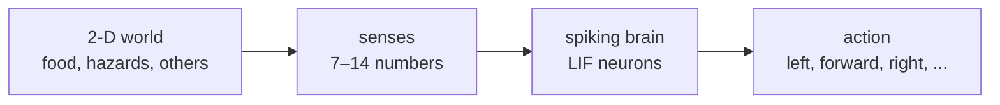
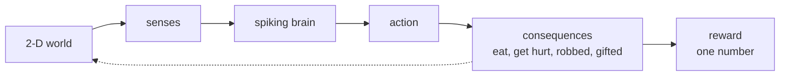
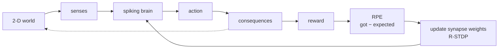
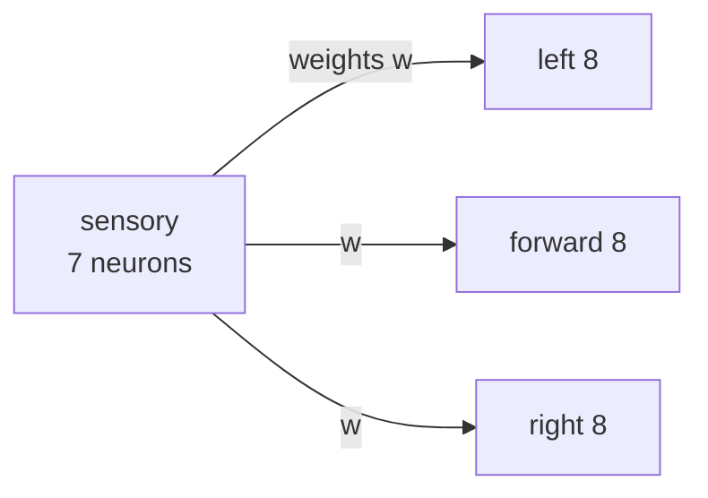
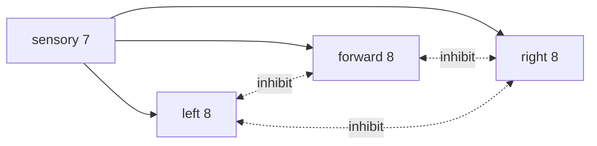
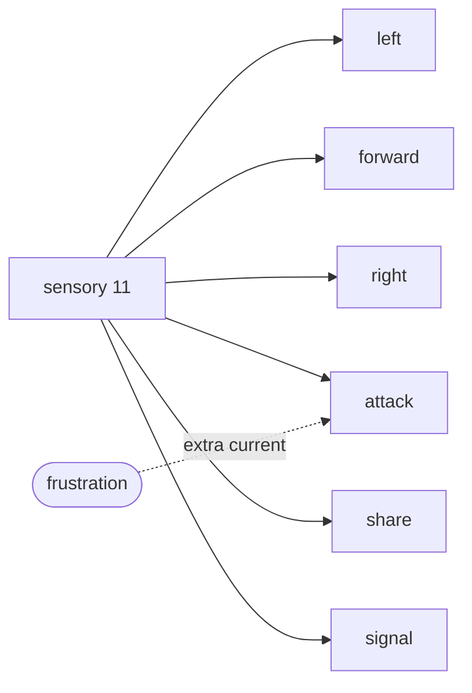
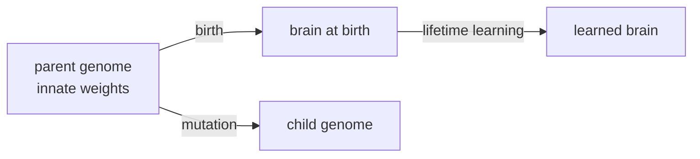
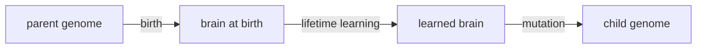
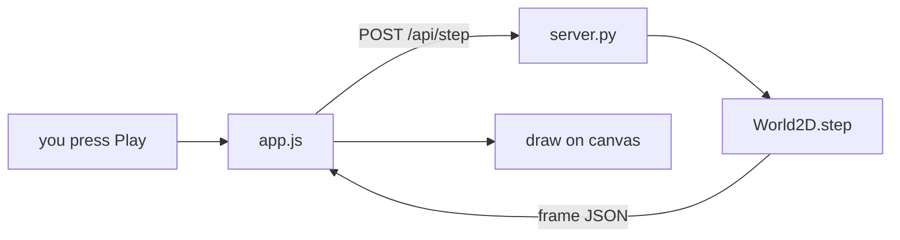
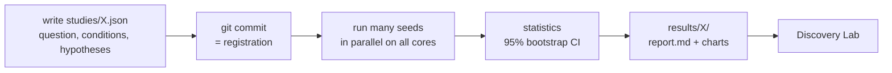

# Understanding NeuralMind: a complete guide

This guide explains the whole system in one sitting. It covers how a single
neuron works, how a population evolves, what research we are doing, what we
have found, what is interesting about it, and what to learn if you want to
build on it. It takes about 45–60 minutes to read.

Every number here comes from the code or from a write-up in
[`docs/research/`](research/). Nothing is a new analysis.

**Contents**

1. [What NeuralMind is](#1-what-neuralmind-is)
2. [The main loop](#2-the-main-loop)
3. [One neuron: LIF](#3-one-neuron-lif)
4. [One brain](#4-one-brain)
5. [Senses](#5-senses)
6. [Learning](#6-learning)
7. [Affect in the model](#7-affect-in-the-model)
8. [The social layer](#8-the-social-layer)
9. [Evolution](#9-evolution)
10. [The software](#10-the-software)
11. [How we do research](#11-how-we-do-research)
12. [The main investigation](#12-the-main-investigation-social-behaviour-that-was-never-learned)
13. [Other results](#13-other-results)
14. [What is interesting, and what is not new](#14-what-is-interesting-and-what-is-not-new)
15. [What to learn](#15-what-to-learn)
16. [Getting started](#16-getting-started)

---

## 1. What NeuralMind is

NeuralMind is an **artificial-life lab** in a 2-D world. Small creatures look
for food, avoid hazards, attack, share, signal, reproduce and die. Every action
is chosen by a **spiking neural network** that simulates each neuron one
millisecond at a time. There is no rule like "if hungry, walk to food"
anywhere in the code.

It is a research tool, not a game. We use it to ask questions such as "does
lifetime learning speed up evolution?" and answer them with multi-seed
experiments whose hypotheses are registered before they run. All results,
positive and negative, are committed so that others can check them.

The system has three layers, each of which can be switched on or off:

- **Single agent.** One creature learns to forage.
- **Social.** Several creatures see each other, and can attack, share food and signal.
- **Evolution.** Well-fed creatures reproduce. A child inherits its parent's
  innate brain with small mutations.

> **What NeuralMind is not.** It is not a human brain and it is not conscious.
> Variables such as "frustration" are numbers we defined in the model. They are
> not evidence of real feelings. [`SCIENTIFIC_EVIDENCE.md`](research/SCIENTIFIC_EVIDENCE.md)
> separates what has evidence, what is a hypothesis, and what is an
> engineering shortcut.

## 2. The main loop

The whole system is one loop that runs every **tick** (one step of the world).
Here it is in three steps. First, the world feeds the brain and the brain
picks an action.



The action changes the world. Eating raises energy and hitting a hazard
lowers it. These consequences are turned into a single number, the
**reward**.



Last comes learning. The brain compares the reward it got with the reward it
expected. The difference is the **reward prediction error (RPE)**, and it is
used to change the synaptic weights. The next decision is then different.



The world's physics only moves bodies and keeps the energy books. It never
chooses an action. The choice comes only from whichever group of neurons fires
most. In the code this loop is `World2D._advance_agent` in
[`neuralmind/world.py`](../neuralmind/world.py).

## 3. One neuron: LIF

The smallest unit is a **leaky integrate-and-fire (LIF)** neuron, a standard
model in use for over a century (Lapicque 1907; Gerstner & Kistler 2002).
Each neuron has one state variable, its **membrane potential V**, in
millivolts.

Every millisecond it does three things:

1. **Integrate.** Input current pushes V up.
2. **Leak.** V drifts back toward its resting value of −65 mV. The further it
   is from rest, the faster it drifts.
3. **Fire.** When V reaches the threshold of −50 mV, the neuron emits a
   **spike**. V is reset to −65 mV and the neuron cannot fire again for 5 ms.

```
tau_m · dV/dt = −(V − V_rest) + R · I
```

The repo uses tau_m = 20 ms and R = 10 MΩ
([`core/neurons.py`](../neuralmind/core/neurons.py)). With a constant current
I, V settles at V_rest + R·I. To reach threshold, R·I must exceed 15 mV, so
the current must be above **1.5 nA**. Below that the neuron never fires, no
matter how long you wait. Added noise lets a neuron below that level fire
now and then. The same mechanism makes agents try new actions.

Why spikes instead of an ordinary deep-learning network? The aim is to study
mechanisms close to biology: learning that depends on the timing of spikes.
The cost is that learning is slower and much harder to control. That cost
turns out to be the centre of the research in section 12.

## 4. One brain

Each creature's brain has 31 to 59 neurons, organised in **populations**. A
sensory population has one neuron per sensor value. It connects to action
populations of 8 neurons each.



Each arrow is an 8×7 weight matrix that can learn.

The action populations **inhibit each other**. When forward fires a lot, it
suppresses left and right. This creates **winner-take-all** competition.



The inhibitory weights are −0.8.

With the social layer on, three more populations are added: attack, share
and signal. Six populations now compete in the same contest.



Social populations start with 0.85× the input weights of the movement
populations, so the default behaviour is to move. Attack also receives extra
current from frustration (section 7).

### How one decision is made

One world tick is 8 brain steps (**substeps**). `Agent.decide` does this:

1. Turn senses into current: `current = 3.0 + 8.0 × sensor value`. The 3.0 is
   a baseline drive that keeps neurons from going silent.
2. Add random noise (s.d. 3.5 nA) to every action population. This is
   exploration.
3. Run the network for 8 steps and count each population's spikes.
4. The population with the most spikes wins and is this tick's action. If
   all are tied, one is chosen at random.

The Playground's Brain scanner shows exactly this. The boxes under the brain
are each population's spike counts, and the highlighted box is the winner.

## 5. Senses

A creature does not see a map. It only senses what is around it, from its own
point of view (**egocentric**), in 3 directional bins: front-left, ahead and
front-right, 0.9 rad apart. It senses up to 0.6 of the world's width.

| Sense | Values | Meaning |
|---|---|---|
| Food | 3 | how close and how directly ahead food is, per bin (0–1) |
| Hazard | 3 | the same, for hazards |
| Hunger | 1 | 1 − energy / starting energy |
| Others (social) | 3 | where other creatures are |
| Heard signal (social) | 1 | signals from the previous tick; louder when closer |
| Signal direction (optional) | 3 | turned on in Exp. S, to locate callers |

Each bin's value is `cos²(angle difference) × (1 − distance / range)`, summed
over every point in range and capped at 1. Food close and straight ahead gives
nearly 1 in the middle bin. Food far away to the left gives a small value in
the left bin.

## 6. Learning

NeuralMind learns with a **three-factor rule**, **reward-modulated STDP
(R-STDP)**. A weight changes only when three things happen together:

1. The **presynaptic** neuron fires (a sensor is active).
2. The **postsynaptic** neuron fires after it (that action population is active).
3. A **reward signal** says the outcome was better or worse than expected.

### Factors 1 and 2: the eligibility trace

Whenever a sensory neuron fires and an action neuron fires after it, the
synapse between them is marked in an **eligibility trace**. The mark fades by
itself over about 100 ms. It does not change the weight yet. It only records
that this connection took part in what just happened. The idea comes from
Bi & Poo (1998), who found that the order of spikes decides whether a synapse
strengthens or weakens.

### Factor 3: reward and RPE

The reward is a sum of parts: +1 for eating, a penalty for hazards, and
**reward shaping**, a small bonus for turning toward food (`r_align`). Without
shaping, learning would wait for actual meals and be far too slow. This is
stated as an engineering shortcut, not biology.

The brain does not learn from the raw reward. It learns from **surprise**:
the reward received minus the reward expected. This is the temporal-difference
rule of Sutton (1988), the leading account of phasic dopamine (Schultz, Dayan
& Montague 1997).

```
delta = r − V(s)        then        V(s) ← V(s) + 0.2 · delta
```

V(s) is the expected reward. The part that stores it is the **critic**. By
default the repo uses a **scalar** critic: a single expectation for every
situation. Keep this in mind. It is the root of the main finding in
section 12.

### Putting the three factors together

```
Δw = learning_rate × delta × eligibility
```

A worked example. Food is straight ahead, so the middle food sensor fires
strongly and forward wins. The synapse "food ahead → forward" is marked. The
creature walks over and eats. The reward beats the expectation, so delta is
positive and that weight grows. Next time food is ahead, forward wins more
easily.

The reverse also holds. When the outcome is worse than expected, delta is
negative and **every marked synapse weakens**, whether or not it was the
"wrong" one. This sounds minor. It is the source of the project's most
interesting result.

```python
rpe = self.predictor.update(reward, key)       # delta
for cn in self._plastic:                        # every sensory→action connection
    cn.apply_reward(c.lr * rpe)                 # Δw = lr × delta × eligibility
self.net.clear_eligibility()
```

(Shortened from `Agent.learn_and_affect` in `world.py`.)

## 7. Affect in the model

Each creature has four variables, together called **affect**. All are
computed from numbers already in the system. They are not real feelings.

| Variable | Range | Driven by |
|---|---|---|
| valence | −1 to 1 | decaying sum of RPE, minus pain |
| arousal | 0 to 1 | size of the RPE, and pain |
| threat | 0 to 1 | rises fast on hazard cues or pain, decays slowly |
| frustration | 0 to 1 | accumulated negative RPE |

Affect feeds back into behaviour in exactly one place: **frustration →
aggression**, following the hypothesis of Dollard (1939) and Berkowitz (1989).
Frustration is multiplied by the creature's **aggression gene** and added as
current to the attack population. It makes attacks more likely but never
forces one. If another population fires more, attack still loses. By default
affect is computed from the primary reward only (eating, getting hurt, being
robbed), not from reward shaping.

## 8. The social layer

With `social` on, each creature gains three actions. Attack and share only
take effect when another creature is within 0.08.

| Action | Cost | Effect |
|---|---|---|
| attack | 0.02 | steals 0.15 energy from the nearest creature; the victim gets a negative reward |
| share | 0.10 | the recipient gets 0.20 (2× what was given), so helping creates value |
| signal | 0.002 | creatures within 0.5 hear it next tick; it has no predefined meaning |

By default every creature's reward is **selfish** (`r_prosocial = 0`). It is
rewarded only for its own energy, so sharing is a loss. If sharing appears, it
has to come from kin selection or from a side effect of learning. Section 12
shows it was the second.

## 9. Evolution

With `evolve` on, the world holds a population. A creature that builds up
1.2 energy has one child and gives it 0.5 energy. Creatures with no energy
starve. Creatures that reach 1,500 ticks die of old age. The population is
capped at 40.

### What the genome is

Each creature's **genome** has two parts:

- **Innate weights.** The sensory → action weights at birth, before any learning.
- **Aggression gene** (`aggression_gain`). The multiplier that turns frustration into a drive to attack.

A child gets its parent's genome plus random mutation (s.d. 0.15 of the
initial weight for weights, 0.2 for the aggression gene). The code is
`World2D._birth`.

Darwinian inheritance (the default). The child gets the parent's innate weights.
What the parent learned is not passed on.



Lamarckian inheritance (an experimental switch). The child gets the weights the
parent learned. Nature does not work this way. We use it as a control.



### Where children are born

The `viscous` switch (on by default) places children next to their parent,
so relatives live close together. Hamilton's kin-selection theory says
helping can evolve under these conditions, because the creatures being helped
are likely to share genes. With `viscous` off, children are born anywhere
(**well-mixed**). The system keeps eight generations of ancestry for every
creature, so relatedness can be computed.

## 10. The software

The project is about 4,300 lines of Python and NumPy. It needs no GPU and no
API key.

| Path | Role |
|---|---|
| `core/neurons.py` | vectorised LIF neurons |
| `core/plasticity.py` | STDP and eligibility traces |
| `core/network.py` | wires populations together and steps them |
| `affect/` | RPE (the critic) and affect variables |
| `world.py` | world, Agent, social layer, evolution, genealogy |
| `envs/` | PettingZoo API, so other RL agents can share the world |
| `research/` | multi-seed experiment runners and statistics (bootstrap CI, mutual information, G-test) |
| `server.py`, `lab.py` | FastAPI backend |
| `webui/` | Playground and Discovery Lab (plain JavaScript and canvas) |
| `studies/*.json` | registered study specs |
| `results/` | raw data and auto-generated reports |

### How the browser talks to the simulation



The browser computes nothing itself. Every number on screen comes from the
same backend that runs the experiments. What you see in the Playground is
the same system that produces the research results.

### The experiment pipeline



The commit hash of the spec is the evidence that the hypotheses were written
down before the results were seen.

## 11. How we do research

The method is borrowed from careful experimental science, which most
artificial-life work does not use.

- **Pre-registration.** Write the hypothesis, the prediction and the
  **falsifier** (the outcome that would prove it wrong) into a file, and
  commit it before running. This prevents changing the question after seeing
  the answer (Nosek et al. 2018).
- **Many seeds.** Each seed gives a different random world. We run 6 to 16
  seeds per condition and reuse the same seeds across conditions, so they can
  be compared in pairs.
- **95% bootstrap confidence intervals.** Resample the seeds thousands of times
  to see how much the mean can move. A hypothesis is supported only if the
  whole interval lies on the predicted side of zero.
- **Replication.** A promising first result is rerun with fresh seeds. Several
  results in this project failed that step.
- **Negative results count.** Hypotheses that fail stay on the board.
- **Ablation.** Switch off one mechanism at a time to find which one causes an
  effect. The "Exp. I, J, K, P, R" switches in the Playground are these
  ablations.

> **Why replication matters: an example.** Experiment F found that well-mixed
> populations went extinct in 9/12 runs versus 1/12. That looked like a strong
> effect, but half of the seeds repeated earlier exploratory runs. The
> independent replication F2, with 16 fresh seeds, found 13/16 versus 7/16. That
> missed the registered threshold (p = 0.066). The conclusion changed from
> "prevents extinction" to "delays extinction".

## 12. The main investigation: social behaviour that was never learned

This is the project's main piece of work: nine experiments in a row (C to R)
tracking down the cause of one odd result. The full summary is
[`SYNTHESIS_LEARNING_SIDE_EFFECT.md`](research/SYNTHESIS_LEARNING_SIDE_EFFECT.md).

### The odd result

In experiment C we predicted that selfish learning would **lower** sharing.
The result was the opposite. Learners shared **about twice as often**, and in
later runs they attacked about 10× as often. The effect replicated in C2, E
and G.

### Suspects that were ruled out

| Explanation | Test | Outcome |
|---|---|---|
| learners meet more neighbours | C2: count only when a neighbour is in reach | ruled out |
| gifts reward the receiver, creating a reciprocity loop | G: remove the gift reward | explains ≈22% |
| one global reward strengthens every action | I: reward only the executed action | removes half of the signalling rise, none of the attack rise |

### The clue in the weights

In I we tracked synaptic weights over a lifetime. **Every weight fell**, and
the movement populations (left, forward, right) fell the most: −3.2% versus
−0.4 to −1.1% for the social ones. Recall section 4: an action is chosen by a
spike-count contest. If the movement populations weaken, the social ones win
more often, without anything being learned about attacking or sharing.

### Causal tests

| Experiment | Intervention | Share of the "learned" social rise removed |
|---|---|---|
| J | freeze movement input weights | all of it |
| K | let movement learn, but hold its total input weight fixed | 80–95% |
| P | skip weight updates when the RPE is negative | all of it (movement weights then grew 73%) |
| R | a critic with one expectation per sensor state | 58–76% |

### The mechanism

1. The scalar critic holds one expectation, but in this world reward depends
   strongly on the situation. About 58% of reward errors are negative
   (exploratory probe in K).
2. Δw = lr × delta × eligibility. The movement pathways fire most, so they
   carry about 8× the eligibility of the social ones and absorb most of the
   negative updates.
3. Movement weakens. Social populations win the contest more often, so
   attacking, sharing and signalling rise.
4. Frémaux, Sprekeler & Gerstner (2010) describe this bias of R-STDP in
   theory, and show it disappears when the expectation is subtracted per
   stimulus. Experiment R confirms that a per-state critic removes most of the
   effect here.

Steps 1–2 rest on an exploratory probe that was not pre-registered. Steps 3–4
are supported by pre-registered tests (J, K, P, R).

### What follows from it

Learning costs foraging. In P, learners ate about 31% less than non-learners.
The per-state critic cut that to about 14%. In T the best rule tested still
ate 7% less. No rule tested so far makes lifetime learning pay in these
worlds. Any statement before J that agents "learn to share" or "learn
aggression" should be read as a side effect of the learning rule.

## 13. Other results

| Question | Current answer |
|---|---|
| Can aggression or cooperation be learned within one lifetime? | No. None of the 4 hypotheses was supported. Attacks are untargeted. |
| Baldwin effect: does learning speed up the evolution of innate ability? (E) | The opposite, a **hiding effect**. Without learning, evolution raised innate foraging by +5.5 [3.3, 7.6]. With learning, innate ability barely moved. |
| Do signals evolve meaning? (M, S) | No. About 0.0002 bits about food, the same as deaf controls, even when food needs a partner. |
| Does an aggression gene rise under scarcity? (D, D2) | No. The first result did not replicate against a neutral marker gene. |
| Lamarckian vs Darwinian (N, N2, N3) | Lamarckian populations go extinct far more often, 9/12 vs 1/12 (p = 0.003), replicated. The cause is unknown. |
| Can Q-learners invade an SNN population? (O) | No advantage either way, but lineage fate is all-or-nothing. |
| Does being born near the parent help through kinship or density? (Q, Q2, Q3) | Still open. Newborns placed beside a stranger went extinct in 34/36 runs vs 13/36 beside the parent (pooled Q–Q3). Yet 42% of killings in viscous worlds are parents killing their own young, and the "energy recycling" explanation was falsified in Q3. |

The clearest positive result is W: once decisions last 32 ms, start from a
cleared state, and use normalised input weights, a trained single agent eats
about 5.7× more than an untrained one (18.7 vs 3.25 food per episode) and
relies on its senses. With the default dynamics, learning does not raise
foraging, and in evolving populations it lowers it. V found that evolved
innate wiring does not measurably use the senses at all.

## 14. What is interesting, and what is not new

**What is interesting:**

- **The brain really decides, and you can see every spike.** No behaviour
  rules are written anywhere. Click any creature to watch its brain live and
  see which population wins.
- **The system is small enough to trace a cause to the end.** Section 12
  starts from what looked like "creatures learn to share" and follows it,
  ablation by ablation, to a mathematical bias in the learning rule. In
  artificial life, emergent behaviour is often read as something the system
  learned. This is a concrete example of how that reading can be wrong.
- **It links theory to behaviour.** The R-STDP bias is known in theory
  (Frémaux et al. 2010). Here it shows up as measurable social behaviour in an
  embodied, evolving population, and the fix the theory predicts works. A
  literature check ([`LITERATURE_NOVELTY.md`](research/LITERATURE_NOVELTY.md))
  rates this "partly known": the bias is published, but we found no report of
  it as a behavioural side effect. The check did not include a forward-citation
  search, so this is a statement about that search, not a claim of novelty.
- **Every number can be checked.** Registered specs, raw data and reports are
  in the repo. Any study can be rerun from the browser on an ordinary laptop.
- **An open puzzle.** Why do newborns placed beside strangers drive the
  population extinct almost every time? The effect is strong and replicates,
  and we cannot yet explain it.

**What is not new:**

- LIF neurons, STDP, TD learning, kin selection and the Baldwin effect are all
  standard.
- The world and the brains are very small (31–59 neurons) and evolution runs
  for tens of generations. The results describe this model. They do not
  transfer to real animals.
- Most results are negative. They have scientific value, but they are not
  "discoveries" in the usual sense.

## 15. What to learn

In the order to learn them, with where each is used in the repo:

1. **Python and NumPy.** Everything is written in these. Be comfortable with
   arrays, broadcasting and seeded random generators.
   *Used in: every file in `neuralmind/`.*
2. **Introductory computational neuroscience.** LIF neurons, spikes,
   synapses, STDP. Read chapters 1–2 and 19 of
   [Neuronal Dynamics](https://neuronaldynamics.epfl.ch/) (Gerstner et al.),
   free online.
   *Used in: `core/`.*
3. **Reinforcement learning.** Reward, value, TD error. Read chapters 1, 2
   and 6 of [Sutton & Barto, *Reinforcement Learning*](http://incompleteideas.net/book/the-book-2nd.html),
   free online. Then three-factor learning (Frémaux & Gerstner 2016) and the
   R-STDP bias (Frémaux, Sprekeler & Gerstner 2010).
   *Used in: `affect/reward.py`, `Agent.learn_and_affect`.*
4. **Evolutionary biology.** Selection, mutation, Hamilton's kin selection,
   the Baldwin effect (Hinton & Nowlan 1987), genetic drift, and why a neutral
   marker gene is the right control.
   *Used in: `World2D._birth`, `research/evolution.py`.*
5. **Statistics for experiments.** Bootstrap confidence intervals, paired
   designs, Fisher's exact test, why a p-value near 0.05 is not enough, and
   pre-registration (Nosek et al. 2018).
   *Used in: `research/stats.py`, everything in `results/`.*
6. **Scientific method.** A hypothesis needs a condition that can prove it
   wrong. Ablation is how cause is shown. Keep what was measured apart from
   how it is interpreted. Reading the C → R write-ups in `docs/research/` in
   order is the best example of this in the project.
   *Used in: `docs/research/`.*
7. **The web side (to change the UI).** FastAPI, plain JavaScript and 2-D
   canvas. No framework.
   *Used in: `server.py`, `webui/`.*

If time is short, steps 2, 3 and 6 matter most. They are enough to read every
result in the repo.

## 16. Getting started

### First run

```bash
git clone https://github.com/sitta07/NeuralMind.git && cd NeuralMind
python3 -m venv .venv && source .venv/bin/activate
pip install -r requirements-neuralmind.txt -r requirements-server.txt -r requirements-research.txt
python -m neuralmind.server     # open http://127.0.0.1:8000
python -m pytest tests/ -q      # full test suite
```

### Five things to try in the Playground

1. Press **Play** and watch the Brain scanner to see which population wins each tick.
2. Press **Deprive**, then **Skip 3 days**. The Day-by-day table shows how
   hunger, affect and neural firing change.
3. Pick the **Evolving population** scenario and open **Family tree** to see
   which lineages survive.
4. Press **Train 40 episodes**, then **Compare** to see a single agent's
   learning effect.
5. Open **Advanced settings**, tick **Freeze locomotion learning (Exp. J)**,
   and compare attacks with it off. This is a small version of the
   experiment in section 12.

### Ask your own question

Write a JSON file in `studies/` with the question, conditions, metrics and
decision rules. Commit it first, then run
`python -m neuralmind.research.spec studies/your_study.json`. The full steps
are in [`ADDING_A_STUDY.md`](ADDING_A_STUDY.md). Results appear in the
Discovery Lab.

### Glossary

| Term | Meaning in this project |
|---|---|
| tick | one world step = 8 brain steps |
| spike | one firing of a neuron |
| population | a group of neurons with one role, e.g. forward |
| synapse / weight | the strength of a connection from one neuron to another |
| eligibility trace | a temporary mark that a synapse just took part in an action |
| RPE (delta) | reward received minus reward expected |
| critic | the part that stores the expected reward; scalar = one value, state = one per situation |
| genome | innate weights + aggression gene |
| viscous | children are born next to their parent |
| ablation | switching off one mechanism to test whether it is a cause |
| seed | the number that fixes the randomness; the same seed gives the same run |
| 95% CI | the range the true value probably lies in; if it excludes zero, the effect is clear |
