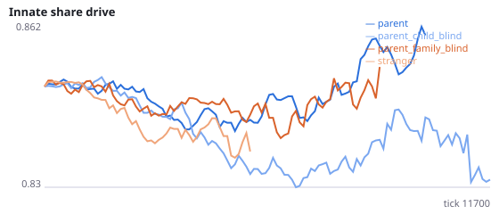
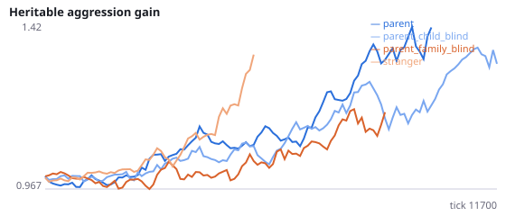
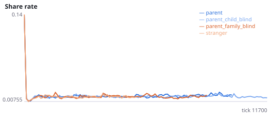
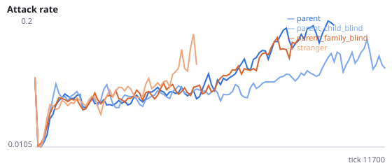
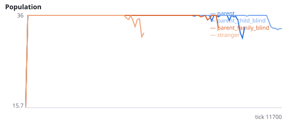
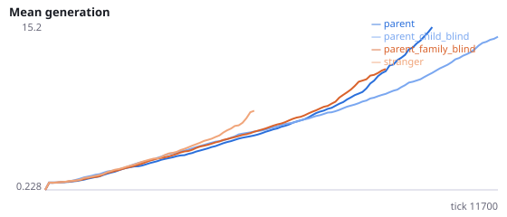

# Does what the newborn senses explain why birth beside the parent protects populations?

**Question.** Over eight studies, populations whose newborns are placed beside a stranger went extinct in 88/96 runs and those placed beside the parent in 30/96. Q6-Q9 changed which attacks and shares land within the family in four ways and never clearly removed the protection (16/48 extinct with the intervention vs 15/48 without). The remaining candidate is sensory: beside the parent, a newborn's 'other agent' sensors respond to its parent rather than to a stranger. This study makes the parent invisible to its offspring's sensors, and in a second condition also makes offspring invisible to their parent.

Interventions change sensing only; attacks, shares and placement are unchanged. blind_to_parent=True: an agent's three 'other agent' sensors never respond to its own parent. blind_to_family=True: also, a parent's sensors never respond to its own offspring. Newborns are placed beside the parent in both. stranger is a reference only. Interpretation rule, fixed in advance: what the newborn senses explains the protection if H50a or H50b is supported; sensing between parent and offspring in either direction matters if H50c or H50d is supported; if none is, neither sensing nor the family attacks tested in Q6-Q9 explain it. No pilot was run. Seeds 2700-2711 have never been run.

NeuralMind 0.2.0 · 2026-10-17 12:59 · mean [95% bootstrap CI] over seeds; paired differences use the same seeds.

**Pre-registration:** spec `studies/AD_blind_to_parent.json` at commit `644a2bf1374d062c7e96e1bbf86fc083aeb61e6b` (2026-10-17T10:19:10+07:00) · unchanged since commit: **True** · preregistered: **True**

## Hypotheses

| id | statement | test (a − b) | result |
|---|---|---|---|
| H50a | With offspring blind to their parent, populations beside the parent die out sooner | 910 [-1191, 3083] | **not supported** |
| H50b | With offspring blind to their parent, populations go extinct more often | -0.08333 [-0.5, 0.3333] | **not supported** |
| H50c | With parent and offspring blind to each other, populations die out sooner | -78.75 [-2401, 2423] | **not supported** |
| H50d | With parent and offspring blind to each other, populations go extinct more often | 0 [-0.5, 0.4167] | **not supported** |

## Conditions

| condition | sense_gain | innate_foraging | share_gene | aggr_gene | share_rate | attack_rate | signal_rate | share_given_encounter | encounter_rate | drift_social_minus_loco | invader_share | final_pop | max_generation |
|---|---|---|---|---|---|---|---|---|---|---|---|---|---|
| parent | -0.7083 [-2.479, 1] | 5.875 [3.667, 8.521] | 0.8433 [0.8244, 0.8653] | 1.263 [0.9669, 1.535] | 0.02376 [0.01453, 0.0386] | 0.1753 [0.118, 0.2379] | 0.01438 [0.01291, 0.01595] | 0.02317 [0.01531, 0.03525] | 0.4975 [0.4901, 0.5049] | 0.02185 [0.01138, 0.03354] | nan [nan, nan] | 18 [9, 27] | 10 [4.498, 15.67] |
| parent_child_blind | -0.2143 [-1.25, 1.036] | 9.071 [6.536, 11.82] | 0.8095 [0.7848, 0.8381] | 1.458 [1.253, 1.654] | 0.01449 [0.01311, 0.01611] | 0.1932 [0.1217, 0.2819] | 0.02356 [0.01822, 0.02889] | 0.01535 [0.01369, 0.0172] | 0.4921 [0.4863, 0.4987] | 0.02129 [0.01686, 0.02742] | nan [nan, nan] | 21 [12, 30] | 12.33 [6.25, 18.33] |
| parent_family_blind | 0.7708 [-0.9792, 2.5] | 8.75 [5.645, 11.58] | 0.8644 [0.828, 0.9081] | 1.532 [1.025, 2.059] | 0.01521 [0.01269, 0.01823] | 0.2248 [0.1462, 0.3106] | 0.02009 [0.01681, 0.02337] | 0.01694 [0.01414, 0.02016] | 0.4596 [0.4144, 0.4928] | 0.01662 [0.003283, 0.03571] | nan [nan, nan] | 17.08 [7.667, 26.42] | 19.25 [4.667, 36.17] |
| stranger | 2 [2, 2] | 10.62 [10.62, 10.62] | 0.8126 [0.8126, 0.8126] | 0.627 [0.627, 0.627] | 0.01357 [0.01241, 0.01474] | 0.1592 [0.1266, 0.1918] | 0.0277 [0.02518, 0.03022] | 0.0134 [0.01232, 0.01447] | 0.4783 [0.4748, 0.4818] | 0.02538 [0.02538, 0.02538] | nan [nan, nan] | 3 [0, 9] | 1.417 [0, 4.25] |

     

Full per-metric summaries and raw per-run data: `results.json`.