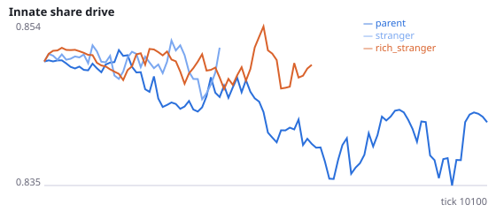
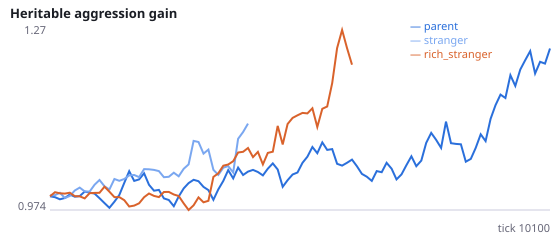
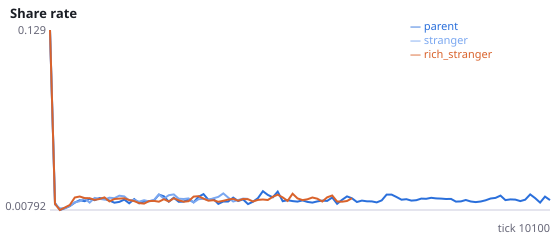
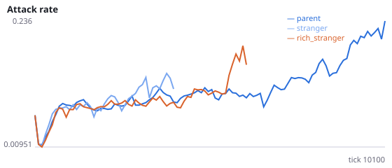
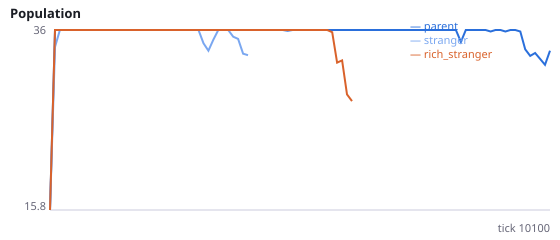
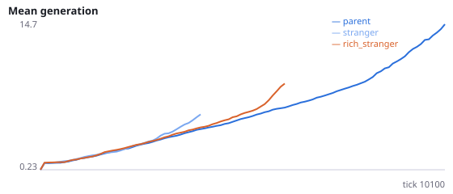

# Do newborns beside the parent survive because they start where food has been easy to find?

**Question.** Over nine studies, populations whose newborns are placed beside a random stranger went extinct in 99/108 runs, against 36/108 beside the parent. Ruled out so far: local density alone (Q, Q2), any relative (Q5: beside another relative 10/12), parental culling (Q6), the aggression sink (Q7, Q9), parent-offspring sharing (Q8), and sensing the parent (AD). A parent has, by definition, just reached the reproduction threshold, so it is likely to stand where food has recently been easy to find; a random stranger or relative stands anywhere. This study places newborns beside the stranger with the most energy, and measures crowding and food at every birth site.

born_near_rich_stranger=True (with viscous=False and born_near_stranger=True): the newborn is placed beside the living non-relative with the most energy at the moment of birth. Birth-site metrics, over the early window: early_birth_neighbours = mean number of other living agents within sensor range of the newborn; early_birth_food = mean number of food items within sensor range. Interpretation rule, fixed in advance: the birth-site account is supported if H53a or H53b is supported. H53c and H53d describe how sites beside the parent differ from sites beside a random stranger. No pilot was run. Seeds 2800-2811 have never been run.

NeuralMind 0.2.0 · 2026-10-17 14:21 · mean [95% bootstrap CI] over seeds; paired differences use the same seeds.

**Pre-registration:** spec `studies/AG_birth_site.json` at commit `7e9b933db001025763e3c41c1566d1d6fa5b199b` (2026-10-17T13:05:16+07:00) · unchanged since commit: **True** · preregistered: **True**

## Hypotheses

| id | statement | test (a − b) | result |
|---|---|---|---|
| H53a | Beside the richest stranger, populations go extinct less often than beside a random stranger | 0 [-0.25, 0.25] | **not supported** |
| H53b | Beside the richest stranger, populations survive longer than beside a random stranger | -41.08 [-2885, 2913] | **not supported** |
| H53c | Birth sites beside the parent have fewer neighbours than beside a random stranger | 0.4902 [0.07595, 0.904] | **not supported** |
| H53d | Birth sites beside the parent have more food in range than beside a random stranger | 0.01559 [-0.2735, 0.3076] | **not supported** |

## Conditions

| condition | sense_gain | innate_foraging | share_gene | aggr_gene | share_rate | attack_rate | signal_rate | share_given_encounter | encounter_rate | drift_social_minus_loco | invader_share | final_pop | max_generation |
|---|---|---|---|---|---|---|---|---|---|---|---|---|---|
| parent | -0.35 [-1.825, 1.075] | 9.825 [7.148, 12.78] | 0.8689 [0.8031, 0.9434] | 1.279 [0.9445, 1.601] | 0.01881 [0.01363, 0.02752] | 0.2309 [0.1401, 0.3287] | 0.02808 [0.01628, 0.04352] | 0.01981 [0.01441, 0.02825] | 0.489 [0.4844, 0.4937] | 0.01753 [0.00429, 0.03288] | nan [nan, nan] | 15 [6, 24] | 12.67 [3.167, 24.25] |
| stranger | 0.625 [0.625, 0.625] | 15.25 [15.25, 15.25] | 0.8639 [0.8639, 0.8639] | 2.002 [2.002, 2.002] | 0.01643 [0.01458, 0.01828] | 0.3375 [0.1979, 0.4414] | 0.02267 [0.01467, 0.03094] | 0.0183 [0.01595, 0.02125] | 0.4209 [0.3752, 0.4661] | 0.002655 [0.002655, 0.002655] | nan [nan, nan] | 3 [0, 9] | 1.917 [0, 5.75] |
| rich_stranger | 1.625 [1.625, 1.625] | 13.62 [13.62, 13.62] | 0.8233 [0.8233, 0.8233] | 1.396 [1.396, 1.396] | 0.02517 [0.01287, 0.03748] | 0.3418 [0.1769, 0.4678] | 0.02451 [0.01776, 0.02889] | 0.02526 [0.01425, 0.03627] | 0.4347 [0.3799, 0.4729] | 0.03468 [0.03468, 0.03468] | nan [nan, nan] | 3 [0, 9] | 1.5 [0, 4.5] |

     

Full per-metric summaries and raw per-run data: `results.json`.