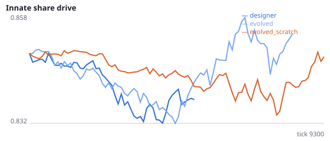
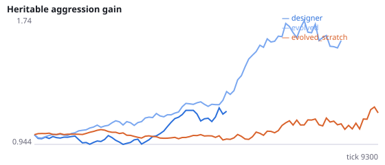
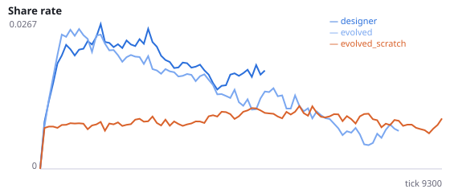
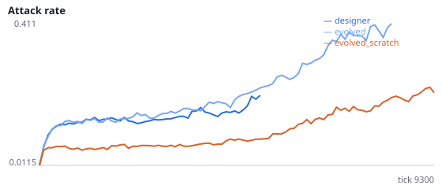
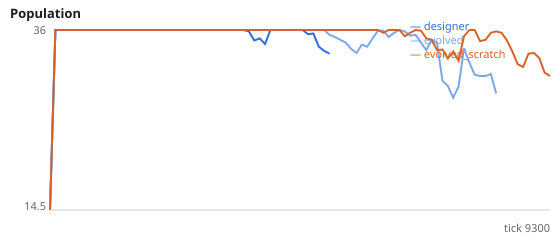
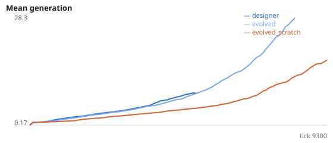

# Can evolution design a better learning reward than the designer?

**Question.** Every learning agent so far has been taught by a reward its designer wrote: eating, hazards, social outcomes, plus a shaping term. AF showed that the designer's shaping term (alignment with food) is what made social agents learn badly. Following Singh, Lewis and Barto (2009) and Niv et al. (2002), who evolved reward functions and learning rules for single agents, this study lets the shaping part of the reward evolve in social, evolving populations. Each agent carries four heritable teacher weights on four signals: change in alignment with the nearest food, decrease in distance to it, change in its own energy, and hunger. Does evolution find a teacher that works better than the designer's, and what does it value?

All conditions use the fixed dynamics (substeps=32, reset_each_decision, normalize with normalize_to='innate') on the standard social evolution base (12 founders, viscous, 24 food), learning on. designer: fixed designer teacher (alignment weight 4, others 0; the default reward). evolved: evolve_teacher=True starting from the designer teacher. evolved_scratch: evolve_teacher=True starting from all zeros (no shaping). Teacher weights mutate by N(0, 0.5) at every birth, unbounded. Each agent also carries a neutral teacher gene, mutated the same way and never read, as a within-run drift baseline; teacher_<k>_shift_minus_neutral is the mean change of weight k from its start minus the neutral gene's change. The primary rewards (eating, hazards, social) and the frustration drive are unchanged. Exploratory pilot (tools/probes/evolved_teacher_pilot.py, unregistered seeds 9550-9552, 12000 ticks, no neutral gene): food per agent-tick designer 0.030, evolved 0.031, evolved_scratch 0.039; in evolved, the energy weight moved to -4.8 and the approach weight to -0.9 over about 44 generations, against about 9 generations under the designer teacher. Because drift grows with the number of generations, those shifts may be drift; the neutral gene is added to tell. H56c follows the AF mechanism (approach shaping helps social learners) and the pilot points against it; H56d and H56e follow the pilot. Interpretation rule, fixed in advance: evolution designs a better teacher if H56a or H56b is supported; the teacher evolves under selection rather than drift for each weight whose shift-minus-neutral test is supported. Seeds 3400-3411 have never been run.

NeuralMind 0.2.0 · 2026-10-17 17:10 · mean [95% bootstrap CI] over seeds; paired differences use the same seeds.

**Pre-registration:** spec `studies/AH_evolved_teacher.json` at commit `d4398fd36251f0f24f27efc3375ade7dec03ad4d` (2026-10-17T14:52:15+07:00) · unchanged since commit: **True** · preregistered: **True**

## Hypotheses

| id | statement | test (a − b) | result |
|---|---|---|---|
| H56a | Populations with an evolving teacher eat more per agent-tick than with the designer teacher | -0.006069 [-0.01368, 0.004874] | **not supported** |
| H56b | Populations with an evolving teacher survive longer than with the designer teacher | 3089 [61.53, 6131] | **supported** |
| H56c | The approach weight rises more than the neutral gene (selection toward approach shaping) | -4.833 [-6.685, -2.914] | **not supported** |
| H56d | The energy weight falls more than the neutral gene (selection to value losing energy) | 3.696 [-0.07093, 7.343] | **not supported** |
| H56e | Populations with an evolving teacher share more than with the designer teacher | 0.0001764 [-0.01906, 0.02215] | **not supported** |
| H56f | A teacher evolved from scratch differs in foraging from the designer teacher | 0.01048 [0.003208, 0.01776] | **difference detected** |

## Conditions

| condition | sense_gain | innate_foraging | share_gene | aggr_gene | share_rate | attack_rate | signal_rate | share_given_encounter | encounter_rate | drift_social_minus_loco | invader_share | final_pop | max_generation |
|---|---|---|---|---|---|---|---|---|---|---|---|---|---|
| designer | 3.167 [2.375, 3.75] | 8.25 [7.25, 9.25] | 0.9077 [0.8227, 0.9633] | 1.927 [0.9621, 3.569] | 0.01645 [0.009915, 0.02298] | 0.3549 [0.2311, 0.4492] | 0.01897 [0.0004081, 0.03898] | 0.01074 [0.007915, 0.01471] | 0.3723 [0.1261, 0.5073] | -8.318e-19 [-6.939e-18, 2.388e-18] | nan [nan, nan] | 6.917 [0, 14.76] | 17.33 [0, 42.42] |
| evolved | 2.475 [0.075, 4.875] | 7.75 [5.8, 9.65] | 0.8818 [0.8178, 0.9457] | 2.001 [1.259, 2.764] | 0.009688 [0.004184, 0.01712] | 0.4229 [0.363, 0.4702] | 0.01602 [0.006509, 0.02616] | 0.007848 [0.003438, 0.0139] | 0.4295 [0.3521, 0.487] | -6.686e-18 [-2.427e-17, 1.09e-17] | nan [nan, nan] | 14.5 [5.583, 23.84] | 43 [16, 75] |
| evolved_scratch | -0.55 [-1.15, 0.425] | 8.275 [5.95, 10.6] | 0.9074 [0.8741, 0.9406] | 0.7294 [0.4701, 0.9991] | 0.01603 [0.008032, 0.02681] | 0.3376 [0.2328, 0.4143] | 0.02674 [0.0119, 0.04761] | 0.01423 [0.006889, 0.0242] | 0.5021 [0.4884, 0.5169] | 9.079e-18 [2.6e-18, 1.522e-17] | nan [nan, nan] | 14.58 [5.583, 24] | 25 [6.5, 47.59] |

     

Full per-metric summaries and raw per-run data: `results.json`.