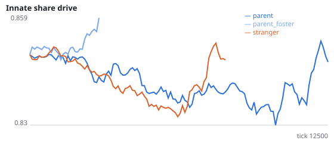
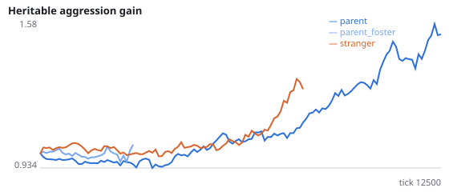
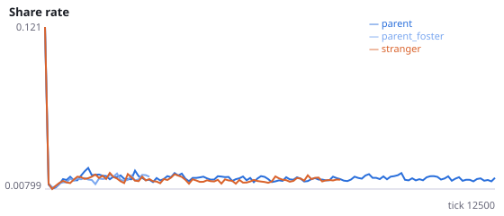
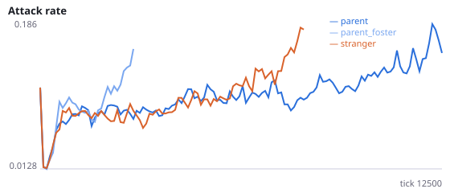
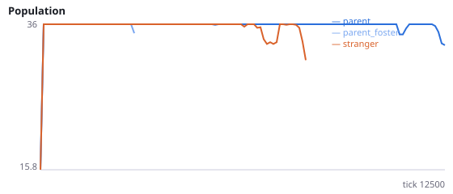
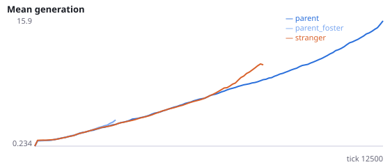

# Is the protection of birth beside the parent carried by genes clustering in space?

**Question.** Over ten studies, populations whose newborns start beside a random stranger went extinct in 110/120 runs, against 43/120 beside the parent. Every ecological account tested has failed: local density, any relative, parental culling, the aggression sink, parent-offspring sharing, sensing the parent, and birth-site quality. An evolutionary account remains, from population genetics: when newborns start beside their parent, each family's genome stays clustered in space, so families compete as units and selection can act at the family level (multilevel selection in a viscous population). This study keeps newborns beside their parent but gives them the genome of a random unrelated agent, which breaks the link between where genes are and who carries them.

foster_genome=True: the newborn is placed beside its parent as usual, keeps its parent as its genealogical parent, but inherits the input weights and the aggression gene of a random living agent unrelated to its parent (mutated as usual). If no unrelated agent is alive, the parent's genome is used (counted in birth_fallback_frac). Interpretation rule, fixed in advance: the protection works through genomes clustering in space if H55a or H55b is supported; if neither, it does not depend on who carries which genes beside the parent. No pilot was run. Seeds 2900-2911 have never been run.

NeuralMind 0.2.0 · 2026-10-17 15:28 · mean [95% bootstrap CI] over seeds; paired differences use the same seeds.

**Pre-registration:** spec `studies/AI_foster_genome.json` at commit `572a94d742f5169407e425b943827313bab8e297` (2026-10-17T14:31:05+07:00) · unchanged since commit: **True** · preregistered: **True**

## Hypotheses

| id | statement | test (a − b) | result |
|---|---|---|---|
| H55a | With foster genomes, populations beside the parent go extinct more often | 0.5 [0.08333, 0.8333] | **supported** |
| H55b | With foster genomes, populations beside the parent die out sooner | -8069 [-1.091e+04, -4790] | **supported** |
| H55c | Foster-genome populations differ in extinction from stranger populations | 0.08333 [-0.25, 0.4167] | **no difference detected** |

## Conditions

| condition | sense_gain | innate_foraging | share_gene | aggr_gene | share_rate | attack_rate | signal_rate | share_given_encounter | encounter_rate | drift_social_minus_loco | invader_share | final_pop | max_generation |
|---|---|---|---|---|---|---|---|---|---|---|---|---|---|
| parent | -0.25 [-1.234, 0.6406] | 9.234 [6.828, 11.38] | 0.8803 [0.8444, 0.9203] | 1.378 [0.9747, 1.818] | 0.01415 [0.01281, 0.01571] | 0.2289 [0.1639, 0.2948] | 0.02832 [0.01996, 0.03955] | 0.01841 [0.01451, 0.02436] | 0.4537 [0.3773, 0.4942] | 0.01353 [0.006485, 0.02075] | nan [nan, nan] | 24 [15, 33] | 20.5 [10.33, 31.5] |
| parent_foster | 2.812 [-0.25, 5.875] | 13.06 [5.25, 20.88] | 0.8635 [0.8484, 0.8785] | 1.127 [0.4835, 1.77] | 0.01654 [0.01403, 0.01904] | 0.1345 [0.04209, 0.2269] | 0.04457 [0.02625, 0.06289] | 0.01689 [0.01499, 0.01878] | 0.4844 [0.4838, 0.4851] | 3.487e-05 [-0.001945, 0.002015] | nan [nan, nan] | 4.583 [0, 12] | 4.833 [0, 12] |
| stranger | 1.792 [0.125, 4.625] | 9.25 [3.75, 14.5] | 0.8075 [0.7625, 0.8438] | 0.7691 [0.2277, 1.196] | 0.01266 [0.01171, 0.01368] | 0.2305 [0.1855, 0.2814] | 0.01694 [0.0139, 0.0202] | 0.0134 [0.01231, 0.01495] | 0.4686 [0.4593, 0.4777] | 0.01148 [0.002079, 0.02922] | nan [nan, nan] | 8.833 [0, 17.83] | 7.167 [0, 15.42] |

     

Full per-metric summaries and raw per-run data: `results.json`.