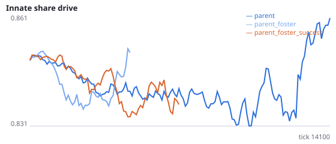
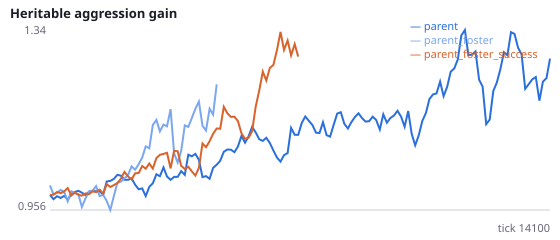
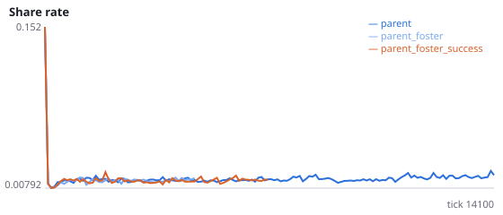
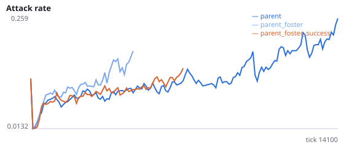
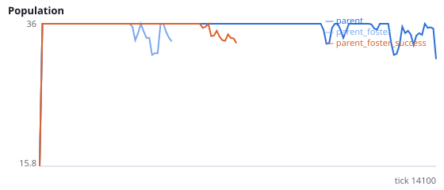
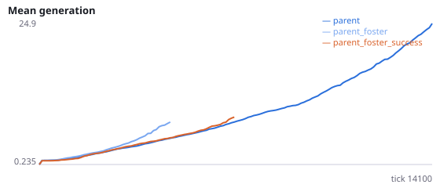

# Is the protection lost with foster genomes because selection stops, or because genomes no longer cluster with their family?

**Question.** AI found that newborns beside their parent lose the protection when they carry the genome of a random unrelated agent (10/12 extinct vs 4/12). Two accounts fit. (1) Genome clustering: beside the parent, each family's genome stays together in space, and this is what protects. (2) Selection switched off: a random donor need not have reproduced, so offspring no longer carry the genome whose success produced them. This study gives newborns the genome of the unrelated agent that reproduced most recently, which keeps selection on genomes but still breaks the family-place link.

foster_from_reproducer=True with foster_genome=True: the donor is the living agent unrelated to the parent with the most recent reproduction (ties: the first found); if no unrelated agent has reproduced, a random unrelated agent is used, and if none is alive, the parent (both counted in birth_fallback_frac). parent_foster repeats AI's random-donor condition on new seeds. Interpretation rule, fixed in advance: if H57a is supported and H57c is not, the protection works through selection on genomes (account 2); if H57c is supported and H57a is not, through genomes clustering with their family (account 1); if both are supported, both contribute. No pilot was run. Seeds 3500-3511 have never been run.

NeuralMind 0.2.0 · 2026-10-17 16:14 · mean [95% bootstrap CI] over seeds; paired differences use the same seeds.

**Pre-registration:** spec `studies/AJ_successful_donor.json` at commit `9aad7aa0c0eccb96abc31389fcc74f0bf3482998` (2026-10-17T15:31:46+07:00) · unchanged since commit: **True** · preregistered: **True**

## Hypotheses

| id | statement | test (a − b) | result |
|---|---|---|---|
| H57a | A successful donor's genome gives fewer extinctions than a random donor's | -0.1667 [-0.5, 0.25] | **not supported** |
| H57b | A successful donor's genome gives longer survival than a random donor's | 4354 [943.3, 7424] | **supported** |
| H57c | A successful donor's genome still gives more extinctions than the parent's own genome | 0.25 [-0.08333, 0.5833] | **not supported** |
| H57d | Replication of AI: a random donor's genome gives more extinctions than the parent's own | 0.4167 [0.08333, 0.75] | **supported** |

## Conditions

| condition | sense_gain | innate_foraging | share_gene | aggr_gene | share_rate | attack_rate | signal_rate | share_given_encounter | encounter_rate | drift_social_minus_loco | invader_share | final_pop | max_generation |
|---|---|---|---|---|---|---|---|---|---|---|---|---|---|
| parent | -0.6719 [-2.172, 0.8125] | 9.516 [7.453, 11.52] | 0.8813 [0.8381, 0.9259] | 1.157 [0.7002, 1.682] | 0.01583 [0.01274, 0.01946] | 0.2645 [0.1846, 0.3441] | 0.02031 [0.01641, 0.02498] | 0.01743 [0.01437, 0.02091] | 0.4929 [0.4858, 0.5008] | 0.01068 [0.0038, 0.01972] | nan [nan, nan] | 24 [15, 33] | 21.5 [10.83, 33.09] |
| parent_foster | -1.458 [-4.25, 1.875] | 11.08 [9.75, 12] | 0.9087 [0.8303, 1.006] | 0.911 [0.5706, 1.224] | 0.01521 [0.01437, 0.01678] | 0.1194 [0.06298, 0.214] | 0.0321 [0.01877, 0.05811] | 0.01486 [0.01379, 0.01595] | 0.4866 [0.4808, 0.4964] | 0.005429 [-0.01619, 0.01743] | nan [nan, nan] | 9 [0, 18] | 5.583 [0, 12.33] |
| parent_foster_success | 0.9 [0.2, 1.65] | 8.5 [5.975, 10.97] | 0.8374 [0.7643, 0.9105] | 1.659 [0.886, 2.555] | 0.01805 [0.01182, 0.02691] | 0.2221 [0.1376, 0.3078] | 0.02464 [0.01912, 0.03018] | 0.01931 [0.01251, 0.02838] | 0.4821 [0.4756, 0.4876] | 0.01599 [0.001812, 0.03016] | nan [nan, nan] | 14.17 [5.167, 24] | 13.58 [3.833, 25.75] |

     

Full per-metric summaries and raw per-run data: `results.json`.