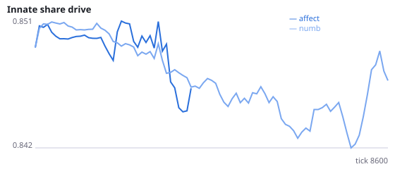
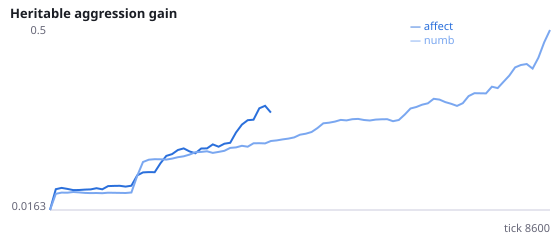
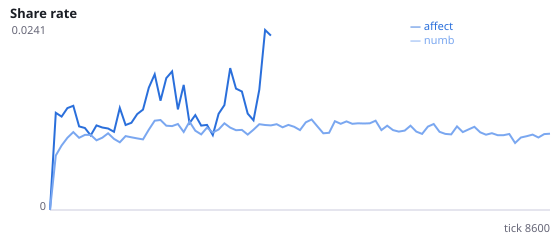
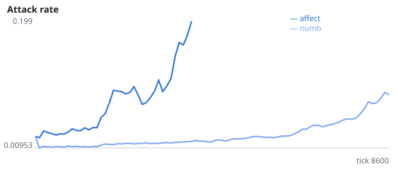
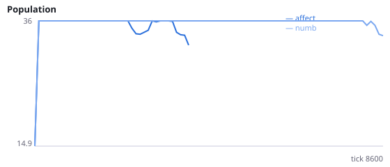
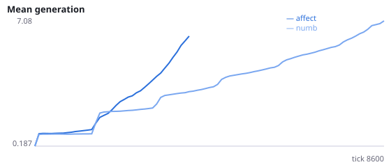

# Do emotion-like internal states evolve when nothing is written in?

**Question.** Anderson and Adolphs (2014) proposed that emotion states, across species, share measurable 'emotion primitives', among them persistence (the state outlasts its trigger), scalability (graded with stimulus strength) and valence (good and bad push behaviour in opposite directions). Gibson et al. (2015) used such tests to show a persistent, scalable defensive state in flies. Here no emotion is designed in: each agent carries two internal state variables whose inputs (pain, food eaten, hunger, threat in view, others in view), decay and effect on every action start at zero (decay 0.5) and are left to mutation and selection. The decision network has no memory of its own (reset before every decision), so this state is its only memory. Do emotion-like states evolve, and do they help?

evolve_affect=True: s <- decay * s + A @ inputs each tick; B.T @ s is added to the input current of each action population; A (2x5), B (2x6) and decay logits (2) mutate by N(0, 0.3) at every birth, starting at zero. numb (control): numb_affect=True, the same genes evolve and are inherited but the state never acts, so its genes drift. The designer's frustration-to-attack drive is switched off in both (aggression_gain=0) and learning is off, so behaviour comes from inherited wiring only. Fixed dynamics (substeps=32, reset_each_decision, normalize with normalize_to='innate') on the standard social evolution base. Assay (neuralmind/research/affect_assay.py) at the end of each run, on up to 8 living agents copied frozen into an empty arena, alone, energy clamped and fresh noise per tick: a one-tick input pulse (pain 1, pain 3 or food 1) is injected into the state at tick 0 and the action histogram is compared with an identical run without the pulse. affect_early = total-variation (TV) distance in ticks 0-4 after pain 1; affect_persistence = TV in ticks 5-19; affect_scalability = TV(pain 3) - TV(pain 1) over ticks 0-9; affect_valence_cos = cosine between the action shifts after pain 1 and after food 1 over ticks 0-9 (negative = opposite). In the numb control the assay unmasks the state, so it measures what drifted genes would do. Runs that go extinct have no assay values and drop out of those paired tests. Interpretation rule, fixed in advance: emotion-like states evolved under selection if H58c is supported together with H58d or H58e; they are adaptive if H58a or H58b is supported. No pilot was run (smoke runs of 1500 ticks only, to test the code). Seeds 3600-3611 have never been run.

NeuralMind 0.2.0 · 2026-10-17 18:08 · mean [95% bootstrap CI] over seeds; paired differences use the same seeds.

**Pre-registration:** spec `studies/AK_evolved_affect.json` at commit `0fabb5018030f7a6fb9dc6b19bf6a74bc506ec55` (2026-10-17T16:36:35+07:00) · unchanged since commit: **True** · preregistered: **True**

## Hypotheses

| id | statement | test (a − b) | result |
|---|---|---|---|
| H58a | Populations with an acting affect state survive longer than numb populations | -2458 [-6018, 635] | **not supported** |
| H58b | Populations with an acting affect state eat more per agent-tick | -0.01195 [-0.02091, -0.002163] | **not supported** |
| H58c | Selected affect states persist longer after a pain pulse than drifted ones | 0.002865 [-0.06771, 0.1107] | **not supported** |
| H58d | Selected affect states scale more with pulse strength than drifted ones | -0.0293 [-0.08711, 0.02734] | **not supported** |
| H58e | In selected affect states, pain and food shift behaviour in more opposite directions than in drifted ones | -0.1716 [-0.6813, 0.1904] | **not supported** |
| H58f | Selection lengthens the affect state's memory (decay closer to 1) | -0.05525 [-0.1818, 0.08516] | **not supported** |

## Conditions

| condition | sense_gain | innate_foraging | share_gene | aggr_gene | share_rate | attack_rate | signal_rate | share_given_encounter | encounter_rate | drift_social_minus_loco | invader_share | final_pop | max_generation |
|---|---|---|---|---|---|---|---|---|---|---|---|---|---|
| affect | -0.3125 [-1.532, 0.9531] | 4.891 [2.672, 7.173] | 0.8861 [0.8187, 0.9665] | 0.8272 [0.4462, 1.318] | 0.2759 [0.07331, 0.4971] | 0.1345 [0.04546, 0.2434] | 0.04223 [0.01551, 0.07125] | 0.3301 [0.09595, 0.5922] | 0.545 [0.4752, 0.6182] | 0 [0, 0] | nan [nan, nan] | 23.92 [14.92, 32.92] | 33.67 [16.5, 52.5] |
| numb | 0.6042 [-0.4167, 1.458] | 9 [7.167, 10.96] | 0.8525 [0.8316, 0.8808] | 0.6697 [0.4105, 0.9777] | 0.006934 [0.005494, 0.008467] | 0.2326 [0.1428, 0.3253] | 0.01772 [0.009723, 0.02986] | 0.007106 [0.004851, 0.01032] | 0.4624 [0.4154, 0.4921] | 0 [0, 0] | nan [nan, nan] | 16.83 [7.833, 25.83] | 9.333 [3.5, 16.67] |

     

Full per-metric summaries and raw per-run data: `results.json`.