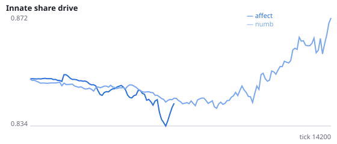
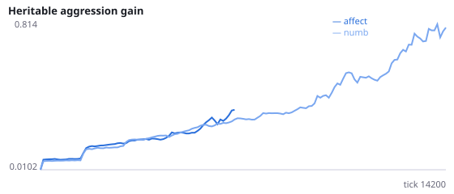
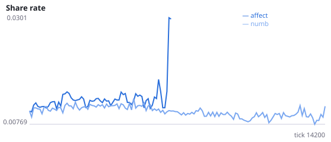
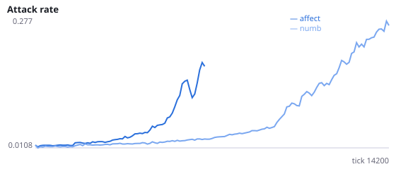
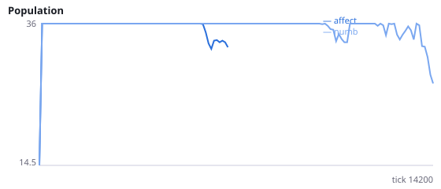
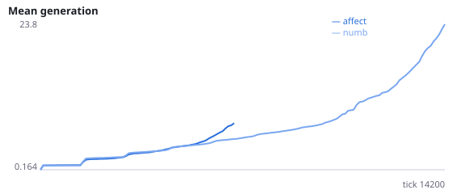

# When hazards can only be felt, does a fear-like internal state evolve?

**Question.** AK found no emotion-like states evolving when nothing was written in, and an acting internal state lowered foraging. One untested reason: in AK's world the decision network already sees hazards through its threat sensors, so an internal state has little to add. Here hazards are invisible (the threat sensors always read 0). The only route by which being hurt can change behaviour is the evolved internal state, whose input includes pain. Does a state that responds to pain evolve, does it outlast the pain (a fear-like, persistent state), and does it help populations?

Same design as AK (evolve_affect with zero-initialised genes; numb control in which the same genes evolve but never act; learning off; designer frustration drive off; fixed dynamics; standard social evolution base), with two changes fixed in advance: hazards_visible=False in both conditions, and a smaller mutation step (affect_sigma=0.15 instead of 0.3), since AK's 0.3 may have been too large for selection to tune. Assay as in AK (neuralmind/research/affect_assay.py): affect_early = behavioural change in ticks 0-4 after a pain pulse; affect_persistence = change in ticks 5-19. Runs that go extinct drop out of the assay tests. Limit carried over from AK: the two conditions may reach different generation counts, so drifted genes in the numb control may have had fewer mutations. Interpretation rule, fixed in advance: a pain-responsive state evolved under selection if H59c is supported; a fear-like persistent state if H59d is also supported; the state is adaptive if H59a or H59b is supported. No pilot was run. Seeds 3700-3711 have never been run.

NeuralMind 0.2.0 · 2026-10-17 19:59 · mean [95% bootstrap CI] over seeds; paired differences use the same seeds.

**Pre-registration:** spec `studies/AL_invisible_hazards.json` at commit `7637c202da082833909ea45e06b43b3aad7f22eb` (2026-10-17T18:25:30+07:00) · unchanged since commit: **True** · preregistered: **True**

## Hypotheses

| id | statement | test (a − b) | result |
|---|---|---|---|
| H59a | With invisible hazards, populations with an acting affect state survive longer than numb ones | -1254 [-3412, 425.1] | **not supported** |
| H59b | With invisible hazards, populations with an acting affect state eat more per agent-tick | -0.006592 [-0.01332, -0.0003532] | **not supported** |
| H59c | Selected states change behaviour more right after a pain pulse than drifted ones | -0.03047 [-0.1, 0.03516] | **not supported** |
| H59d | Selected states keep changing behaviour after the pain has passed (ticks 5-19) more than drifted ones | -0.0612 [-0.1301, -0.009115] | **not supported** |
| H59e | Selection lengthens the state's memory (decay closer to 1) | -0.07776 [-0.2419, 0.05998] | **not supported** |

## Conditions

| condition | sense_gain | innate_foraging | share_gene | aggr_gene | share_rate | attack_rate | signal_rate | share_given_encounter | encounter_rate | drift_social_minus_loco | invader_share | final_pop | max_generation |
|---|---|---|---|---|---|---|---|---|---|---|---|---|---|
| affect | 1.917 [-0.06944, 3.681] | 7.389 [4.194, 10.47] | 0.9184 [0.8821, 0.9586] | 0.8473 [0.5722, 1.161] | 0.009212 [0.007181, 0.01147] | 0.2864 [0.1801, 0.3928] | 0.0253 [0.01239, 0.0434] | 0.00919 [0.006288, 0.01238] | 0.4668 [0.4472, 0.4838] | 0 [0, 0] | nan [nan, nan] | 27 [18, 36] | 49.58 [27.75, 74.58] |
| numb | 0.6667 [-0.9174, 2.361] | 8.653 [7.431, 9.931] | 0.8454 [0.8133, 0.8816] | 1.191 [0.758, 1.708] | 0.009208 [0.005302, 0.01416] | 0.2938 [0.1937, 0.3903] | 0.02339 [0.01146, 0.03734] | 0.007986 [0.004651, 0.01221] | 0.4822 [0.4736, 0.4915] | 0 [0, 0] | nan [nan, nan] | 21.17 [12.17, 29.17] | 32.83 [15.17, 52.58] |

     

Full per-metric summaries and raw per-run data: `results.json`.