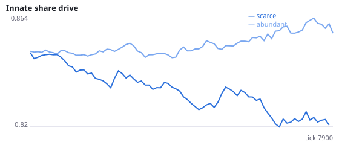
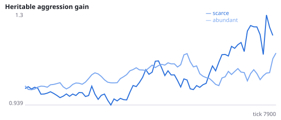
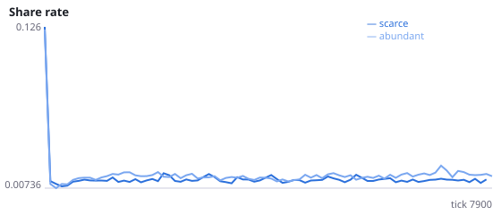
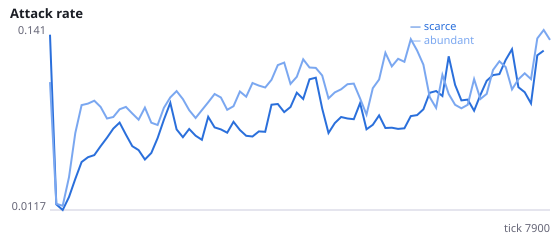
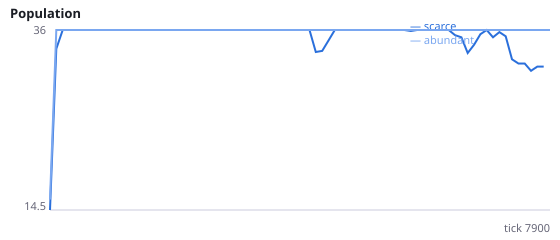
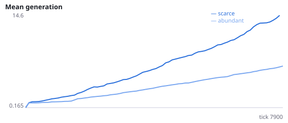

# Selection or drift? Aggression gene vs a neutral marker under scarcity

**Question.** Experiment D found a higher aggression gene under scarcity but no change in attack behaviour, and scarce worlds ran through ~2x more generations. Does the aggression gene rise beyond a neutral marker that is inherited and mutated identically but has no effect?

A neutral marker is the standard control for genetic drift: it shares the aggression gene's inheritance, mutation and clipping but is never read by behaviour. Selection on aggression predicts aggression > marker. Pure drift predicts no systematic difference.

NeuralMind 0.2.0 · 2026-10-12 03:14 · mean [95% bootstrap CI] over seeds; paired differences use the same seeds.

**Pre-registration:** spec `studies/D2_aggression_vs_neutral_marker.json` at commit `491df2bf856533de04c83ff0f9a436adaf2dad81` (2026-10-12T01:47:13+07:00) · unchanged since commit: **True** · preregistered: **True**

## Hypotheses

| id | statement | test (a − b) | result |
|---|---|---|---|
| H16 | Under scarcity the aggression gene exceeds the neutral marker (selection) | -0.204 [-0.7413, 0.2412] | **not supported** |
| H16b | The aggression-minus-marker excess is larger under scarcity than abundance | -0.3387 [-0.8601, 0.09776] | **not supported** |
| H16c | The neutral marker itself is higher under scarcity (drift/clipping with more generations) | 0.07707 [-0.2601, 0.4746] | **not supported** |

## Conditions

| condition | innate_foraging | share_gene | aggr_gene | share_rate | attack_rate | share_given_encounter | encounter_rate | final_pop | max_generation |
|---|---|---|---|---|---|---|---|---|---|
| scarce | 5.821 [4.321, 7] | 0.8297 [0.8067, 0.8525] | 0.9592 [0.6834, 1.192] | 0.01297 [0.01195, 0.01404] | 0.1049 [0.07094, 0.1553] | 0.01373 [0.01292, 0.01457] | 0.4954 [0.4816, 0.5082] | 31.5 [22.5, 36] | 12.38 [8.125, 16.5] |
| abundant | 9.609 [7.171, 12.22] | 0.8578 [0.8446, 0.8698] | 1.133 [0.8814, 1.368] | 0.01763 [0.01605, 0.01931] | 0.1074 [0.09418, 0.1232] | 0.01723 [0.01561, 0.01885] | 0.4864 [0.4815, 0.4911] | 36 [36, 36] | 7.75 [7.375, 8] |

     

Full per-metric summaries and raw per-run data: `results.json`.