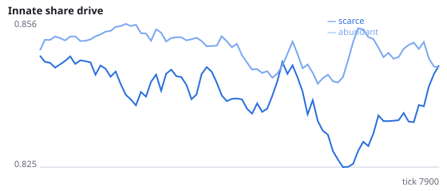
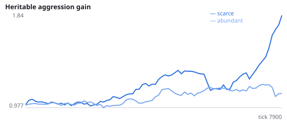
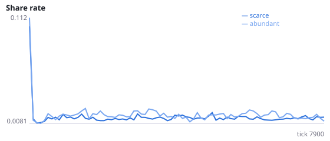
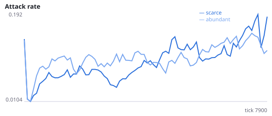
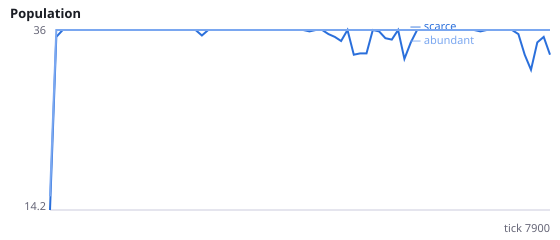
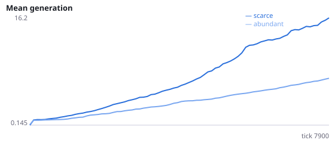

# Does a heritable aggression gene evolve higher under food scarcity?

**Question.** When food is scarce, does natural selection favour agents whose frustration translates more strongly into attack?

Agents inherit an aggression gain: how strongly frustration (accumulated negative reward-prediction error) drives their attack population. Attacking steals energy from a neighbour. Resource-defence theory predicts that aggression pays when resources are contested, but very scarce resources may not be worth defending. Both outcomes are plausible.

NeuralMind 0.1.0 · 2026-10-12 01:43 · mean [95% bootstrap CI] over seeds; paired differences use the same seeds.

**Pre-registration:** spec `studies/D_scarcity_aggression.json` at commit `589e70948b9418f229631e80935c7fb63293581c` (2026-10-12T00:54:54+07:00) · unchanged since commit: **True** · preregistered: **True**

## Hypotheses

| id | statement | test (a − b) | result |
|---|---|---|---|
| H8 | The aggression gene evolves higher under scarcity | 0.7488 [0.3725, 1.035] | **supported** |
| H8b | Agents attack more often under scarcity | 0.001239 [-0.03082, 0.03729] | **not supported** |
| H8c | Under scarcity, attacks are more likely when a neighbour is in reach | 0.006408 [-0.02179, 0.03985] | **not supported** |

## Conditions

| condition | innate_foraging | share_gene | aggr_gene | share_rate | attack_rate | share_given_encounter | encounter_rate | final_pop | max_generation |
|---|---|---|---|---|---|---|---|---|---|
| scarce | 5.042 [3.957, 6.188] | 0.8438 [0.8351, 0.8531] | 1.857 [1.421, 2.358] | 0.01299 [0.01182, 0.01431] | 0.1349 [0.0974, 0.1724] | 0.01402 [0.01271, 0.01539] | 0.4979 [0.4832, 0.5091] | 33.83 [29.5, 36] | 19.17 [13.33, 27.33] |
| abundant | 9.458 [6.083, 13.02] | 0.8448 [0.8311, 0.8602] | 1.108 [0.8744, 1.381] | 0.01506 [0.01361, 0.01679] | 0.1337 [0.09713, 0.1893] | 0.0153 [0.01418, 0.01647] | 0.4862 [0.4807, 0.4917] | 36 [36, 36] | 8.167 [7.333, 9.333] |

     

Full per-metric summaries and raw per-run data: `results.json`.