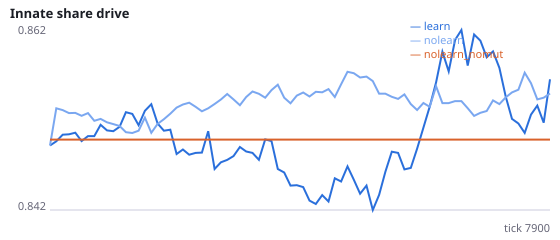
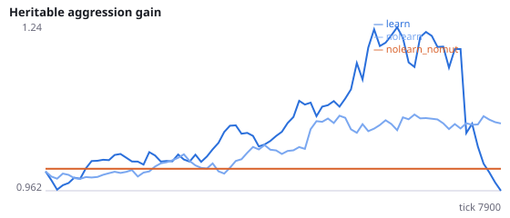
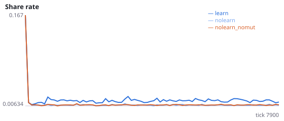
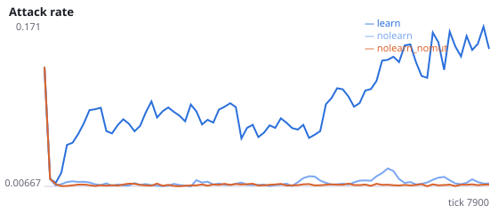
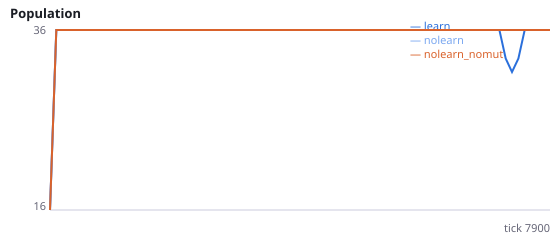
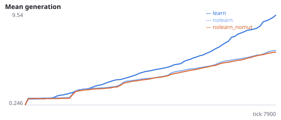

# Baldwin effect or hiding effect? Lifetime learning and the evolution of innate foraging

**Question.** Does reward-modulated lifetime learning speed up the evolution of innate foraging ability (Baldwin effect / genetic assimilation), or does it shield genotypes from selection so innate ability evolves less (hiding effect)?

Theory predicts both directions (Hinton & Nowlan 1987; Mayley 1997; Paenke, Sendhoff & Kawecki 2007). We measure innate foraging by assaying evolved genomes alone, with learning switched off, so only the inherited wiring is tested. A no-mutation control checks whether mutation plus selection improves innate foraging at all.

NeuralMind 0.2.0 · 2026-10-12 02:01 · mean [95% bootstrap CI] over seeds; paired differences use the same seeds.

**Pre-registration:** spec `studies/E_baldwin_vs_hiding.json` at commit `589e70948b9418f229631e80935c7fb63293581c` (2026-10-12T00:54:54+07:00) · unchanged since commit: **True** · preregistered: **True**

## Hypotheses

| id | statement | test (a − b) | result |
|---|---|---|---|
| H11a | Baldwin: learning populations evolve HIGHER innate foraging | -4.375 [-7.001, -1.479] | **not supported** |
| H11b | Hiding: learning populations evolve LOWER innate foraging | -4.375 [-7.001, -1.479] | **supported** |
| H12 | Mutation + selection improves innate foraging over selection among founder genomes alone | 5.479 [3.312, 7.626] | **supported** |

## Conditions

| condition | innate_foraging | share_gene | aggr_gene | share_rate | attack_rate | share_given_encounter | encounter_rate | final_pop | max_generation |
|---|---|---|---|---|---|---|---|---|---|
| learn | 5.354 [3.312, 7.083] | 0.8552 [0.844, 0.8698] | 0.9888 [0.8235, 1.208] | 0.01556 [0.01384, 0.01742] | 0.1462 [0.08124, 0.2319] | 0.01629 [0.01451, 0.01811] | 0.4886 [0.4835, 0.4944] | 36 [36, 36] | 11 [8, 15.67] |
| nolearn | 9.729 [7.271, 11.92] | 0.8546 [0.848, 0.8622] | 1.088 [0.9977, 1.17] | 0.00766 [0.007352, 0.007958] | 0.01311 [0.0102, 0.01615] | 0.007688 [0.007225, 0.008168] | 0.4832 [0.4776, 0.4885] | 36 [36, 36] | 6.833 [6.333, 7.333] |
| nolearn_nomut | 4.25 [3.104, 5.479] | 0.85 [0.85, 0.85] | 1 [1, 1] | 0.008007 [0.007678, 0.008329] | 0.008102 [0.007877, 0.008343] | 0.007688 [0.007401, 0.007924] | 0.488 [0.4828, 0.4942] | 36 [36, 36] | 6.167 [6, 6.5] |

     

Full per-metric summaries and raw per-run data: `results.json`.