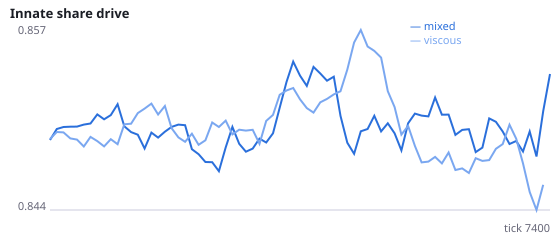
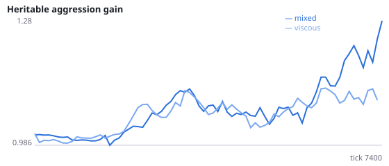
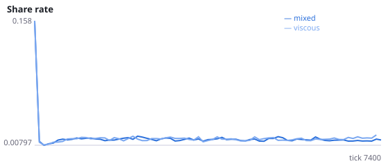
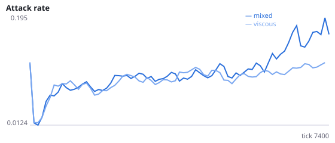
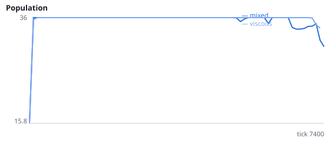
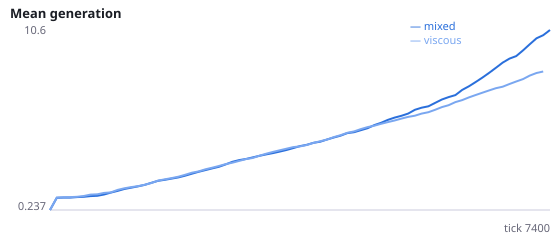

# Independent replication: does spatial structure protect populations from extinction?

**Question.** Using seeds never run before (100-115), do well-mixed evolving populations still go extinct more often than viscous ones? Are their population sizes more volatile (boom-bust)?

Experiment F found 9/12 vs 1/12 extinctions, but half of its seeds duplicated the exploratory C2 runs that suggested the hypothesis. On fresh seeds alone the result was 4/6 vs 0/6 (p = 0.06). This spec uses seed_start = 100 so the confirmation is independent.

NeuralMind 0.2.0 · 2026-10-15 21:18 · mean [95% bootstrap CI] over seeds; paired differences use the same seeds.

**Pre-registration:** spec `studies/F2_viscosity_extinction_replication.json` at commit `435ab42b3855333e438092e26613e7dfff2be95d` (2026-10-12T03:00:59+07:00) · unchanged since commit: **True** · preregistered: **True**

## Hypotheses

| id | statement | test (a − b) | result |
|---|---|---|---|
| H14r | Replication: well-mixed populations go extinct more often | 0.375 [0, 0.6875] | **not supported** |
| H14br | Replication: well-mixed populations die out sooner | -3140 [-5183, -1084] | **supported** |
| H17 | Mechanism: well-mixed population sizes are more volatile (coefficient of variation) | 0.05828 [0.01244, 0.1076] | **supported** |

## Conditions

| condition | innate_foraging | share_gene | aggr_gene | share_rate | attack_rate | share_given_encounter | encounter_rate | final_pop | max_generation |
|---|---|---|---|---|---|---|---|---|---|
| mixed | 11.96 [11.25, 12.62] | 0.8483 [0.789, 0.9095] | 1.007 [0.3892, 1.353] | 0.01538 [0.01281, 0.01851] | 0.233 [0.1561, 0.2963] | 0.01491 [0.01269, 0.01775] | 0.4301 [0.4039, 0.4583] | 6.75 [0, 13.5] | 4.438 [0, 10] |
| viscous | 10.03 [7.917, 12.15] | 0.8358 [0.8127, 0.8689] | 1.598 [1.116, 2.107] | 0.01601 [0.01326, 0.01972] | 0.227 [0.162, 0.2998] | 0.01801 [0.01428, 0.0226] | 0.4815 [0.4581, 0.4964] | 19.69 [10.75, 28.19] | 15.44 [7.747, 24.12] |

     

Full per-metric summaries and raw per-run data: `results.json`.