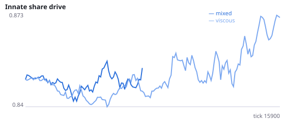
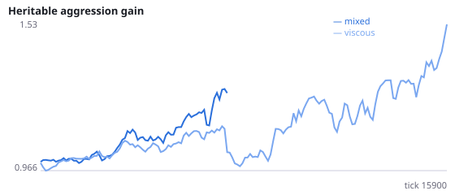
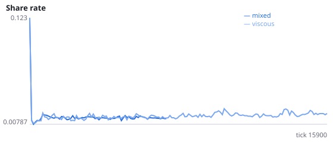
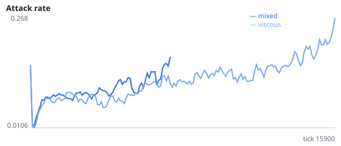
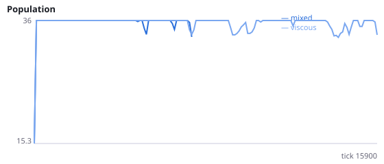
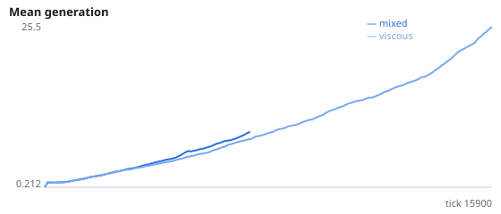

# Does spatial structure protect evolving populations from extinction?

**Question.** Do well-mixed populations (offspring born anywhere) go extinct more often than viscous ones (offspring born near their parents), and do they evolve higher aggression?

Exploratory observation in Experiment C2: 7/12 well-mixed populations went extinct vs 2/12 viscous (Fisher p = 0.09, not significant). In the one surviving well-mixed+learning run the aggression gene reached 3.2 vs ~1.9 in viscous runs. This mirrors Kerr et al. (2006, Nature): restricted migration favours restraint and avoids a tragedy of the commons. This study re-tests it with more seeds.

NeuralMind 0.2.0 · 2026-10-12 02:59 · mean [95% bootstrap CI] over seeds; paired differences use the same seeds.

**Pre-registration:** spec `studies/F_viscosity_extinction.json` at commit `591d801a8ac4226a5693c79af68b63f4ea91e4c2` (2026-10-12T01:34:16+07:00) · unchanged since commit: **True** · preregistered: **True**

## Hypotheses

| id | statement | test (a − b) | result |
|---|---|---|---|
| H14 | Well-mixed populations go extinct more often | 0.6667 [0.25, 1] | **supported** |
| H14b | Well-mixed populations die out sooner | -4616 [-6844, -2349] | **supported** |
| H15 | The aggression gene evolves higher in well-mixed populations (surviving runs) | 0.05732 [-0.09311, 0.2077] | **not supported** |

## Conditions

| condition | innate_foraging | share_gene | aggr_gene | share_rate | attack_rate | share_given_encounter | encounter_rate | final_pop | max_generation |
|---|---|---|---|---|---|---|---|---|---|
| mixed | 4.458 [2.125, 8] | 0.8851 [0.8619, 0.9289] | 2.386 [1.488, 3.204] | 0.01528 [0.01151, 0.02004] | 0.3152 [0.1687, 0.457] | 0.01457 [0.01064, 0.0196] | 0.4164 [0.3837, 0.4491] | 9 [0, 18] | 10.83 [0, 27.5] |
| viscous | 7.955 [5.602, 10.17] | 0.877 [0.8419, 0.9153] | 1.709 [1.2, 2.355] | 0.01867 [0.01378, 0.0251] | 0.2225 [0.1606, 0.2901] | 0.01966 [0.01481, 0.02618] | 0.4947 [0.4889, 0.5001] | 31.25 [23.5, 36] | 34.5 [21.91, 48.25] |

     

Full per-metric summaries and raw per-run data: `results.json`.