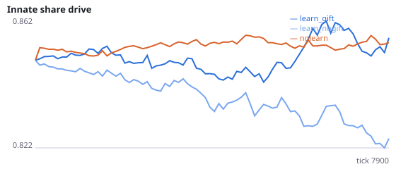
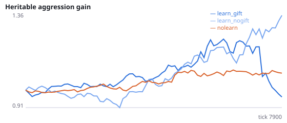
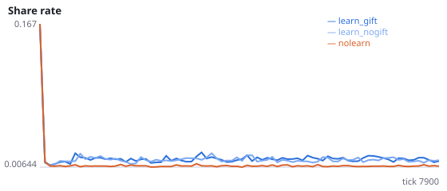
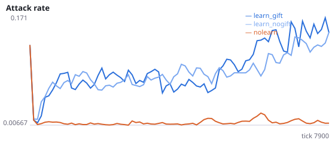
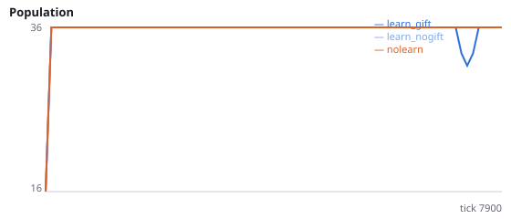
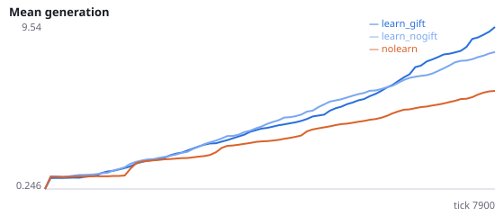

# Does learning increase sharing because receiving a gift is rewarding?

**Question.** In Experiments C and C2, selfish lifetime learning roughly doubled sharing, even when we condition on a neighbour being in reach, so crowding does not explain it. Is the effect driven by recipients being rewarded for gifts, which reinforces whatever their own network was doing (often sharing)?

When a gift is received, the recipient's reward counts the energy gained. If the recipient's share population was active, that pathway is potentiated, a learned reciprocity loop. Ablation: gift_reward=false still transfers the energy but gives no reward credit for it.

NeuralMind 0.2.0 · 2026-10-12 02:18 · mean [95% bootstrap CI] over seeds; paired differences use the same seeds.

**Pre-registration:** spec `studies/G_gift_reward_reciprocity.json` at commit `591d801a8ac4226a5693c79af68b63f4ea91e4c2` (2026-10-12T01:34:16+07:00) · unchanged since commit: **True** · preregistered: **True**

## Hypotheses

| id | statement | test (a − b) | result |
|---|---|---|---|
| H13 | Removing gift reward lowers learned sharing | 0.001936 [0.0003574, 0.003631] | **supported** |
| H13b | Without gift reward, learning no longer raises sharing above no-learning | 0.006665 [0.005663, 0.007605] | **difference detected** |
| H13c | Replication: with gift reward, learning raises sharing | 0.008601 [0.006398, 0.01084] | **supported** |

## Conditions

| condition | innate_foraging | share_gene | aggr_gene | share_rate | attack_rate | share_given_encounter | encounter_rate | final_pop | max_generation |
|---|---|---|---|---|---|---|---|---|---|
| learn_gift | 5.354 [3.312, 7.083] | 0.8552 [0.844, 0.8698] | 0.9888 [0.8235, 1.208] | 0.01556 [0.01384, 0.01742] | 0.1462 [0.08124, 0.2319] | 0.01629 [0.01451, 0.01811] | 0.4886 [0.4835, 0.4944] | 36 [36, 36] | 11 [8, 15.67] |
| learn_nogift | 7.667 [5.479, 9.854] | 0.8279 [0.8162, 0.842] | 1.306 [1.069, 1.56] | 0.01437 [0.01325, 0.01541] | 0.1223 [0.1012, 0.145] | 0.01435 [0.01363, 0.01508] | 0.4846 [0.4775, 0.4914] | 36 [36, 36] | 9.667 [8.833, 10.33] |
| nolearn | 9.729 [7.271, 11.92] | 0.8546 [0.848, 0.8622] | 1.088 [0.9977, 1.17] | 0.00766 [0.007352, 0.007958] | 0.01311 [0.0102, 0.01615] | 0.007688 [0.007225, 0.008168] | 0.4832 [0.4776, 0.4885] | 36 [36, 36] | 6.833 [6.333, 7.333] |

     

Full per-metric summaries and raw per-run data: `results.json`.