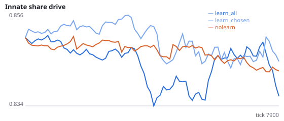
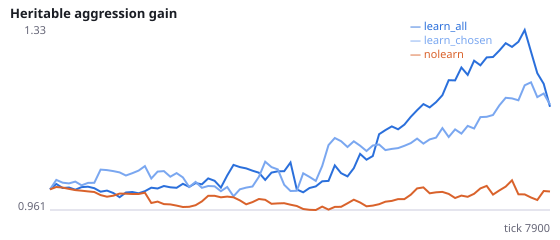
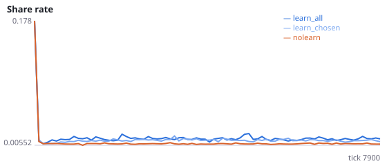
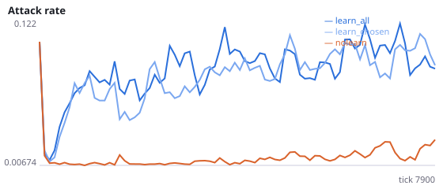
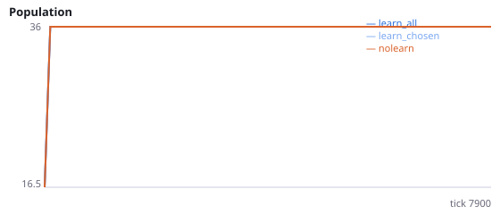
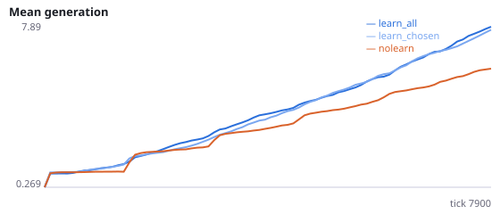

# Does lifetime learning strengthen every social action, rewarded or not?

**Question.** In Experiments E and G, learning raised attacks ~11x and sharing ~2x, and the gift-reward loop explained only ~22% of the sharing rise. Is this a non-specific effect of the learning rule: reward reaching the input weights of every action population that was active, not just the executed one?

Each action population has its own plastic sensory input with potentiation-only eligibility (a_minus = 0), and a global RPE is applied to all of them. Non-executed populations that spiked still collect eligibility, so they are strengthened whenever the RPE is positive. Signalling has a cost and no reward pathway, so a reward-specific learner should not increase it. Intervention: credit_chosen_only applies the RPE only to the executed action's input weights. Seeds 200-207 have never been run.

NeuralMind 0.2.0 · 2026-10-15 20:41 · mean [95% bootstrap CI] over seeds; paired differences use the same seeds.

**Pre-registration:** spec `studies/I_nonspecific_social_potentiation.json` at commit `6201432ab71484e6547742ba8e0d274ae607b9bc` (2026-10-15T20:03:34+07:00) · unchanged since commit: **True** · preregistered: **True**

## Hypotheses

| id | statement | test (a − b) | result |
|---|---|---|---|
| H18a | Learning raises signalling, an action with only a cost | 0.01928 [0.01196, 0.02771] | **supported** |
| H18b | Under learning, input weights to social actions grow more over a lifetime than those to locomotion | 0.02494 [0.01912, 0.02979] | **supported** |
| H18c | Crediting only the executed action lowers the attack rate | 0.003566 [-0.02168, 0.03119] | **not supported** |
| H18d | Crediting only the executed action lowers sharing given a neighbour in reach | 0.002535 [0.000333, 0.005179] | **supported** |
| H18e | Crediting only the executed action lowers signalling | 0.01012 [0.004442, 0.01564] | **supported** |
| H18f | Replication of E/G: learning raises the attack rate | 0.08142 [0.06793, 0.09567] | **supported** |

## Conditions

| condition | innate_foraging | share_gene | aggr_gene | share_rate | attack_rate | signal_rate | share_given_encounter | encounter_rate | drift_social_minus_loco | final_pop | max_generation |
|---|---|---|---|---|---|---|---|---|---|---|---|
| learn_all | 7.938 [5.312, 10.47] | 0.8363 [0.8235, 0.8469] | 1.17 [0.9331, 1.456] | 0.01444 [0.01257, 0.01699] | 0.1003 [0.08509, 0.1179] | 0.02708 [0.0198, 0.03547] | 0.01447 [0.0129, 0.01664] | 0.4968 [0.4921, 0.5014] | 0.02494 [0.01912, 0.02979] | 36 [36, 36] | 9 [8.25, 9.753] |
| learn_chosen | 8.094 [6.125, 10] | 0.8451 [0.8325, 0.857] | 1.209 [0.9941, 1.437] | 0.01188 [0.01091, 0.01293] | 0.09673 [0.0766, 0.1165] | 0.01696 [0.0135, 0.02065] | 0.01194 [0.01114, 0.01287] | 0.5005 [0.4935, 0.5068] | 0.0221 [0.01632, 0.02943] | 36 [36, 36] | 9 [8.25, 9.75] |
| nolearn | 12.41 [10.02, 14.64] | 0.8432 [0.8342, 0.8515] | 0.9994 [0.8964, 1.102] | 0.007757 [0.007509, 0.007998] | 0.01887 [0.01193, 0.0269] | 0.007795 [0.007663, 0.007908] | 0.007816 [0.007536, 0.008097] | 0.4874 [0.4835, 0.4909] | 0 [0, 0] | 36 [36, 36] | 7.125 [6.75, 7.5] |

     

Full per-metric summaries and raw per-run data: `results.json`.