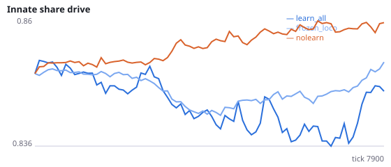
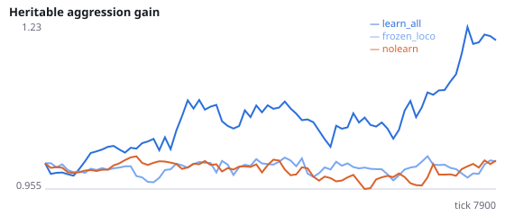
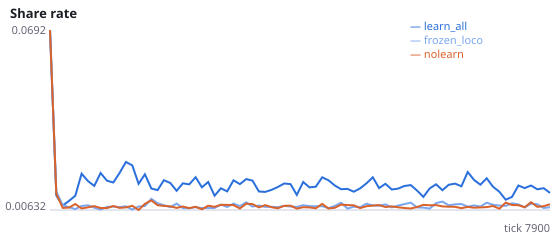
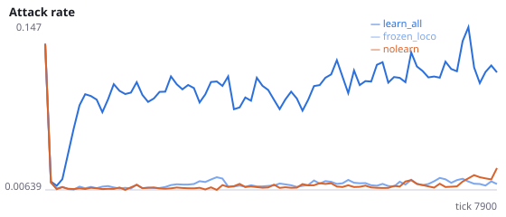
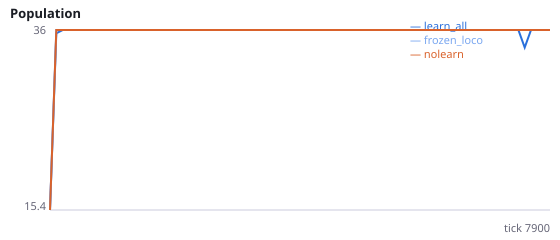
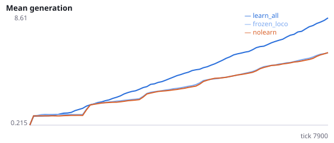

# Does learning raise social actions by weakening locomotion?

**Question.** In Experiment I, every input weight fell over a lifetime and locomotion weights fell the most, even when credit went only to the executed action. Action choice is a spike-count competition, so weaker locomotion could let every social action win more often. If locomotion inputs are frozen and only social inputs may learn, does the learning-induced rise in attacking, signalling and sharing shrink?

Experiment I: under learning, drift (learned/innate - 1) was -0.032 for locomotion and -0.004 to -0.011 for social actions. Crediting only the executed action removed none of the attack rise and about half of the signalling rise. Intervention: frozen_inputs = [left, forward, right] keeps locomotion input weights at their innate values while social inputs keep learning. Caveat: this also removes all lifetime learning of foraging. Seeds 300-307 have never been run.

NeuralMind 0.2.0 · 2026-10-15 21:18 · mean [95% bootstrap CI] over seeds; paired differences use the same seeds.

**Pre-registration:** spec `studies/J_locomotion_weakening.json` at commit `a2e1b47584c5d26143ae853c40c2e0a8d3fec17f` (2026-10-15T20:43:37+07:00) · unchanged since commit: **True** · preregistered: **True**

## Hypotheses

| id | statement | test (a − b) | result |
|---|---|---|---|
| H19a | Freezing locomotion inputs lowers the attack rate | 0.09897 [0.07202, 0.13] | **supported** |
| H19b | Freezing locomotion inputs lowers signalling | 0.01819 [0.01198, 0.0254] | **supported** |
| H19c | Freezing locomotion inputs lowers sharing given a neighbour in reach | 0.006731 [0.006024, 0.007464] | **supported** |
| H19d | With locomotion frozen, learning no longer raises the attack rate above no-learning | -0.0004149 [-0.003304, 0.00261] | **no difference detected** |
| H19m | Manipulation check: social inputs drift up relative to locomotion under learn_all (replicates I's H18b) | 0.03393 [0.02518, 0.04528] | **supported** |

## Conditions

| condition | innate_foraging | share_gene | aggr_gene | share_rate | attack_rate | signal_rate | share_given_encounter | encounter_rate | drift_social_minus_loco | final_pop | max_generation |
|---|---|---|---|---|---|---|---|---|---|---|---|
| learn_all | 4.969 [3.75, 6.188] | 0.848 [0.837, 0.8614] | 1.269 [0.9638, 1.546] | 0.01439 [0.01342, 0.01539] | 0.112 [0.08627, 0.142] | 0.02618 [0.02012, 0.03341] | 0.01459 [0.01381, 0.01535] | 0.4933 [0.4837, 0.5054] | 0.03393 [0.02518, 0.04528] | 36 [36, 36] | 9.875 [8.375, 11.75] |
| frozen_loco | 10.77 [9.891, 11.67] | 0.8509 [0.8446, 0.8574] | 0.993 [0.8677, 1.113] | 0.008024 [0.007658, 0.008339] | 0.01299 [0.01058, 0.01542] | 0.007986 [0.007734, 0.00822] | 0.007864 [0.007558, 0.008197] | 0.4828 [0.4743, 0.4925] | -0.007861 [-0.01048, -0.005386] | 36 [36, 36] | 7 [6.5, 7.5] |
| nolearn | 12.25 [10.42, 14.09] | 0.8596 [0.8527, 0.8672] | 0.9954 [0.9072, 1.095] | 0.007656 [0.007319, 0.008012] | 0.01341 [0.01125, 0.0155] | 0.007807 [0.007582, 0.008024] | 0.007408 [0.006944, 0.00785] | 0.4876 [0.4789, 0.4962] | 0 [0, 0] | 36 [36, 36] | 6.625 [6.25, 6.875] |

     

Full per-metric summaries and raw per-run data: `results.json`.