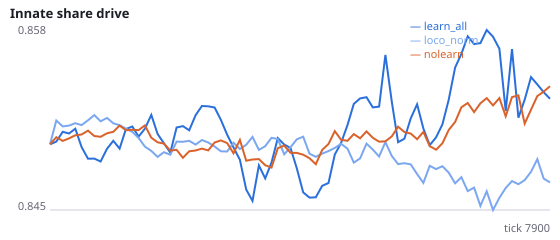
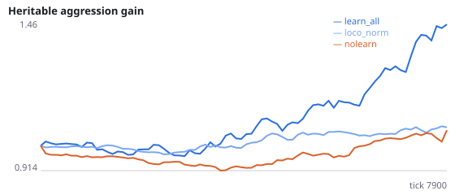
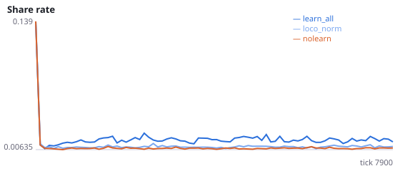
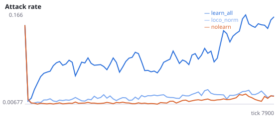
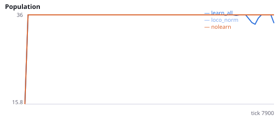
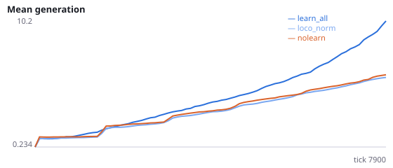

# Is it the weakening of locomotion, rather than other foraging changes, that frees social actions?

**Question.** Experiment J froze all locomotion learning, which also removed lifetime foraging learning. Here the locomotion inputs keep learning (weights can be redistributed across sensors) but each locomotion neuron's total input is held at its innate value, so locomotion cannot weaken overall. Does the learning-induced rise in attacking, signalling and sharing disappear?

Experiment I: under learning, locomotion input weights fell by ~3-4% over a lifetime, more than social inputs. Experiment J: freezing locomotion inputs removed the rise in all social actions. Intervention: normalized_inputs = [left, forward, right] rescales each locomotion neuron's input row back to its innate sum after every weight update. Seeds 400-407 have never been run.

NeuralMind 0.2.0 · 2026-10-15 22:29 · mean [95% bootstrap CI] over seeds; paired differences use the same seeds.

**Pre-registration:** spec `studies/K_locomotion_normalized.json` at commit `98a188fb765f435b0535d6857ee6ad3e293a3ab0` (2026-10-15T22:08:55+07:00) · unchanged since commit: **True** · preregistered: **True**

## Hypotheses

| id | statement | test (a − b) | result |
|---|---|---|---|
| H20a | Holding locomotion input sums fixed lowers the attack rate | 0.1166 [0.06523, 0.1974] | **supported** |
| H20b | Holding locomotion input sums fixed lowers signalling | 0.01276 [0.007298, 0.019] | **supported** |
| H20c | Holding locomotion input sums fixed lowers sharing given a neighbour in reach | 0.006421 [0.004437, 0.008325] | **supported** |
| H20d | With locomotion sums fixed, learning no longer raises the attack rate above no-learning | 0.006406 [-0.002653, 0.01523] | **no difference detected** |
| H20e | With locomotion sums fixed, learning no longer raises signalling above no-learning | 0.0009219 [0.0003159, 0.001528] | **difference detected** |

## Conditions

| condition | innate_foraging | share_gene | aggr_gene | share_rate | attack_rate | signal_rate | share_given_encounter | encounter_rate | drift_social_minus_loco | final_pop | max_generation |
|---|---|---|---|---|---|---|---|---|---|---|---|
| learn_all | 7.141 [5.25, 8.954] | 0.8551 [0.845, 0.8656] | 1.434 [1.11, 1.796] | 0.016 [0.01443, 0.01778] | 0.1408 [0.0912, 0.2197] | 0.02212 [0.01656, 0.02873] | 0.01592 [0.01441, 0.01746] | 0.4933 [0.4842, 0.5021] | 0.02778 [0.01875, 0.03594] | 36 [36, 36] | 12.38 [8.5, 19.25] |
| loco_norm | 9.469 [7.562, 11.41] | 0.848 [0.8434, 0.8533] | 1.092 [0.9718, 1.209] | 0.009589 [0.008835, 0.01051] | 0.02424 [0.01813, 0.03104] | 0.009365 [0.008903, 0.009833] | 0.009498 [0.008673, 0.01047] | 0.4893 [0.4814, 0.499] | -0.006929 [-0.008973, -0.004622] | 36 [36, 36] | 6.5 [6.125, 6.875] |
| nolearn | 11.23 [8.656, 13.39] | 0.8533 [0.8454, 0.8624] | 1.072 [0.9807, 1.168] | 0.007884 [0.00762, 0.008172] | 0.01784 [0.01349, 0.02188] | 0.008443 [0.007898, 0.009214] | 0.007856 [0.00758, 0.008151] | 0.4802 [0.4715, 0.4892] | 0 [0, 0] | 36 [36, 36] | 7.25 [6.5, 8.003] |

     

Full per-metric summaries and raw per-run data: `results.json`.