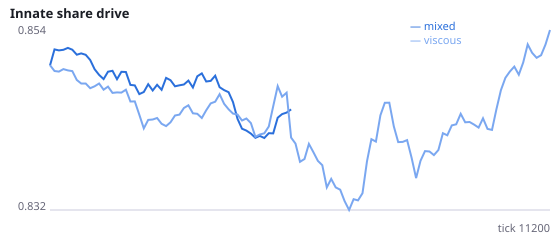
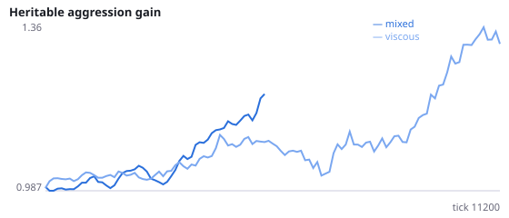
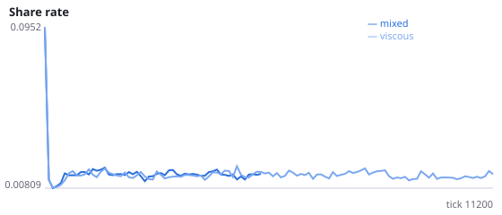
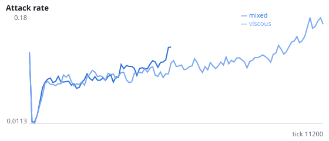
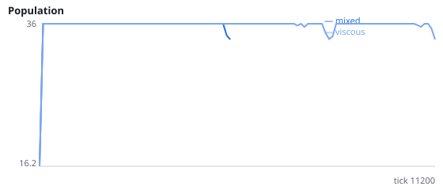
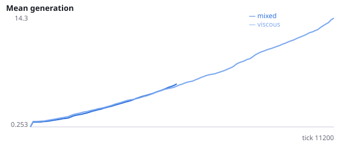

# What differs between well-mixed and viscous populations before well-mixed ones collapse?

**Question.** F and F2 found that well-mixed populations die out sooner, but their population sizes were not more volatile before collapse. In the first 6000 ticks, before any population has died out, do well-mixed populations differ in birth rate, death rate, cause of death (killed, starved, old age) or offspring success?

F2 (seeds 100-115): extinctions 13/16 vs 7/16; the earliest extinction was at tick 7332; population CV over ticks 0-6000 was 0.073 in both conditions. All metrics here are measured over ticks 0-6000 only, so they precede the collapse. Offspring success is the fraction of agents born before tick 4500 that reproduced at least once before tick 6000. Seeds 500-515 have never been run.

NeuralMind 0.2.0 · 2026-10-15 23:23 · mean [95% bootstrap CI] over seeds; paired differences use the same seeds.

**Pre-registration:** spec `studies/L_collapse_demography.json` at commit `a2ce17cd384397a72a1b01234920dceef6a18597` (2026-10-15T22:10:35+07:00) · unchanged since commit: **True** · preregistered: **True**

## Hypotheses

| id | statement | test (a − b) | result |
|---|---|---|---|
| H21a | Before collapse, well-mixed populations have a lower birth rate per agent-tick | -0.0008979 [-0.001489, -0.0002559] | **supported** |
| H21b | Before collapse, a larger fraction of well-mixed deaths are killings | -0.08265 [-0.1333, -0.034] | **not supported** |
| H21c | Before collapse, a larger fraction of well-mixed deaths are starvation | 0.065 [0.03149, 0.09836] | **supported** |
| H21d | Before collapse, fewer well-mixed offspring go on to reproduce | 0.04637 [0.03365, 0.06006] | **not supported** |
| H14b3 | Third test: well-mixed populations die out sooner | -3916 [-6379, -1490] | **supported** |

## Conditions

| condition | innate_foraging | share_gene | aggr_gene | share_rate | attack_rate | signal_rate | share_given_encounter | encounter_rate | drift_social_minus_loco | final_pop | max_generation |
|---|---|---|---|---|---|---|---|---|---|---|---|
| mixed | 6.475 [4.375, 8.525] | 0.8609 [0.7995, 0.9248] | 2.671 [1.463, 4.019] | 0.01365 [0.01167, 0.01568] | 0.3171 [0.2262, 0.4045] | 0.01821 [0.01314, 0.02417] | 0.0135 [0.01156, 0.0154] | 0.4145 [0.3759, 0.4468] | 0.009857 [-0.002157, 0.02376] | 9.812 [3.062, 17.88] | 14 [2.562, 31.38] |
| viscous | 8 [6.205, 9.841] | 0.8674 [0.84, 0.8972] | 1.668 [1.226, 2.09] | 0.01798 [0.01534, 0.02123] | 0.2473 [0.1926, 0.3027] | 0.0214 [0.01688, 0.02766] | 0.01958 [0.01697, 0.02259] | 0.4945 [0.4917, 0.4974] | 0.01622 [0.009211, 0.02532] | 24.75 [15.75, 31.5] | 22.94 [13.56, 32.94] |

     

Full per-metric summaries and raw per-run data: `results.json`.