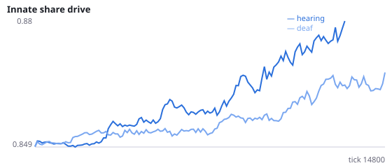
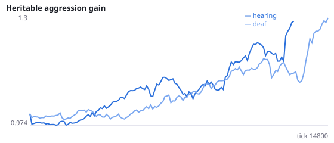
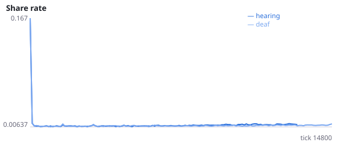
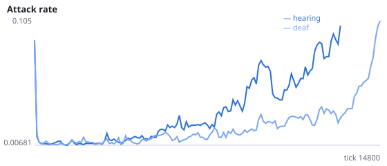
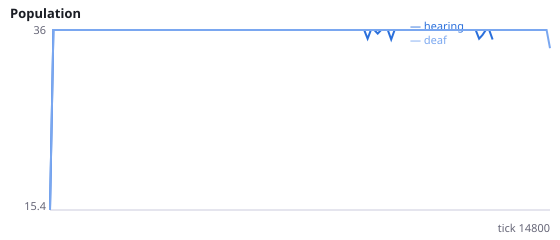
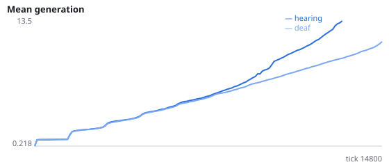

# Do signals evolve meaning when someone can hear them?

**Question.** Over ~18000 ticks of evolution with learning off, does the signal action come to carry information about the signaller's state (food in view, threat in view, hunger) more when receivers can hear it than when every agent is deaf?

Exploratory data from C2, E and G: MI(signal; own food/threat/hunger sensors) <= 0.002 bits in every condition. Experiments I and J showed that learning raises signalling as a side effect, so learning is off here and only selection can shape signalling. In the deaf control the heard-signal sensor always reads 0, so a signal cannot affect anyone and there is no selection for it to carry information. Referential signalling has been reported in evolved spiking-network swarms with cooperative tasks (arXiv 2212.08484); this world rewards no cooperation. MI is measured in bits over the final quarter of the run, from 2x2 tables of signal (yes/no) against each binarised sensor. Viscous populations (relatives nearby) are used because kin structure favours honest signals. Seeds 700-711 have never been run.

NeuralMind 0.2.0 · 2026-10-16 00:44 · mean [95% bootstrap CI] over seeds; paired differences use the same seeds.

**Pre-registration:** spec `studies/M_signal_meaning.json` at commit `6fe6eb66c60bda65f8e822a045170f310e60d18a` (2026-10-15T22:13:53+07:00) · unchanged since commit: **True** · preregistered: **True**

## Hypotheses

| id | statement | test (a − b) | result |
|---|---|---|---|
| H23a | Signals carry more information about food in view when they can be heard | -4.953e-05 [-0.0001533, 4.25e-05] | **not supported** |
| H23b | Signals carry more information about threat in view when they can be heard | -0.0001572 [-0.0003429, -1.151e-05] | **not supported** |
| H23c | Signals carry more information about hunger when they can be heard | 0.0001519 [-0.0005798, 0.001056] | **not supported** |
| H23d | With hearing, signals carry at least 0.01 bits about food in view | -0.00978 [-0.00985, -0.009705] | **not supported** |
| H23e | Signalling rate is no different when signals can be heard | 0.000114 [-0.001766, 0.002204] | **no difference detected** |

## Conditions

| condition | innate_foraging | share_gene | aggr_gene | share_rate | attack_rate | signal_rate | share_given_encounter | encounter_rate | drift_social_minus_loco | final_pop | max_generation |
|---|---|---|---|---|---|---|---|---|---|---|---|
| hearing | 11.51 [8.562, 14.05] | 0.8787 [0.8617, 0.8987] | 1.412 [0.9689, 2.179] | 0.0104 [0.008366, 0.01283] | 0.1201 [0.0351, 0.2228] | 0.01085 [0.009133, 0.01271] | 0.01152 [0.008582, 0.01491] | 0.4863 [0.4796, 0.4936] | 0 [0, 0] | 29.58 [21, 36] | 19.33 [9.667, 34.09] |
| deaf | 10.9 [8.588, 13.03] | 0.8818 [0.8639, 0.9063] | 1.324 [1.068, 1.623] | 0.009947 [0.008809, 0.01135] | 0.08796 [0.03872, 0.1448] | 0.01058 [0.009147, 0.01233] | 0.01044 [0.00887, 0.01244] | 0.4833 [0.4795, 0.4872] | 0 [0, 0] | 30 [21, 36] | 13.5 [9.083, 18.5] |

     

Full per-metric summaries and raw per-run data: `results.json`.