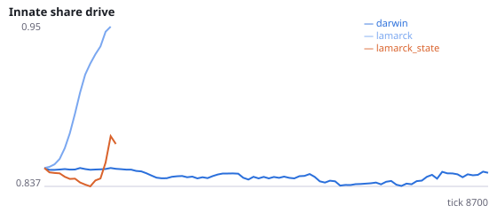
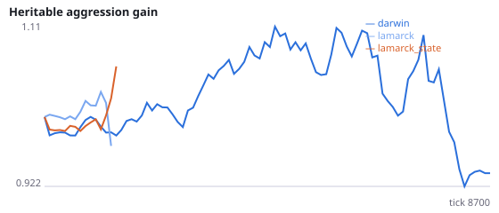
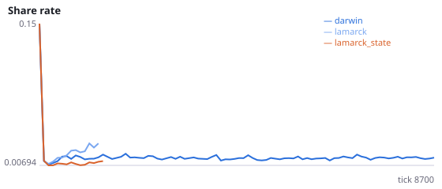
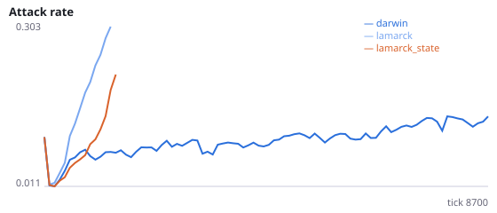
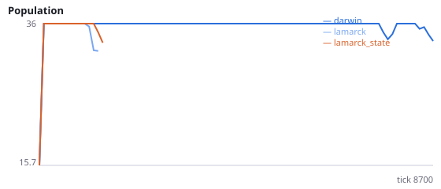
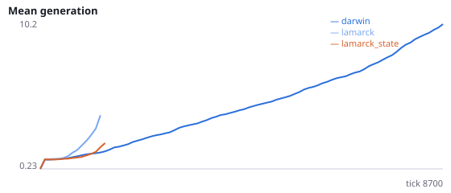

# Does Lamarckian inheritance compound the learning bias across generations?

**Question.** In Experiment N (not pre-registered as a hypothesis), Lamarckian populations attacked 2-3x more and went extinct in 9/16 runs vs 2/16 Darwinian. Inheriting learned weights may pass on the locomotion weakening found in I-K, so it accumulates over generations. Does that replicate on fresh seeds, and does a stimulus-specific critic (which should remove the bias) prevent it?

share_gene is the inborn mean weight into 'share' divided by the inborn mean weight into locomotion; a rise means inherited wiring shifts toward social actions. The state critic is the intervention from Experiment R (critic='state'). Static world, viscous. Seeds 1300-1311 have never been run.

NeuralMind 0.2.0 · 2026-10-16 03:29 · mean [95% bootstrap CI] over seeds; paired differences use the same seeds.

**Pre-registration:** spec `studies/N2_lamarck_bias_compounding.json` at commit `f5bde9b1bffaa0e31ccc17395de10844d896fd7c` (2026-10-16T00:00:45+07:00) · unchanged since commit: **True** · preregistered: **True**

## Hypotheses

| id | statement | test (a − b) | result |
|---|---|---|---|
| H28a | Lamarckian populations die out sooner | -5685 [-8043, -3039] | **supported** |
| H28b | Lamarckian populations go extinct more often | 0.6667 [0.25, 1] | **supported** |
| H28c | Inherited wiring shifts toward social actions under Lamarckian inheritance | 0.1425 [0.07163, 0.2134] | **supported** |
| H28d | A state critic lets Lamarckian populations survive longer | 910.8 [-1970, 3888] | **not supported** |
| H28e | A state critic reduces the inherited shift toward social actions | nan [nan, nan] | **no data** |

## Conditions

| condition | innate_foraging | share_gene | aggr_gene | share_rate | attack_rate | signal_rate | share_given_encounter | encounter_rate | drift_social_minus_loco | invader_share | final_pop | max_generation |
|---|---|---|---|---|---|---|---|---|---|---|---|---|
| darwin | 8.034 [6.125, 9.978] | 0.8343 [0.8188, 0.8496] | 1.048 [0.7518, 1.4] | 0.01531 [0.01365, 0.01711] | 0.1525 [0.1063, 0.2144] | 0.02454 [0.01964, 0.03007] | 0.01571 [0.01413, 0.01734] | 0.4921 [0.4893, 0.495] | 0.02633 [0.01656, 0.03628] | nan [nan, nan] | 33 [27, 36] | 15.92 [10.58, 22.17] |
| lamarck | 5.542 [3.375, 6.625] | 0.937 [0.883, 0.9987] | 1.932 [0.8691, 2.976] | 0.02701 [0.02323, 0.02993] | 0.4118 [0.4004, 0.4272] | 0.01888 [0.01246, 0.02214] | 0.02797 [0.02415, 0.03068] | 0.5057 [0.5006, 0.512] | -0.004519 [-0.00746, -0.002308] | nan [nan, nan] | 9 [0, 18] | 17.42 [0, 35] |
| lamarck_state | 15.92 [14.25, 17.38] | 0.7356 [0.695, 0.7995] | 1.316 [1.005, 1.876] | 0.0129 [0.008264, 0.01754] | 0.1491 [0.01452, 0.4138] | 0.009097 [0.008525, 0.009454] | 0.01319 [0.008405, 0.01797] | 0.4752 [0.4671, 0.4805] | 0.004609 [-0.003024, 0.01353] | nan [nan, nan] | 9 [0, 18] | 3.75 [0, 9] |

     

Full per-metric summaries and raw per-run data: `results.json`.