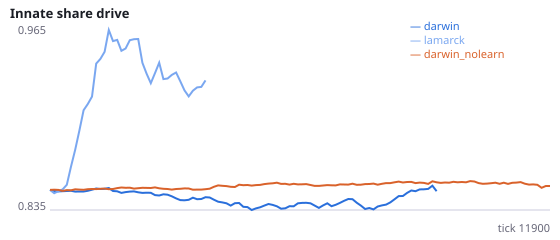
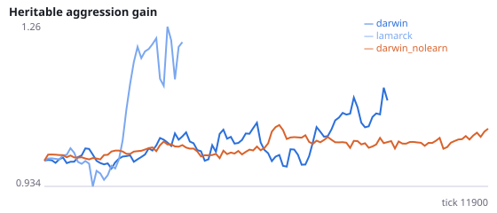
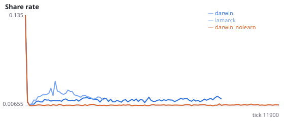
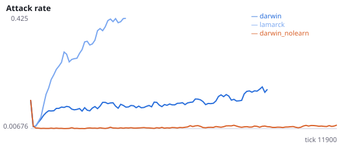
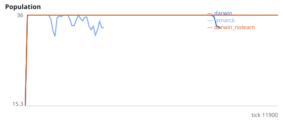
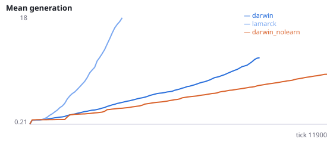

# Repeated environment shifts: does learning buffer them, and does Lamarckian inheritance cope worse?

**Question.** Experiment N's single mirror shift was measured too late to show any effect. Here left/right sensing flips every 2000 ticks, and foraging is measured in the 500 ticks just after each flip versus the 500 ticks just before it. Does lifetime learning shrink the post-flip drop, and do Lamarckian populations suffer a larger drop than Darwinian ones (Sasaki & Tokoro 1999)?

shift_drop = food per agent-tick in the last quarter before each flip minus the first quarter after it, averaged over the 5 flips in 12000 ticks (sampled every 100 ticks). N (not pre-registered) suggested Lamarckian populations go extinct more often; extinct runs give no shift_drop, so tests rest on survivors. Seeds 1500-1511 have never been run.

NeuralMind 0.2.0 · 2026-10-16 05:52 · mean [95% bootstrap CI] over seeds; paired differences use the same seeds.

**Pre-registration:** spec `studies/N3_repeated_shifts.json` at commit `2663ed3604b40d675e3d36f637309fdd1bc833c3` (2026-10-16T01:35:03+07:00) · unchanged since commit: **True** · preregistered: **True**

## Hypotheses

| id | statement | test (a − b) | result |
|---|---|---|---|
| H30a | Manipulation check: foraging drops after each flip (Darwinian, learning) | 0.0004473 [-0.0007881, 0.001832] | **not supported** |
| H30b | Manipulation check: foraging drops after each flip (no learning) | -0.001437 [-0.002156, -0.0005739] | **not supported** |
| H30c | Lifetime learning shrinks the post-flip drop | 0.001884 [0.0006027, 0.003387] | **not supported** |
| H30d | Lamarckian populations suffer a larger post-flip drop | 0.000833 [-0.001513, 0.002941] | **not supported** |
| H30e | Lamarckian populations die out sooner under repeated shifts | -2083 [-3956, -349.2] | **supported** |

## Conditions

| condition | innate_foraging | share_gene | aggr_gene | share_rate | attack_rate | signal_rate | share_given_encounter | encounter_rate | drift_social_minus_loco | invader_share | final_pop | max_generation |
|---|---|---|---|---|---|---|---|---|---|---|---|---|
| darwin | 7.725 [5.862, 9.588] | 0.8451 [0.8235, 0.8674] | 1.003 [0.7697, 1.241] | 0.01765 [0.01394, 0.02292] | 0.1481 [0.1037, 0.204] | 0.02368 [0.01978, 0.02748] | 0.02115 [0.01434, 0.03244] | 0.4651 [0.4055, 0.4974] | 0.03172 [0.01997, 0.04252] | nan [nan, nan] | 30 [21, 36] | 11.92 [8.417, 14.75] |
| lamarck | 7.304 [5.714, 8.75] | 0.9086 [0.8844, 0.9364] | 2.242 [1.327, 3.144] | 0.01705 [0.01429, 0.01973] | 0.394 [0.3408, 0.4325] | 0.02628 [0.01474, 0.04285] | 0.01909 [0.01653, 0.02154] | 0.5048 [0.4991, 0.5113] | -0.002504 [-0.007847, 0.002697] | nan [nan, nan] | 21 [12, 30] | 45.67 [23.91, 67.25] |
| darwin_nolearn | 11.96 [10.86, 13.07] | 0.8515 [0.8448, 0.8588] | 1.048 [0.9763, 1.128] | 0.008013 [0.007788, 0.008277] | 0.0151 [0.0127, 0.01769] | 0.007729 [0.007461, 0.007988] | 0.007846 [0.007554, 0.008157] | 0.4873 [0.4819, 0.4931] | 0 [0, 0] | nan [nan, nan] | 36 [36, 36] | 9.667 [9.25, 10.08] |

     

Full per-metric summaries and raw per-run data: `results.json`.