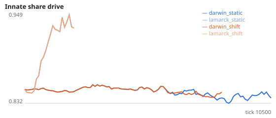
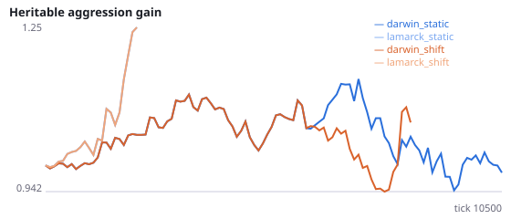
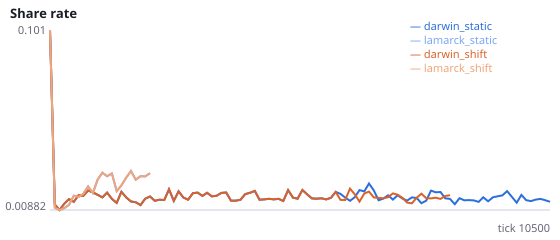
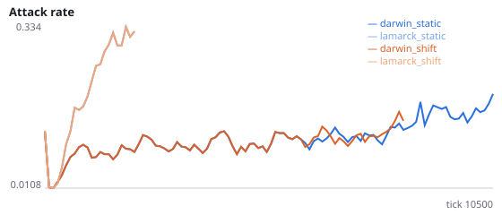
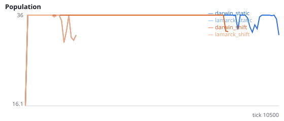
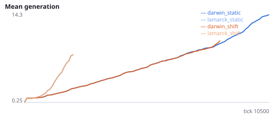

# Lamarckian vs Darwinian inheritance of learned weights, in a static and a shifting world

**Question.** If offspring inherit their parent's learned weights (Lamarckian) rather than its inborn ones (Darwinian), do populations forage better in a static world and worse after the environment changes?

Sasaki & Tokoro (1997, 2000) report, with neural networks and genetic algorithms, that Lamarckian inheritance adapts faster in static environments but is less robust when the environment changes. Experiment E found a hiding effect under Darwinian inheritance. Shift: from tick 6000, left and right sensor bins are swapped (food, hazards, other agents), so wiring that turned toward food now turns away from it. Innate foraging is assayed with learning off, in the environment the population ended in. food_rate is food eaten per agent-tick in the final quarter of the run, with learning on. Seeds 600-607 have never been run.

NeuralMind 0.2.0 · 2026-10-15 23:59 · mean [95% bootstrap CI] over seeds; paired differences use the same seeds.

**Pre-registration:** spec `studies/N_lamarck_vs_darwin_shift.json` at commit `3af222854343f47c0d5630081b0d0800cfa37ead` (2026-10-15T22:12:54+07:00) · unchanged since commit: **True** · preregistered: **True**

## Hypotheses

| id | statement | test (a − b) | result |
|---|---|---|---|
| H22a | Static world: Lamarckian populations have higher innate foraging | 0.375 [-2.75, 4.25] | **not supported** |
| H22b | Static world: Lamarckian populations forage more (with learning) | -0.005726 [-0.01191, 0.0003371] | **not supported** |
| H22c | After the shift: Darwinian populations have higher innate foraging | 2.833 [0.25, 7.125] | **supported** |
| H22d | After the shift: Darwinian populations forage more (with learning) | 0.004684 [-0.001714, 0.01146] | **not supported** |
| H22e | Manipulation check: the shift lowers Darwinian foraging | 0.002183 [-0.002227, 0.00576] | **not supported** |

## Conditions

| condition | innate_foraging | share_gene | aggr_gene | share_rate | attack_rate | signal_rate | share_given_encounter | encounter_rate | drift_social_minus_loco | final_pop | max_generation |
|---|---|---|---|---|---|---|---|---|---|---|---|
| darwin_static | 5.857 [3.839, 8.161] | 0.8427 [0.8213, 0.8677] | 1.193 [0.8431, 1.521] | 0.01502 [0.01363, 0.01659] | 0.1797 [0.1109, 0.2475] | 0.02051 [0.0162, 0.02583] | 0.01586 [0.01469, 0.01705] | 0.4953 [0.4871, 0.5039] | 0.01649 [0.009865, 0.02302] | 31.5 [22.5, 36] | 15.25 [10.38, 19.38] |
| lamarck_static | 4.667 [2.25, 7.875] | 0.9533 [0.8808, 1.075] | 2.896 [1.444, 4.28] | 0.02131 [0.01199, 0.03528] | 0.4325 [0.4156, 0.4468] | 0.02109 [0.01507, 0.02873] | 0.02287 [0.01393, 0.03598] | 0.5067 [0.5027, 0.5103] | -0.00446 [-0.007645, -0.001535] | 13.5 [4.5, 27] | 29 [8.125, 56.38] |
| darwin_shift | 9.161 [6.536, 12.21] | 0.8666 [0.8366, 0.9009] | 1.113 [0.7997, 1.431] | 0.01468 [0.01317, 0.0161] | 0.1537 [0.09551, 0.219] | 0.01761 [0.01518, 0.0201] | 0.01566 [0.01399, 0.0175] | 0.4895 [0.4843, 0.4952] | 0.02177 [0.00669, 0.03561] | 29.62 [20.62, 36] | 16.12 [8.875, 24.5] |
| lamarck_shift | 8.781 [6.25, 11.53] | 0.9078 [0.8797, 0.9359] | 2.032 [0.9668, 2.732] | 0.02101 [0.01593, 0.02642] | 0.3468 [0.2229, 0.4344] | 0.03267 [0.01809, 0.04829] | 0.02236 [0.0171, 0.02793] | 0.4936 [0.4859, 0.5006] | 0.002804 [-0.000529, 0.008482] | 18 [4.5, 31.5] | 39.62 [11.62, 66.38] |

     

Full per-metric summaries and raw per-run data: `results.json`.