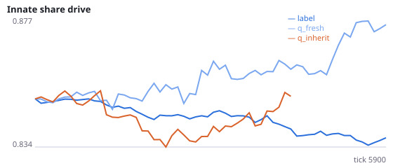
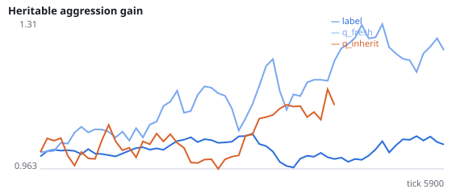
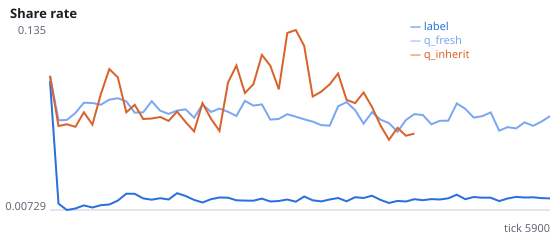
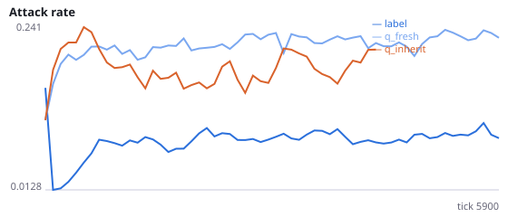
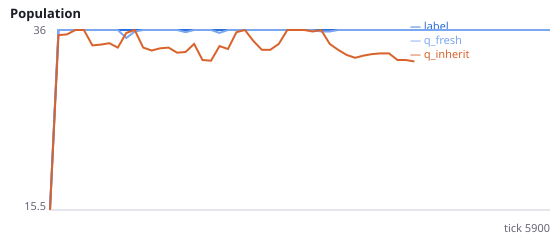
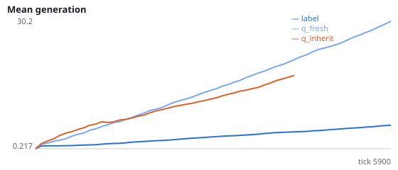
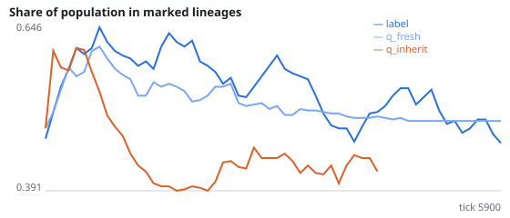

# Can tabular Q-learners invade an evolving population of spiking agents?

**Question.** Six of twelve founders, and all their descendants, are driven by tabular Q-learners instead of their spiking networks; bodies, sensors, actions, rewards and reproduction rules are identical. Do Q-learner lineages take over the population, and does it matter whether a newborn inherits its parent's Q-table or starts from zero?

Controllers: see neuralmind/research/invasion.py (2048 binarised sensor states, epsilon 0.05, alpha 0.1, gamma 0.9). The 'label' condition marks the same six founder lineages but leaves them SNN-driven, which measures neutral drift of lineage share. An engineering pilot on one unregistered seed (9999, 2000 ticks) showed q_inherit lineages reaching 100% and q_fresh lineages falling to ~3%; these predictions were written after that pilot. The primary metric is the mean share of the population in marked lineages over the whole run (invader_share_mean), which is robust to when fixation happens. Seeds 800-811 have never been run.

NeuralMind 0.2.0 · 2026-10-16 01:06 · mean [95% bootstrap CI] over seeds; paired differences use the same seeds.

**Pre-registration:** spec `studies/O_rl_invasion.json` at commit `5eb649eecf77379f762e6cf6e156c07bd3318c3c` (2026-10-15T22:21:26+07:00) · unchanged since commit: **True** · preregistered: **True**

## Hypotheses

| id | statement | test (a − b) | result |
|---|---|---|---|
| H24a | Q-learners that inherit their parent's table out-compete SNN lineages (relative to the neutral-drift control) | -0.1161 [-0.3918, 0.1591] | **not supported** |
| H24b | Q-learners that start every life from a zero table lose to SNN lineages | -0.02404 [-0.3071, 0.2663] | **not supported** |
| H24c | Inheriting the Q-table matters | -0.09209 [-0.3508, 0.1535] | **not supported** |
| H24d | Neutral-drift control: marked SNN lineages hold about half the population on average | 0.05282 [-0.04594, 0.1547] | **no difference detected** |

## Conditions

| condition | innate_foraging | share_gene | aggr_gene | share_rate | attack_rate | signal_rate | share_given_encounter | encounter_rate | drift_social_minus_loco | invader_share | final_pop | max_generation |
|---|---|---|---|---|---|---|---|---|---|---|---|---|
| label | 6.344 [4.531, 8.25] | 0.8357 [0.8238, 0.847] | 1.006 [0.8816, 1.131] | 0.01569 [0.01395, 0.01744] | 0.08969 [0.0769, 0.1038] | 0.02267 [0.01977, 0.02587] | 0.01511 [0.01375, 0.01644] | 0.4869 [0.4795, 0.494] | 0.0378 [0.02971, 0.04632] | 0.4653 [0.2569, 0.6622] | 36 [36, 36] | 6.75 [6.167, 7.417] |
| q_fresh | 5.281 [4.167, 6.542] | 0.8746 [0.8355, 0.9151] | 1.315 [1.075, 1.583] | 0.07165 [0.04267, 0.1008] | 0.2252 [0.1587, 0.2881] | 0.1059 [0.06271, 0.1493] | 0.05735 [0.03579, 0.07938] | 0.4948 [0.4891, 0.5007] | 0.01409 [0.005209, 0.02378] | 0.5 [0.25, 0.75] | 36 [36, 36] | 33.42 [20.75, 45.84] |
| q_inherit | 7.341 [5.42, 9.171] | 0.8522 [0.8354, 0.871] | 1.532 [1.018, 2.121] | 0.04023 [0.02087, 0.06159] | 0.1625 [0.1111, 0.2179] | 0.07699 [0.03957, 0.1211] | 0.0334 [0.01922, 0.04954] | 0.5057 [0.4861, 0.5286] | 0.02089 [0.009127, 0.03464] | 0.2803 [0.01263, 0.553] | 32.58 [26.58, 36] | 22.67 [11.92, 35.5] |

      

Full per-metric summaries and raw per-run data: `results.json`.