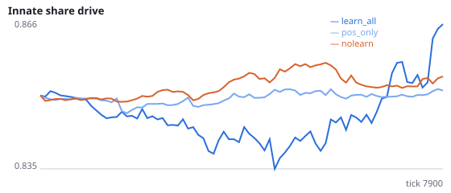
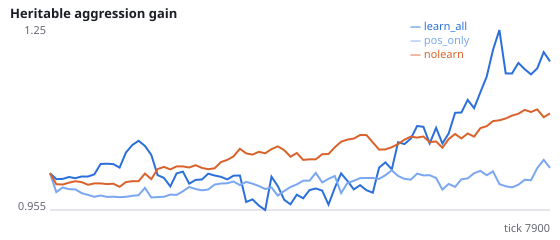
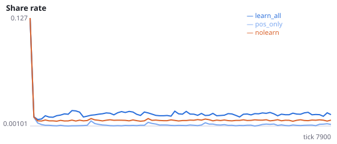
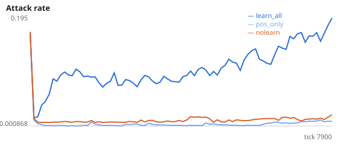
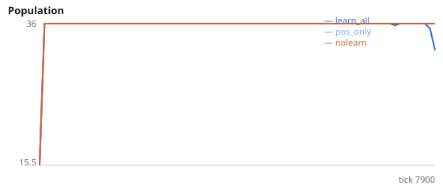
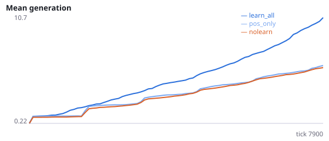

# Do negative reward-prediction errors drive the learned rise in social actions?

**Question.** An exploratory probe (FINDINGS_K, seeds 900-902) found that ~58% of learning updates carry a negative RPE and that locomotion, which fires ~8x more than social populations, absorbs most of the resulting depression. If negative RPEs are ignored (only positive RPEs change weights), does the learning-induced rise in attacking, signalling and sharing disappear, and do locomotion weights now grow more than social ones?

Experiments I-K: the rise in social behaviour under learning comes from a fall in total locomotion drive. Intervention: positive_rpe_only=true skips every weight update whose RPE is negative. Prediction from the candidate mechanism: activity-weighted potentiation now favours the most active pathways (locomotion), so social actions win less often than without learning or no more often. Seeds 1000-1007 have never been run.

NeuralMind 0.2.0 · 2026-10-16 01:29 · mean [95% bootstrap CI] over seeds; paired differences use the same seeds.

**Pre-registration:** spec `studies/P_positive_rpe_only.json` at commit `8a64dca8334f454226334b6f5cd0d12f027c109b` (2026-10-15T22:36:22+07:00) · unchanged since commit: **True** · preregistered: **True**

## Hypotheses

| id | statement | test (a − b) | result |
|---|---|---|---|
| H25a | Ignoring negative RPEs lowers the attack rate | 0.1446 [0.1013, 0.2063] | **supported** |
| H25b | Ignoring negative RPEs lowers signalling | 0.02478 [0.01789, 0.03284] | **supported** |
| H25c | Ignoring negative RPEs lowers sharing given a neighbour in reach | 0.01316 [0.01119, 0.01492] | **supported** |
| H25d | With positive RPEs only, locomotion inputs grow more than social inputs | -0.7142 [-0.7515, -0.6717] | **supported** |
| H25e | With positive RPEs only, learning does not raise the attack rate above no-learning | -0.006597 [-0.0153, 0.002708] | **no difference detected** |

## Conditions

| condition | innate_foraging | share_gene | aggr_gene | share_rate | attack_rate | signal_rate | share_given_encounter | encounter_rate | drift_social_minus_loco | invader_share | final_pop | max_generation |
|---|---|---|---|---|---|---|---|---|---|---|---|---|
| learn_all | 8.141 [5.453, 10.84] | 0.8657 [0.8403, 0.8924] | 1.122 [0.9549, 1.284] | 0.015 [0.01336, 0.01654] | 0.1526 [0.1098, 0.2161] | 0.02721 [0.02037, 0.03531] | 0.01557 [0.01379, 0.01727] | 0.4945 [0.4878, 0.5013] | 0.01999 [0.01116, 0.02963] | nan [nan, nan] | 33.62 [28.88, 36] | 12.25 [9.375, 17] |
| pos_only | 9.844 [7.405, 12.17] | 0.8514 [0.8416, 0.8602] | 1.039 [0.9775, 1.115] | 0.002352 [0.002132, 0.002575] | 0.00801 [0.00334, 0.01375] | 0.002427 [0.002278, 0.002571] | 0.002409 [0.00208, 0.002707] | 0.493 [0.4877, 0.4977] | -0.7142 [-0.7515, -0.6717] | nan [nan, nan] | 36 [36, 36] | 6.75 [6.5, 7] |
| nolearn | 11.66 [10.64, 12.59] | 0.855 [0.8511, 0.8587] | 1.128 [1.064, 1.196] | 0.007665 [0.007443, 0.007898] | 0.01461 [0.01022, 0.0193] | 0.007918 [0.007632, 0.008236] | 0.007911 [0.007536, 0.008323] | 0.4806 [0.4762, 0.4849] | 0 [0, 0] | nan [nan, nan] | 36 [36, 36] | 6.125 [6, 6.375] |

     

Full per-metric summaries and raw per-run data: `results.json`.