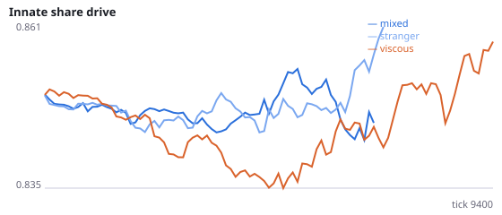
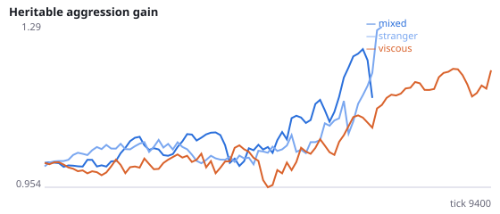
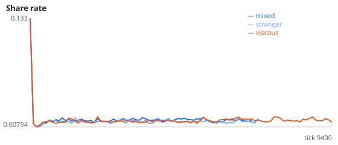
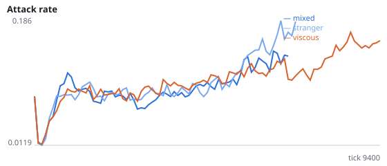
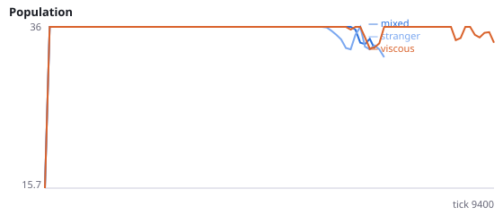
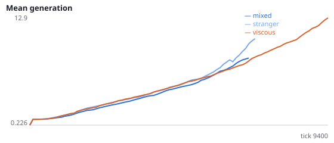

# Who kills newborns, and does it explain why viscosity protects populations?

**Question.** Q found (not pre-registered) that populations whose newborns were placed beside a non-relative went extinct in 11/12 runs, against 3/12 when newborns were placed beside their parent. Is that because non-relatives kill newborns? This study logs every killing in the first 6000 ticks: whether the killer is a relative, whether it is the victim's parent, and whether the victim is young (age < 150 ticks).

A pilot on unregistered seed 9997 (3000 ticks, one run per placement) leaned against the stranger-attack idea: 62% (stranger) and 74% (viscous) of kills hit young agents, who made up 33% and 28% of agent-ticks; 59% of kills in the viscous run were of relatives. H31b is the mechanism Q suggested and is registered in that direction even though the pilot does not favour it. early_young_kill_excess = share of kills with a young victim minus the share of agent-ticks spent young. Seeds 1600-1611 have never been run.

NeuralMind 0.2.0 · 2026-10-16 06:45 · mean [95% bootstrap CI] over seeds; paired differences use the same seeds.

**Pre-registration:** spec `studies/Q2_who_kills_newborns.json` at commit `fdf4cc325ee1d36464215d9c4a6a62e30ac7313c` (2026-10-16T02:41:21+07:00) · unchanged since commit: **True** · preregistered: **True**

## Hypotheses

| id | statement | test (a − b) | result |
|---|---|---|---|
| H31a | Young agents are killed more often than their share of the population (viscous) | 0.3816 [0.363, 0.4007] | **supported** |
| H31a2 | Young agents are killed more often than their share of the population (stranger) | 0.2216 [0.2082, 0.2342] | **supported** |
| H31b | Newborns placed beside a stranger are killed more (excess young kills higher than when placed beside the parent) | -0.16 [-0.1795, -0.1419] | **not supported** |
| H31c | Replication of Q (post hoc there): populations whose newborns sit beside a stranger die out sooner than viscous ones | -4410 [-6605, -1900] | **supported** |
| H31d | In viscous populations, parents kill their own offspring in at least 10% of killings | 0.3189 [0.2908, 0.3379] | **supported** |

## Conditions

| condition | innate_foraging | share_gene | aggr_gene | share_rate | attack_rate | signal_rate | share_given_encounter | encounter_rate | drift_social_minus_loco | invader_share | final_pop | max_generation |
|---|---|---|---|---|---|---|---|---|---|---|---|---|
| mixed | 5.125 [2.875, 7.375] | 0.8642 [0.8469, 0.8814] | 2.202 [1.5, 2.904] | 0.01466 [0.01342, 0.01564] | 0.3084 [0.2034, 0.4002] | 0.0171 [0.01373, 0.02251] | 0.0141 [0.01336, 0.01474] | 0.4056 [0.3793, 0.4483] | 0.009505 [0.005683, 0.01333] | nan [nan, nan] | 5.75 [0, 14.26] | 5.917 [0, 15] |
| stranger | nan [nan, nan] | nan [nan, nan] | nan [nan, nan] | 0.01643 [0.01426, 0.0186] | 0.2408 [0.2228, 0.2588] | 0.01771 [0.01119, 0.02424] | 0.0175 [0.01443, 0.02057] | 0.4477 [0.4348, 0.4607] | nan [nan, nan] | nan [nan, nan] | 0 [0, 0] | 0 [0, 0] |
| viscous | 7 [4.542, 9.854] | 0.8783 [0.8529, 0.9011] | 1.543 [0.9524, 2.237] | 0.01502 [0.01263, 0.0179] | 0.2811 [0.214, 0.3552] | 0.02294 [0.01816, 0.02899] | 0.01652 [0.01383, 0.01971] | 0.4748 [0.4344, 0.5013] | 0.002911 [-0.0004627, 0.006581] | nan [nan, nan] | 17.92 [8.833, 27] | 15.33 [6.333, 25.09] |

     

Full per-metric summaries and raw per-run data: `results.json`.