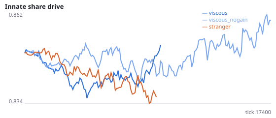
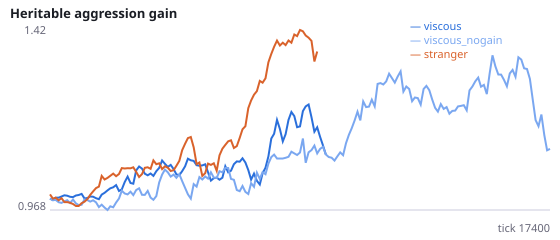
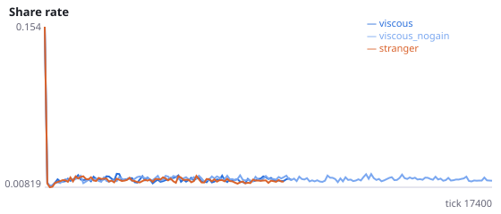
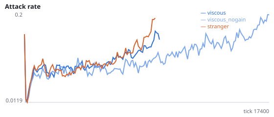
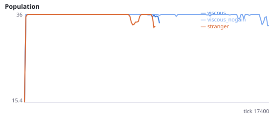
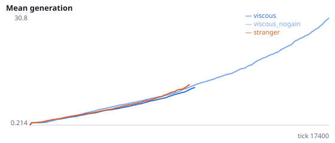

# Do viscous populations persist because parents recycle energy by killing their offspring?

**Question.** In Q2, 42% of killings in viscous populations were parents killing their own offspring, and viscous populations still survived longest (6/12 extinct vs 12/12 when newborns were placed beside a stranger). An attack transfers the victim's energy to the attacker, so a parent recovers part of its reproductive investment. If that recycling explains persistence, removing the energy gain from attacks on one's own offspring (the offspring still loses the energy) should make viscous populations die out sooner.

Intervention: no_filial_gain=True gives the attacker no energy and no reward from an attack on its own offspring; all other attacks are unchanged. Q2 (ticks 0-6000, viscous): early birth rate 0.0039 vs 0.0030 stranger. The stranger condition is a reference only; no hypothesis uses it except as context. No pilot was run. Seeds 1800-1811 have never been run.

NeuralMind 0.2.0 · 2026-10-16 08:18 · mean [95% bootstrap CI] over seeds; paired differences use the same seeds.

**Pre-registration:** spec `studies/Q3_filial_energy_recycling.json` at commit `fd869280505b161695aaf4241c8f332b351243f0` (2026-10-16T06:46:59+07:00) · unchanged since commit: **True** · preregistered: **True**

## Hypotheses

| id | statement | test (a − b) | result |
|---|---|---|---|
| H33a | Without energy from killing own offspring, viscous populations die out sooner | 1162 [-18.25, 2734] | **not supported** |
| H33b | Without energy from killing own offspring, viscous populations go extinct more often | -0.25 [-0.5833, 0.08333] | **not supported** |
| H33c | Without energy from killing own offspring, the early birth rate falls | -0.0006502 [-0.001016, -0.0003217] | **supported** |
| H33d | Manipulation check: parents still kill their offspring in at least 10% of killings when it yields no energy | 0.1445 [0.1284, 0.1577] | **supported** |

## Conditions

| condition | innate_foraging | share_gene | aggr_gene | share_rate | attack_rate | signal_rate | share_given_encounter | encounter_rate | drift_social_minus_loco | invader_share | final_pop | max_generation |
|---|---|---|---|---|---|---|---|---|---|---|---|---|
| viscous | 9.375 [7.016, 11.58] | 0.8598 [0.8141, 0.9057] | 1.841 [1.205, 2.51] | 0.01768 [0.01403, 0.02136] | 0.2297 [0.1377, 0.3251] | 0.02382 [0.0159, 0.0354] | 0.01883 [0.0149, 0.02277] | 0.4938 [0.4868, 0.5011] | 0.02086 [0.009387, 0.03211] | nan [nan, nan] | 24 [15, 33] | 28.92 [10.58, 50.25] |
| viscous_nogain | 10.55 [8.045, 12.91] | 0.8641 [0.8357, 0.8979] | 1.081 [0.7733, 1.411] | 0.01531 [0.01309, 0.01752] | 0.1582 [0.117, 0.1996] | 0.02334 [0.01747, 0.03017] | 0.01559 [0.01349, 0.01784] | 0.4887 [0.4852, 0.4923] | 0.01341 [0.006668, 0.02062] | nan [nan, nan] | 32.92 [26.83, 36] | 32.17 [21, 45] |
| stranger | 9 [9, 9] | 0.8517 [0.8517, 0.8517] | 1.729 [1.729, 1.729] | 0.01225 [0.01158, 0.01292] | 0.2342 [0.1166, 0.3518] | 0.01891 [0.01407, 0.02374] | 0.01378 [0.01199, 0.01558] | 0.4711 [0.4549, 0.4872] | 0.02076 [0.02076, 0.02076] | nan [nan, nan] | 3 [0, 9] | 1.583 [0, 4.75] |

     

Full per-metric summaries and raw per-run data: `results.json`.