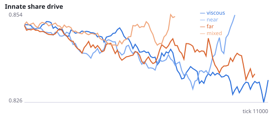
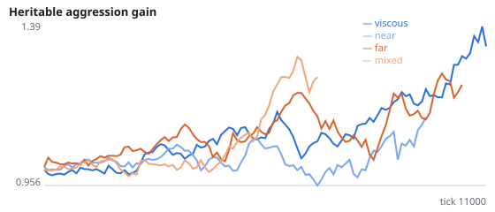
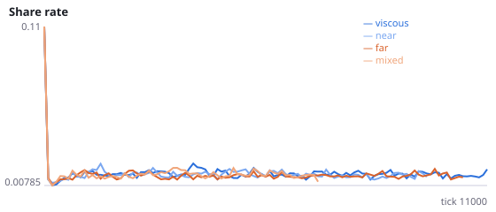
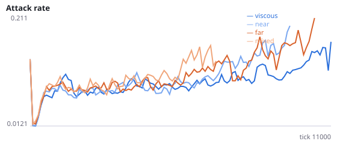
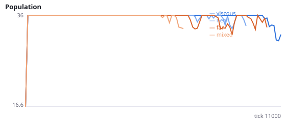
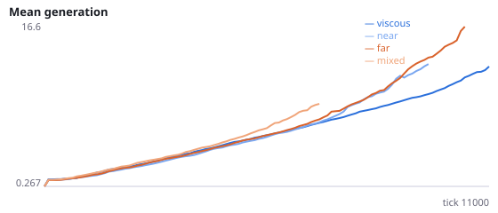

# Does viscosity protect populations because offspring stay in one place?

**Question.** Placing newborns beside their parent keeps populations alive; placing them beside a stranger kills them (pooled Q-Q3: 34/36 vs 13/36 extinct), and random placement sits in between (Q: 8/12). Local density (Q), strangers killing newborns (Q2) and parents recycling energy (Q3) have been ruled out. The remaining candidate is spatial spread: viscous lineages stay in one area, while other placements scatter newborns across the world. If spread is the cause, survival should fall as newborns are placed further from their parent, with no stranger involved.

Intervention: birth_distance=d places each newborn exactly d from its parent in a uniformly random direction, reflected at walls (so near a wall the realised distance can be shorter). The default viscous placement has a Gaussian scatter of s.d. 0.04 per axis. World width is 1.0, sensor range 0.6. Interpretation rule, fixed in advance: spread is supported as a cause if H34a and H34c are supported (far placement shortens survival, with a dose-response from near to far). If neither is supported, spread alone does not explain viscosity's protection. mixed is a reference for comparison with Q and has no hypothesis. No pilot was run. Seeds 1900-1911 have never been run.

NeuralMind 0.2.0 · 2026-10-16 21:40 · mean [95% bootstrap CI] over seeds; paired differences use the same seeds.

**Pre-registration:** spec `studies/Q4_dispersal_distance.json` at commit `cb7cba95e534edb1b57d655ef051688f98f298c5` (2026-10-16T20:06:08+07:00) · unchanged since commit: **True** · preregistered: **True**

## Hypotheses

| id | statement | test (a − b) | result |
|---|---|---|---|
| H34a | Spread: populations whose newborns are placed far (0.45) from the parent die out sooner than viscous ones | -1458 [-3378, 620.8] | **not supported** |
| H34b | Spread: far placement goes extinct more often than viscous placement | 0.4167 [0, 0.75] | **not supported** |
| H34c | Dose-response: far placement dies out sooner than near (0.15) placement | 928.2 [-1270, 3101] | **not supported** |
| H34e | Spread lowers the early birth rate (far vs viscous) | -0.0006922 [-0.001083, -0.000304] | **supported** |

## Conditions

| condition | innate_foraging | share_gene | aggr_gene | share_rate | attack_rate | signal_rate | share_given_encounter | encounter_rate | drift_social_minus_loco | invader_share | final_pop | max_generation |
|---|---|---|---|---|---|---|---|---|---|---|---|---|
| viscous | 6.6 [4.475, 9.063] | 0.8386 [0.8019, 0.8769] | 1.826 [1.254, 2.465] | 0.01329 [0.01151, 0.01524] | 0.2241 [0.1577, 0.2953] | 0.0207 [0.01741, 0.02395] | 0.01466 [0.01229, 0.01736] | 0.494 [0.4893, 0.5003] | 0.00954 [0.002059, 0.01831] | nan [nan, nan] | 27.08 [18.08, 34.83] | 28.33 [17.08, 41.75] |
| near | 8.594 [5.844, 11.06] | 0.8145 [0.8016, 0.8297] | 1.168 [0.6571, 1.586] | 0.01576 [0.01285, 0.01882] | 0.2749 [0.1937, 0.361] | 0.01662 [0.01317, 0.02102] | 0.0152 [0.0124, 0.01787] | 0.4248 [0.3941, 0.4508] | 0.01657 [0.00393, 0.034] | nan [nan, nan] | 11.67 [3, 20.67] | 9.583 [1.917, 19.17] |
| far | 7.4 [4.45, 10.45] | 0.8462 [0.8118, 0.8807] | 1.296 [0.729, 1.897] | 0.01953 [0.01352, 0.02999] | 0.2548 [0.162, 0.3563] | 0.01888 [0.01493, 0.02285] | 0.01841 [0.01323, 0.02692] | 0.4074 [0.3641, 0.4494] | 0.0131 [0.002226, 0.02634] | nan [nan, nan] | 13.17 [4.167, 22.17] | 12.5 [3, 23.83] |
| mixed | 6.042 [2.333, 9.75] | 0.871 [0.8585, 0.8834] | 2.138 [1.435, 2.841] | 0.01552 [0.01236, 0.01931] | 0.3319 [0.2255, 0.4486] | 0.03146 [0.02034, 0.04506] | 0.0164 [0.01212, 0.02251] | 0.3826 [0.3133, 0.4329] | 0.004146 [0.0003791, 0.007913] | nan [nan, nan] | 3.5 [0, 9.5] | 4.917 [0, 13] |

     

Full per-metric summaries and raw per-run data: `results.json`.