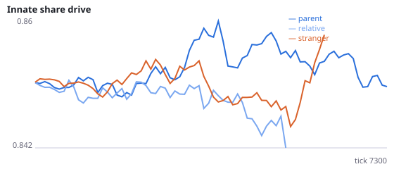
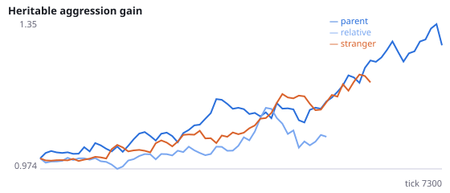
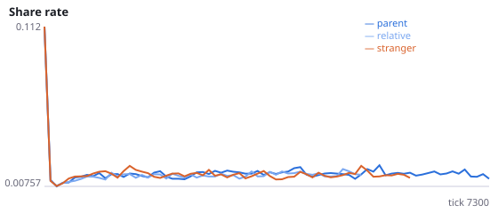
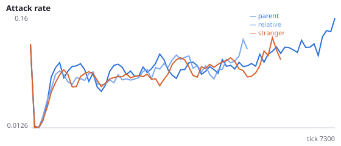
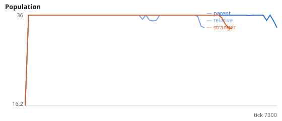
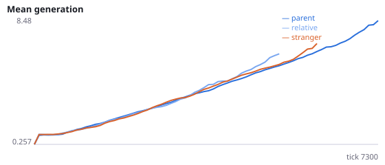

# Does it matter that a newborn starts beside its parent, or beside any relative?

**Question.** Viscous placement protects populations (4 replications). Placing newborns beside a stranger (Q-Q3, pooled 34/36 vs 13/36 extinct) or just 0.15 away from the parent (Q4, 8/12 vs 2/12) removes most of that protection. Density, killing of newborns by strangers, energy recycling and gradual spatial spread have been ruled out. What harmful placements share is that the newborn does not start beside its own parent. This study separates the parent from relatives in general by placing newborns beside a random living relative other than the parent.

Intervention: born_near_relative=True (with viscous=False) places each newborn at the viscous scatter (s.d. 0.04) around a random living agent with recorded relatedness > 0 to the parent, excluding the parent. If no such agent exists (for example a founder's first child), the newborn is placed beside the parent; birth_fallback_frac records how often. Fallbacks make the relative condition more parent-like, which biases against finding a parent-specific effect. Interpretation rule, fixed in advance: kin neighbourhood is supported if H37a or H37b is supported and neither H37c nor H37d; a parent-specific effect is supported if H37c or H37d is supported and neither H37a nor H37b; both if at least one of each pair; otherwise inconclusive. H37e is the manipulation check. No pilot was run. Seeds 2100-2111 have never been run.

NeuralMind 0.2.0 · 2026-10-16 23:21 · mean [95% bootstrap CI] over seeds; paired differences use the same seeds.

**Pre-registration:** spec `studies/Q5_parent_vs_relative.json` at commit `11f807b8baca0216f0a75b588fa0a017842401c5` (2026-10-16T21:49:48+07:00) · unchanged since commit: **True** · preregistered: **True**

## Hypotheses

| id | statement | test (a − b) | result |
|---|---|---|---|
| H37a | Kin neighbourhood: placement beside a relative survives longer than placement beside a stranger | 1425 [-809, 3713] | **not supported** |
| H37b | Kin neighbourhood: placement beside a relative goes extinct less often than beside a stranger | -0.1667 [-0.4167, 0] | **not supported** |
| H37c | Parent-specific: placement beside the parent survives longer than beside another relative | 3848 [714.5, 6844] | **supported** |
| H37d | Parent-specific: placement beside the parent goes extinct less often than beside another relative | -0.6667 [-0.9167, -0.4167] | **supported** |
| H37e | Manipulation check: fewer than half of births in the relative condition fall back to the parent | -0.4841 [-0.4879, -0.4798] | **supported** |

## Conditions

| condition | innate_foraging | share_gene | aggr_gene | share_rate | attack_rate | signal_rate | share_given_encounter | encounter_rate | drift_social_minus_loco | invader_share | final_pop | max_generation |
|---|---|---|---|---|---|---|---|---|---|---|---|---|
| parent | 8.963 [6.749, 11.29] | 0.852 [0.8148, 0.8862] | 1.972 [1.34, 2.696] | 0.01579 [0.01301, 0.01888] | 0.2283 [0.149, 0.3228] | 0.02052 [0.0168, 0.02516] | 0.01741 [0.01432, 0.02085] | 0.4955 [0.489, 0.5025] | 0.01025 [0.003621, 0.01848] | nan [nan, nan] | 30 [21, 36] | 36 [18.42, 54.92] |
| relative | 7.125 [4.75, 9.5] | 0.8724 [0.8446, 0.9001] | 1.655 [0.3226, 2.987] | 0.01476 [0.0128, 0.01697] | 0.3165 [0.1912, 0.4418] | 0.01996 [0.01423, 0.02723] | 0.0169 [0.01536, 0.01818] | 0.4605 [0.4325, 0.4875] | 0.02915 [0.01463, 0.04367] | nan [nan, nan] | 6 [0, 15] | 4 [0, 10.5] |
| stranger | nan [nan, nan] | nan [nan, nan] | nan [nan, nan] | 0.01549 [0, 0.02739] | 0.1844 [0.01786, 0.2866] | 0.04947 [0.01511, 0.08929] | 0.02371 [0.01948, 0.02794] | 0.2947 [0, 0.4472] | nan [nan, nan] | nan [nan, nan] | 0 [0, 0] | 0 [0, 0] |

     

Full per-metric summaries and raw per-run data: `results.json`.