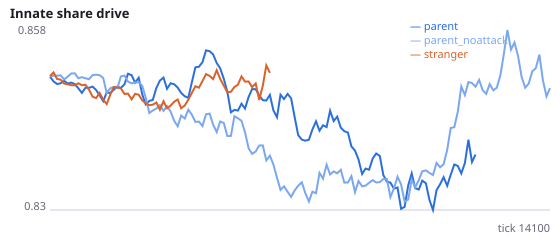
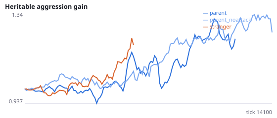
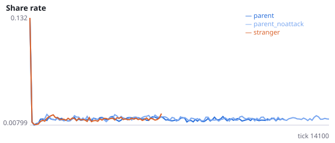
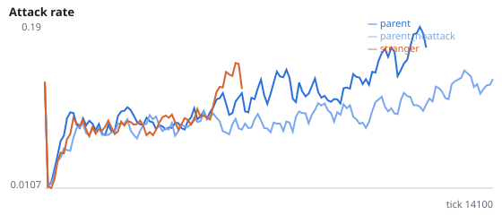
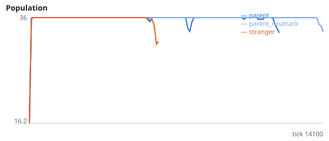
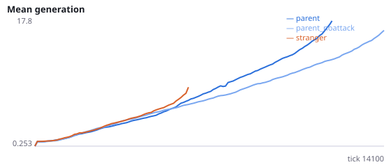

# Do parents protect their population by culling their own newborns?

**Question.** Placing newborns beside their own parent protects evolving populations, while placing them beside another relative or a stranger does not (Q5: 2/12 vs 10/12 vs 12/12 extinct). Beside the parent, 42% of killings are parents killing their own offspring. Q3 showed the energy parents gain from those kills does not explain the protection, but the killing itself still happened. If parental culling holds population growth below the level that leads to a crash, making attacks on one's own offspring ineffective should remove the protection.

Intervention: no_filial_attack=True makes an attack whose nearest target is the attacker's own offspring have no effect (the attacker still pays the attack cost; nothing is stolen and the offspring is not hurt). Placement is beside the parent in both main conditions. stranger is a reference only. Interpretation rule, fixed in advance: parental culling is supported as a mechanism if H39a or H39b is supported; if neither, the parent protects its offspring some other way. H39c tests the predicted route (larger population swings without culling). H39d is the manipulation check. No pilot was run. Seeds 2200-2211 have never been run.

NeuralMind 0.2.0 · 2026-10-17 00:42 · mean [95% bootstrap CI] over seeds; paired differences use the same seeds.

**Pre-registration:** spec `studies/Q6_parental_culling.json` at commit `f51551b9a3652eb66db8f38292f1d9df7109fd84` (2026-10-16T23:34:47+07:00) · unchanged since commit: **True** · preregistered: **True**

## Hypotheses

| id | statement | test (a − b) | result |
|---|---|---|---|
| H39a | Without effective attacks on own offspring, populations placed beside the parent die out sooner | 394.6 [-648.2, 1590] | **not supported** |
| H39b | Without effective attacks on own offspring, populations go extinct more often | -0.08333 [-0.3333, 0.1667] | **not supported** |
| H39c | Without culling, population size swings more (coefficient of variation) | -0.0308 [-0.06661, 0.002666] | **not supported** |
| H39d | Manipulation check: kills of own offspring fall below 5% of kills | -0.05 [-0.05, -0.05] | **supported** |

## Conditions

| condition | innate_foraging | share_gene | aggr_gene | share_rate | attack_rate | signal_rate | share_given_encounter | encounter_rate | drift_social_minus_loco | invader_share | final_pop | max_generation |
|---|---|---|---|---|---|---|---|---|---|---|---|---|
| parent | 7.908 [5.922, 10.07] | 0.8732 [0.8297, 0.9149] | 1.512 [1.035, 2.066] | 0.01697 [0.01374, 0.02067] | 0.2399 [0.1673, 0.3101] | 0.03422 [0.02142, 0.05318] | 0.01853 [0.01459, 0.02293] | 0.4932 [0.4879, 0.4989] | 0.01308 [0.005001, 0.02233] | nan [nan, nan] | 24.42 [15.41, 33] | 25.17 [13.75, 36.67] |
| parent_noattack | 8.95 [6.999, 11.11] | 0.8648 [0.8366, 0.9023] | 1.33 [0.8966, 1.75] | 0.01757 [0.01527, 0.02045] | 0.1549 [0.1139, 0.1993] | 0.02192 [0.01814, 0.0265] | 0.01769 [0.01527, 0.02063] | 0.4859 [0.4796, 0.4914] | 0.0137 [0.007013, 0.02094] | nan [nan, nan] | 30 [21, 36] | 21 [14, 28.67] |
| stranger | 7.188 [4.375, 10] | 0.8367 [0.7738, 0.8997] | 1.025 [0.6046, 1.446] | 0.01751 [0.01401, 0.02102] | 0.2117 [0.125, 0.3052] | 0.05126 [0.01856, 0.106] | 0.01562 [0.008622, 0.02156] | 0.3755 [0.2498, 0.4709] | 0.02719 [0.02189, 0.03248] | nan [nan, nan] | 6 [0, 15] | 3.333 [0, 8.333] |

     

Full per-metric summaries and raw per-run data: `results.json`.