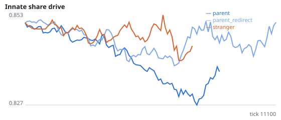
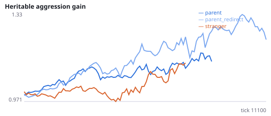
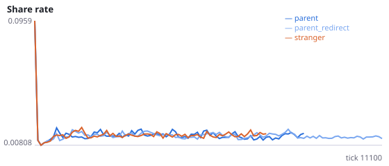
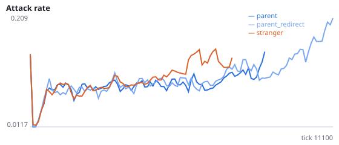
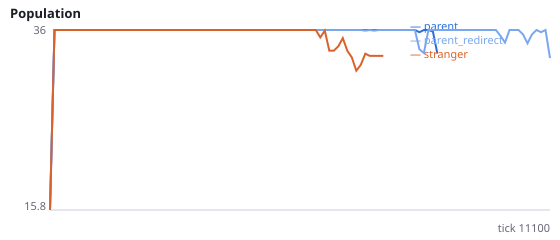
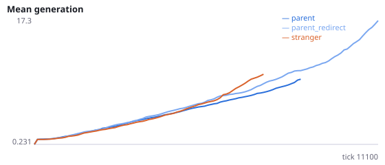

# Does a newborn beside its parent protect the population by absorbing aggression?

**Question.** Placing newborns beside their parent protects evolving populations (Q-Q6: stranger placement 56/60 extinct vs parent placement 18/60), and neither relatedness in general (Q5) nor parental culling (Q6) explains it. An attack hits the nearest agent in reach. Beside the parent, that is often the parent's own young (67% of kills are of young agents vs 54% beside strangers, Q6), so aggression may be absorbed by cheap, replaceable newborns instead of hitting established foragers. If so, redirecting attacks that would hit one's own offspring onto the nearest other agent should remove the protection.

Intervention: filial_attack_redirect=True. When the nearest target of an attack is the attacker's own offspring, the attack instead hits the nearest other agent within reach (or misses if there is none). Newborns are placed beside the parent. stranger is a reference only. Interpretation rule, fixed in advance: the aggression-sink account is supported if H41a or H41b is supported; it is not supported if neither is. H41c and H41d are manipulation checks (kills move away from young agents and own offspring). Post hoc caution from Q6: with filial attacks made ineffective, kills of young fell to 38% yet protection held, which this account explains only if attacks that hit nobody also count as absorbed. No pilot was run. Seeds 2400-2411 have never been run.

NeuralMind 0.2.0 · 2026-10-17 03:45 · mean [95% bootstrap CI] over seeds; paired differences use the same seeds.

**Pre-registration:** spec `studies/Q7_aggression_sink.json` at commit `34a394a17567f21cabacfeb2816463ba3aaa19a2` (2026-10-17T00:54:17+07:00) · unchanged since commit: **True** · preregistered: **True**

## Hypotheses

| id | statement | test (a − b) | result |
|---|---|---|---|
| H41a | With filial attacks redirected to other agents, populations beside the parent die out sooner | 611.1 [-1694, 2959] | **not supported** |
| H41b | With filial attacks redirected, populations go extinct more often | -0.08333 [-0.5, 0.3333] | **not supported** |
| H41c | Manipulation check: redirection lowers the share of kills that are of young agents | -0.2416 [-0.2746, -0.2051] | **supported** |
| H41d | Manipulation check: kills of own offspring fall below 5% of kills | -0.05 [-0.05, -0.05] | **supported** |

## Conditions

| condition | sense_gain | innate_foraging | share_gene | aggr_gene | share_rate | attack_rate | signal_rate | share_given_encounter | encounter_rate | drift_social_minus_loco | invader_share | final_pop | max_generation |
|---|---|---|---|---|---|---|---|---|---|---|---|---|---|
| parent | -0.4062 [-1.375, 0.5938] | 8.047 [6.672, 9.594] | 0.8185 [0.7885, 0.8571] | 1.3 [0.8257, 1.798] | 0.01334 [0.01245, 0.01418] | 0.2001 [0.1156, 0.303] | 0.02814 [0.01912, 0.03905] | 0.01432 [0.01319, 0.01562] | 0.4909 [0.4802, 0.4997] | 0.01403 [0.004212, 0.0248] | nan [nan, nan] | 24 [15, 33] | 20.67 [8.167, 39.42] |
| parent_redirect | -0.5278 [-1.25, 0.1948] | 7.028 [5.292, 9.07] | 0.8643 [0.8253, 0.9091] | 1.467 [1.045, 1.883] | 0.01675 [0.01292, 0.02086] | 0.196 [0.1374, 0.2654] | 0.02649 [0.01861, 0.03496] | 0.01732 [0.01312, 0.02195] | 0.4945 [0.4911, 0.4979] | 0.01241 [0.006062, 0.01902] | nan [nan, nan] | 24.83 [15, 33] | 30.58 [14.83, 51.92] |
| stranger | 1 [1, 1] | 13.25 [13.25, 13.25] | 0.9321 [0.9321, 0.9321] | 0.9855 [0.9855, 0.9855] | 0.01607 [0.009793, 0.02281] | 0.2387 [0.1266, 0.3424] | 0.01447 [0.0115, 0.01941] | 0.01582 [0.00959, 0.02167] | 0.4633 [0.4559, 0.4697] | 0.0189 [0.0189, 0.0189] | nan [nan, nan] | 3 [0, 9] | 1.833 [0, 5.5] |

     

Full per-metric summaries and raw per-run data: `results.json`.