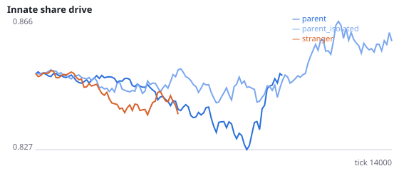
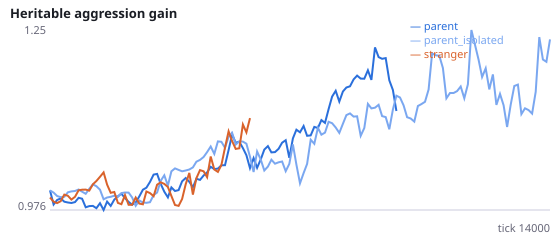
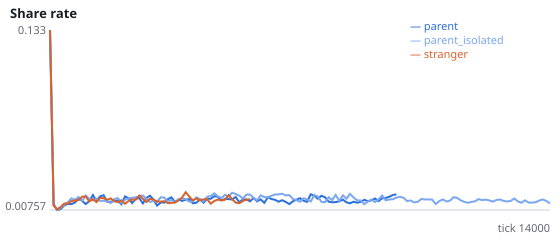
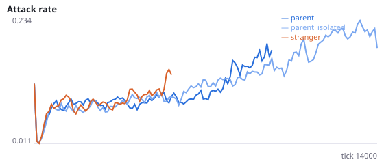
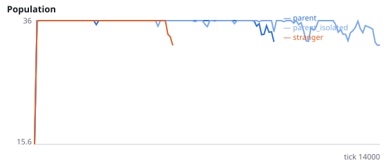
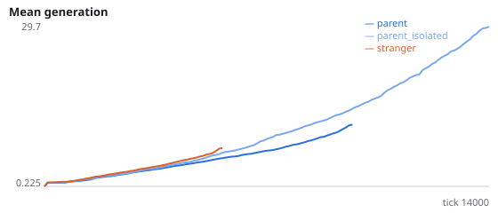

# Does placement beside the parent protect populations through parent–offspring interaction?

**Question.** Newborns placed beside their parent protect evolving populations (stranger placement went extinct in 67/72 runs vs 22/72 beside the parent over Q, Q2, Q3, Q5, Q6, Q7). Six accounts are ruled out: local density, energy recycling, gradual spread, relatedness in general, parental culling (Q6) and the aggression sink (Q7). Q4 found that moving newborns only 0.15 from the parent removed most of the protection, while the reach for attacks and sharing is 0.08. So the protection may need parent and newborn to interact. Q6 and Q7 changed only the parent's attacks on its offspring; the newborn's actions on its parent and sharing in both directions were left intact.

Intervention: no_family_interaction=True. Attacks and shares between a parent and its own offspring, in either direction, have no effect (an attacker still pays the attack cost; a blocked share costs nothing). Siblings and other relatives still interact. Newborns are placed beside the parent. stranger is a reference only. Interpretation rule, fixed in advance: protection works through parent-offspring interaction if H44a or H44b is supported; if neither is, it works some other way (for example sensing or spatial clustering). H44c and H44d are manipulation checks. No pilot was run. Seeds 2500-2511 have never been run.

NeuralMind 0.2.0 · 2026-10-17 05:21 · mean [95% bootstrap CI] over seeds; paired differences use the same seeds.

**Pre-registration:** spec `studies/Q8_family_isolation.json` at commit `1e4eecac88c92a108d461961ffae8d61d8597997` (2026-10-17T03:51:11+07:00) · unchanged since commit: **True** · preregistered: **True**

## Hypotheses

| id | statement | test (a − b) | result |
|---|---|---|---|
| H44a | With parent-offspring interaction blocked, populations beside the parent die out sooner | 1056 [-988.5, 3345] | **not supported** |
| H44b | With parent-offspring interaction blocked, populations go extinct more often | 0.08333 [-0.3333, 0.5] | **not supported** |
| H44c | Manipulation check: kills of own offspring fall below 5% of kills | -0.05 [-0.05, -0.05] | **supported** |
| H44d | Manipulation check: blocking lowers the share of gifts that go to kin | -0.2734 [-0.3707, -0.1849] | **supported** |

## Conditions

| condition | sense_gain | innate_foraging | share_gene | aggr_gene | share_rate | attack_rate | signal_rate | share_given_encounter | encounter_rate | drift_social_minus_loco | invader_share | final_pop | max_generation |
|---|---|---|---|---|---|---|---|---|---|---|---|---|---|
| parent | 0.5156 [-0.8438, 1.734] | 7.906 [5.594, 10.56] | 0.8634 [0.8246, 0.9033] | 2.076 [1.31, 2.93] | 0.01862 [0.01366, 0.02432] | 0.2279 [0.1401, 0.3295] | 0.02533 [0.0202, 0.03105] | 0.01958 [0.01443, 0.02546] | 0.497 [0.4908, 0.5037] | 0.01345 [0.001841, 0.02625] | nan [nan, nan] | 21.17 [12, 30.17] | 26.92 [11.08, 44.75] |
| parent_isolated | -0.2679 [-1.286, 0.7147] | 10.64 [8.411, 12.77] | 0.8532 [0.8141, 0.8961] | 1.09 [0.8076, 1.394] | 0.01573 [0.01254, 0.02019] | 0.2471 [0.1599, 0.3409] | 0.02232 [0.01714, 0.02796] | 0.01731 [0.01356, 0.02182] | 0.475 [0.4545, 0.4875] | 0.02147 [0.008196, 0.03544] | nan [nan, nan] | 21 [12, 30] | 19.92 [5.917, 41.75] |
| stranger | 1.5 [0.875, 2.125] | 6.375 [5.375, 7.375] | 0.8309 [0.8282, 0.8335] | 0.8618 [0.6029, 1.121] | 0.01565 [0.0138, 0.01826] | 0.2175 [0.06376, 0.3712] | 0.03218 [0.02036, 0.04436] | 0.01594 [0.0133, 0.01859] | 0.4413 [0.3586, 0.5] | 0.01239 [0.01084, 0.01395] | nan [nan, nan] | 6 [0, 15] | 3.083 [0, 7.583] |

     

Full per-metric summaries and raw per-run data: `results.json`.