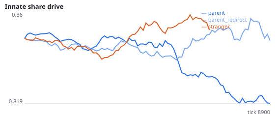
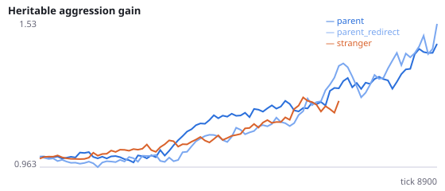
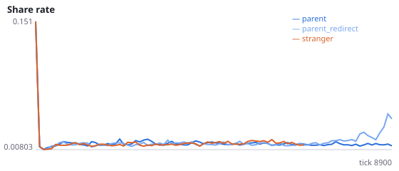
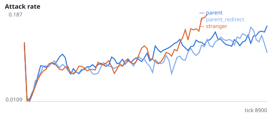
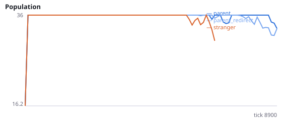
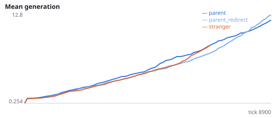

# Do attacks wasted within the family protect populations born beside the parent?

**Question.** Placing newborns beside their parent protects evolving populations (stranger placement went extinct in 77/84 runs vs 26/84 beside the parent over Q-Q8). Redirecting only the parent's attacks on its offspring (Q7) and blocking all parent-offspring attacks and shares (Q8) both left the protection intact. But in Q8 a blocked attack still does not reach an unrelated adult, and in Q7 the offspring's attacks on its parent were never redirected. A broad sink account remains: beside the parent, many attacks in both directions land within the family instead of on unrelated adults. This study redirects attacks in both directions.

Intervention: family_attack_redirect=True. When the nearest target of an attack is the attacker's own offspring or own parent, the attack instead hits the nearest agent within reach that is neither (or misses if there is none). Sharing is unchanged. Newborns are placed beside the parent. stranger is a reference only. Interpretation rule, fixed in advance: the broad sink account is supported if H45a or H45b is supported; if neither is, attacks between parent and offspring are not the mechanism in any form tested, and what the newborn senses becomes the leading candidate. H45c and H45d are manipulation checks. No pilot was run. Seeds 2600-2611 have never been run.

NeuralMind 0.2.0 · 2026-10-17 06:55 · mean [95% bootstrap CI] over seeds; paired differences use the same seeds.

**Pre-registration:** spec `studies/Q9_family_redirect.json` at commit `c71c5c83c5e3623e242b5b5764357bc40f59409b` (2026-10-17T05:24:17+07:00) · unchanged since commit: **True** · preregistered: **True**

## Hypotheses

| id | statement | test (a − b) | result |
|---|---|---|---|
| H45a | With attacks between parent and offspring redirected to others, populations beside the parent die out sooner | -553.1 [-2725, 1456] | **not supported** |
| H45b | With attacks between parent and offspring redirected, populations go extinct more often | 0.1667 [-0.1667, 0.5] | **not supported** |
| H45c | Manipulation check: kills of own offspring fall below 5% of kills | -0.05 [-0.05, -0.05] | **supported** |
| H45d | Manipulation check: redirection lowers the share of kills that are of kin | -0.328 [-0.3867, -0.2672] | **supported** |

## Conditions

| condition | sense_gain | innate_foraging | share_gene | aggr_gene | share_rate | attack_rate | signal_rate | share_given_encounter | encounter_rate | drift_social_minus_loco | invader_share | final_pop | max_generation |
|---|---|---|---|---|---|---|---|---|---|---|---|---|---|
| parent | 0.1406 [-0.75, 1.109] | 9.406 [7.266, 11.55] | 0.8586 [0.8064, 0.9167] | 1.746 [0.9376, 2.738] | 0.01764 [0.01249, 0.02606] | 0.2349 [0.1552, 0.3205] | 0.02173 [0.0173, 0.02551] | 0.0191 [0.01361, 0.02816] | 0.4953 [0.4839, 0.5089] | 0.01525 [0.002443, 0.02881] | nan [nan, nan] | 24 [15, 33] | 30.42 [13.33, 47.67] |
| parent_redirect | -0.4792 [-1.667, 1.167] | 6.312 [4.083, 8.605] | 0.8849 [0.8325, 0.9323] | 1.989 [1.327, 2.691] | 0.01682 [0.01414, 0.01968] | 0.2995 [0.2157, 0.3851] | 0.02385 [0.01637, 0.03382] | 0.01809 [0.01517, 0.02148] | 0.4951 [0.4818, 0.5054] | 0.003676 [-0.002113, 0.01005] | nan [nan, nan] | 16 [7, 25] | 19.17 [7.417, 32.67] |
| stranger | -0.125 [-0.125, -0.125] | 6.125 [6.125, 6.125] | 0.9345 [0.9345, 0.9345] | 2.596 [2.596, 2.596] | 0.02198 [0.0127, 0.03557] | 0.281 [0.2202, 0.3449] | 0.01633 [0.01301, 0.01925] | 0.024 [0.01372, 0.03885] | 0.4349 [0.4007, 0.469] | -0.008454 [-0.008454, -0.008454] | nan [nan, nan] | 1.25 [0, 3.75] | 5.583 [0, 16.75] |

     

Full per-metric summaries and raw per-run data: `results.json`.