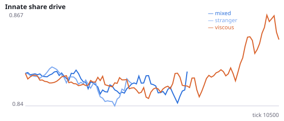
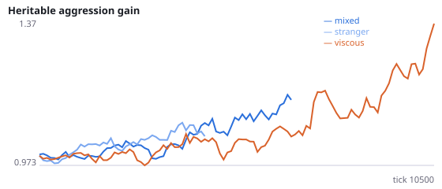
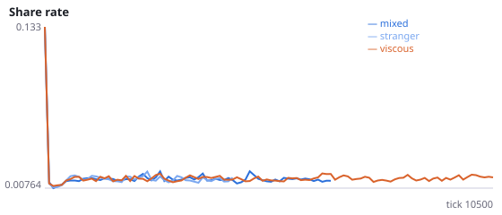
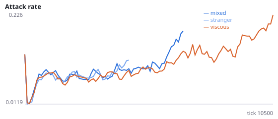
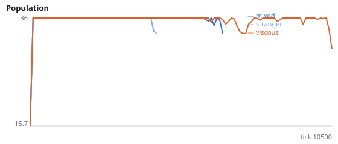
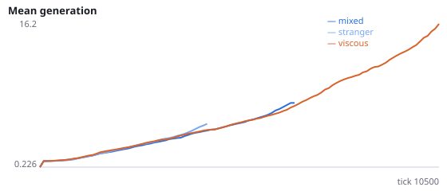

# Does viscosity protect populations through kinship or through local density?

**Question.** Viscous populations (newborns placed beside their parent) survive longer and breed faster than well-mixed ones (F, F2, L). Is that because newborns start next to a relative, or simply next to someone? A third condition places well-mixed newborns beside a random living agent that is not a recorded relative.

L (ticks 0-6000): births per agent-tick 0.0027 well-mixed vs 0.0036 viscous; starvation 37% vs 31% of deaths; killings 58% vs 67%. Food respawns uniformly, so food patches cannot explain it. Interpretation rule, fixed in advance: if only density matters, H26a and H26b are supported and H26c and H26d are not; if only kinship matters, the reverse. Seeds 1100-1111 have never been run.

NeuralMind 0.2.0 · 2026-10-16 02:30 · mean [95% bootstrap CI] over seeds; paired differences use the same seeds.

**Pre-registration:** spec `studies/Q_kin_vs_density.json` at commit `5e4dda84b2b7df9e941cf2b4d779d90b6f816da8` (2026-10-15T23:26:14+07:00) · unchanged since commit: **True** · preregistered: **True**

## Hypotheses

| id | statement | test (a − b) | result |
|---|---|---|---|
| H26a | Density: newborns placed beside a stranger survive longer as populations than randomly placed ones | -936.3 [-4148, 2194] | **not supported** |
| H26b | Density: placing newborns beside a stranger raises the early birth rate | 0.0004332 [-0.0002075, 0.001198] | **not supported** |
| H26c | Kinship: placing newborns beside their parent beats placing them beside a stranger (survival) | 2902 [-230.2, 5941] | **not supported** |
| H26d | Kinship: placing newborns beside their parent beats placing them beside a stranger (early birth rate) | 0.0003594 [-0.0005811, 0.00116] | **not supported** |
| H14b4 | Fourth test: viscous populations survive longer than well-mixed ones | 1965 [-336.8, 4142] | **not supported** |

## Conditions

| condition | innate_foraging | share_gene | aggr_gene | share_rate | attack_rate | signal_rate | share_given_encounter | encounter_rate | drift_social_minus_loco | invader_share | final_pop | max_generation |
|---|---|---|---|---|---|---|---|---|---|---|---|---|
| mixed | 7.812 [5, 10.75] | 0.798 [0.7663, 0.8424] | 1.302 [0.7649, 1.968] | 0.01401 [0.01154, 0.01672] | 0.31 [0.1632, 0.4497] | 0.02008 [0.01521, 0.02555] | 0.01252 [0.01, 0.01537] | 0.4052 [0.3566, 0.456] | 0.02481 [0.01437, 0.0338] | nan [nan, nan] | 12 [3, 21] | 5.833 [1.417, 10.42] |
| stranger | 17.38 [17.38, 17.38] | 0.8109 [0.8109, 0.8109] | 0.7752 [0.7752, 0.7752] | 0.01333 [0.01125, 0.01505] | 0.1777 [0.1133, 0.2496] | 0.02842 [0.02155, 0.03528] | 0.01319 [0.01097, 0.01452] | 0.4749 [0.4655, 0.4826] | 0.04084 [0.04084, 0.04084] | nan [nan, nan] | 3 [0, 9] | 1.333 [0, 4] |
| viscous | 7.109 [5.125, 9.391] | 0.892 [0.8375, 0.9617] | 1.696 [1.299, 2.1] | 0.01864 [0.01423, 0.02461] | 0.284 [0.1981, 0.3652] | 0.0295 [0.01895, 0.04079] | 0.02037 [0.01579, 0.02669] | 0.4985 [0.492, 0.5044] | 0.01145 [0.0002105, 0.02784] | nan [nan, nan] | 22.92 [13.92, 31.92] | 29.5 [13.91, 45.67] |

     

Full per-metric summaries and raw per-run data: `results.json`.