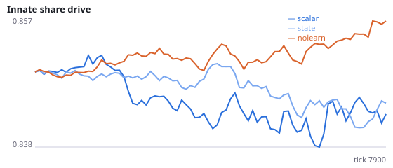
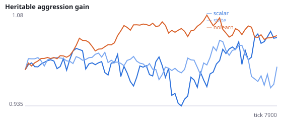
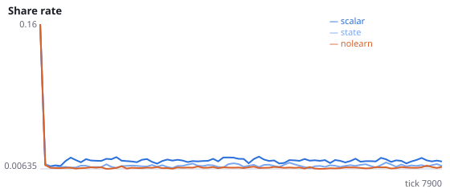
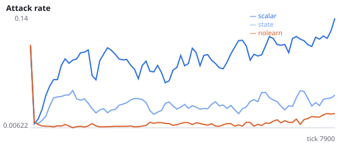
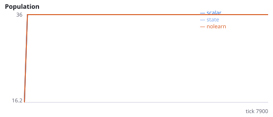
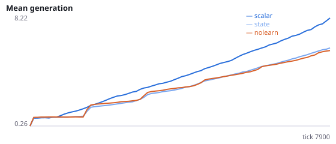

# Does a stimulus-specific critic remove the side effect of learning on social behaviour?

**Question.** Frémaux, Sprekeler & Gerstner (2010) show that reward-modulated STDP carries an unsupervised bias term unless the reward expectation is subtracted per stimulus. Our agents use one scalar expectation. If the expectation is kept separately for each binarised sensor state, does the learning-induced rise in attacking, signalling and sharing shrink, and does foraging improve?

Experiments I-K traced the rise in social actions under learning to a fall in total locomotion drive; an exploratory probe found ~58% of updates carry a negative RPE, absorbed mostly by the busiest (locomotion) pathways. Intervention: critic='state' keys the TD(0) reward expectation by the sensor vector thresholded at 0.2 (up to 2048 states for social agents). Seeds 1200-1207 have never been run.

NeuralMind 0.2.0 · 2026-10-16 02:54 · mean [95% bootstrap CI] over seeds; paired differences use the same seeds.

**Pre-registration:** spec `studies/R_state_critic.json` at commit `36743d9af83a86a84104ea7b2f90e74d89595f28` (2026-10-15T23:32:52+07:00) · unchanged since commit: **True** · preregistered: **True**

## Hypotheses

| id | statement | test (a − b) | result |
|---|---|---|---|
| H27a | A state critic lowers the attack rate | 0.07408 [0.03719, 0.1135] | **supported** |
| H27b | A state critic lowers signalling | 0.008859 [0.003804, 0.01308] | **supported** |
| H27c | A state critic lowers sharing given a neighbour in reach | 0.004841 [0.002896, 0.006677] | **supported** |
| H27d | A state critic reduces the drift of social relative to locomotion inputs | 0.0734 [0.06016, 0.08635] | **supported** |
| H27e | A state critic improves realised foraging | 0.007891 [0.005125, 0.01065] | **supported** |

## Conditions

| condition | innate_foraging | share_gene | aggr_gene | share_rate | attack_rate | signal_rate | share_given_encounter | encounter_rate | drift_social_minus_loco | invader_share | final_pop | max_generation |
|---|---|---|---|---|---|---|---|---|---|---|---|---|
| scalar | 6.609 [4.75, 8.172] | 0.842 [0.8267, 0.8583] | 1.021 [0.8881, 1.129] | 0.01505 [0.01325, 0.01719] | 0.1145 [0.08353, 0.1487] | 0.02289 [0.01845, 0.02729] | 0.01504 [0.01398, 0.01623] | 0.4898 [0.4846, 0.4952] | 0.02952 [0.01911, 0.04094] | nan [nan, nan] | 36 [36, 36] | 9.625 [8.125, 11.12] |
| state | 9.734 [8.734, 10.84] | 0.8448 [0.8375, 0.853] | 0.9782 [0.9259, 1.035] | 0.01011 [0.008993, 0.01156] | 0.04045 [0.03049, 0.05127] | 0.01403 [0.0118, 0.01614] | 0.0102 [0.009028, 0.01156] | 0.4803 [0.4756, 0.4848] | -0.04388 [-0.05709, -0.03165] | nan [nan, nan] | 36 [36, 36] | 7 [6.375, 7.625] |
| nolearn | 11.47 [10.12, 12.72] | 0.8563 [0.8464, 0.8669] | 1.045 [0.8994, 1.197] | 0.007814 [0.007476, 0.008153] | 0.01689 [0.01237, 0.0222] | 0.007613 [0.007278, 0.007965] | 0.00775 [0.00727, 0.008208] | 0.4853 [0.479, 0.4925] | 0 [0, 0] | nan [nan, nan] | 36 [36, 36] | 6.875 [6.5, 7.25] |

     

Full per-metric summaries and raw per-run data: `results.json`.