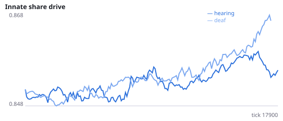
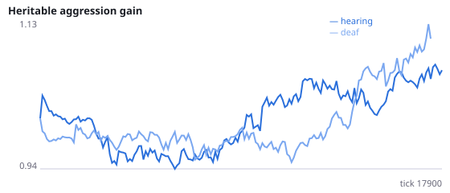
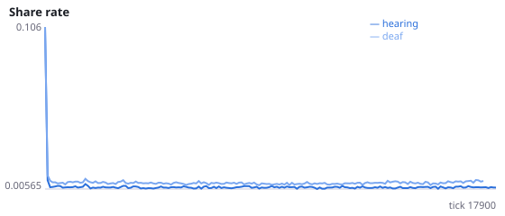
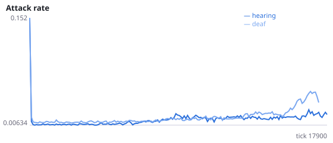
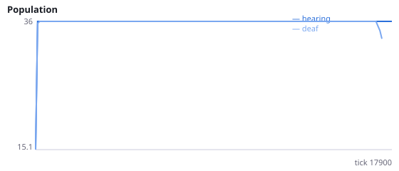
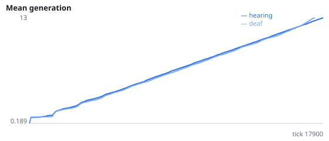

# Do signals evolve meaning when food must be eaten together?

**Question.** Experiment M found no meaning in signals when nothing rewarded communication. Here food can only be eaten when another living agent is within 0.15, and hearing is directional (three egocentric bins locate callers). Does a signal now carry more information about the signaller's view of food when it can be heard than in a deaf control?

M: MI(signal; food in view) ~0.0002 bits with or without hearing. New mechanics: coop_radius=0.15 (an engineering pilot on unregistered seed 9998 found 0.08 went extinct within 548 ticks and 0.15 persisted for 3000 ticks); directional_hearing adds three caller-direction sensors, which read 0 in the deaf condition just like the heard-level sensor. Learning is off so only selection shapes signalling (I-K showed learning raises signalling as a side effect). Seeds 1400-1411 have never been run.

NeuralMind 0.2.0 · 2026-10-16 04:15 · mean [95% bootstrap CI] over seeds; paired differences use the same seeds.

**Pre-registration:** spec `studies/S_signals_with_a_reason.json` at commit `4e69dea54df58a919e2fce1a131b61c16e25d453` (2026-10-16T00:52:44+07:00) · unchanged since commit: **True** · preregistered: **True**

## Hypotheses

| id | statement | test (a − b) | result |
|---|---|---|---|
| H29a | Signals carry more information about food in view when they can be heard | -1.979e-05 [-0.0001009, 8.161e-05] | **not supported** |
| H29b | Hearing populations survive longer | 45.58 [0, 136.8] | **not supported** |
| H29c | Hearing populations eat more per agent-tick | 0.0008905 [-0.0005669, 0.002384] | **not supported** |
| H29d | Hearing populations signal more | -0.002364 [-0.003626, -0.0009378] | **not supported** |

## Conditions

| condition | innate_foraging | share_gene | aggr_gene | share_rate | attack_rate | signal_rate | share_given_encounter | encounter_rate | drift_social_minus_loco | invader_share | final_pop | max_generation |
|---|---|---|---|---|---|---|---|---|---|---|---|---|
| hearing | 0 [0, 0] | 0.8557 [0.8493, 0.8621] | 1.089 [0.9254, 1.262] | 0.006641 [0.006322, 0.006957] | 0.01815 [0.01369, 0.02292] | 0.007543 [0.006537, 0.00914] | 0.006756 [0.006418, 0.007076] | 0.4786 [0.4751, 0.4816] | 0 [0, 0] | nan [nan, nan] | 36 [36, 36] | 14.17 [13.83, 14.5] |
| deaf | 0 [0, 0] | 0.8658 [0.8547, 0.8784] | 1.026 [0.8204, 1.259] | 0.009734 [0.008952, 0.01075] | 0.03208 [0.01908, 0.05029] | 0.009906 [0.009051, 0.01078] | 0.009781 [0.008895, 0.01095] | 0.4816 [0.4795, 0.4839] | 0 [0, 0] | nan [nan, nan] | 33 [27, 36] | 12.5 [10.08, 13.92] |

     

Full per-metric summaries and raw per-run data: `results.json`.