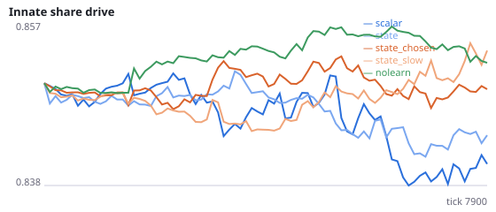
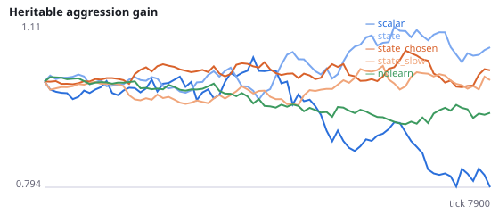
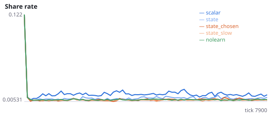
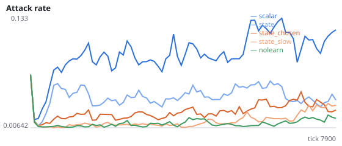
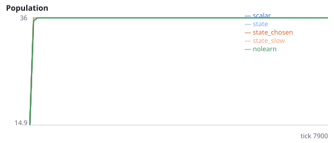
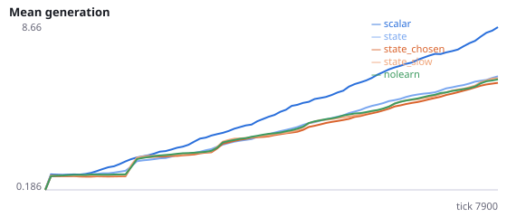

# Can any simple change to the learning rule make lifetime learning pay in an evolving population?

**Question.** P and R found that agents learning during their lifetime eat less than agents with fixed, evolved wiring (scalar critic -31%, per-state critic about -15%). Starting from the per-state critic, do two further changes close the gap: crediting only the executed action, or a four-times lower learning rate?

R: food per agent-tick 0.035 scalar, 0.042 state, 0.050 no learning (viscous, 8000 ticks). credit_chosen_only cut about half of the learned signalling rise in I. lr=0.2 is a quarter of the default 0.8. No pilot was run for this study; directions come from R and I only. Survival is not tested because no viscous population went extinct within 8000 ticks in P or R. Seeds 1700-1707 have never been run.

NeuralMind 0.2.0 · 2026-10-16 07:16 · mean [95% bootstrap CI] over seeds; paired differences use the same seeds.

**Pre-registration:** spec `studies/T_learning_rules.json` at commit `3ce7a2c8f3862c9c6de1c6c1a545445708c13b99` (2026-10-16T02:55:04+07:00) · unchanged since commit: **True** · preregistered: **True**

## Hypotheses

| id | statement | test (a − b) | result |
|---|---|---|---|
| H32a | Replication of R: a per-state critic forages better than the scalar critic | 0.007222 [0.004328, 0.009861] | **supported** |
| H32b | Crediting only the executed action improves foraging over the per-state critic alone | 0.001382 [-0.00174, 0.004299] | **not supported** |
| H32c | A lower learning rate improves foraging over the per-state critic alone | 0.003505 [-0.0003257, 0.007127] | **not supported** |
| H32d | Learning still costs foraging with state critic plus chosen-only credit | -0.005747 [-0.00853, -0.002681] | **supported** |
| H32e | Learning still costs foraging with state critic plus a low learning rate | -0.003623 [-0.007288, -0.0009824] | **supported** |

## Conditions

| condition | innate_foraging | share_gene | aggr_gene | share_rate | attack_rate | signal_rate | share_given_encounter | encounter_rate | drift_social_minus_loco | invader_share | final_pop | max_generation |
|---|---|---|---|---|---|---|---|---|---|---|---|---|
| scalar | 7.516 [6.281, 8.86] | 0.8433 [0.8269, 0.8566] | 0.7984 [0.5565, 1.005] | 0.0144 [0.01299, 0.01578] | 0.1126 [0.0924, 0.137] | 0.02057 [0.0169, 0.02461] | 0.01446 [0.01307, 0.01588] | 0.4965 [0.4861, 0.5069] | 0.02786 [0.02108, 0.03365] | nan [nan, nan] | 36 [36, 36] | 9.75 [8.25, 11.38] |
| state | 7.984 [6.109, 9.734] | 0.8431 [0.8344, 0.8508] | 1.078 [0.9713, 1.195] | 0.009882 [0.008878, 0.01091] | 0.04224 [0.03731, 0.04751] | 0.01367 [0.01025, 0.01791] | 0.009769 [0.009032, 0.01063] | 0.4821 [0.4763, 0.4878] | -0.05479 [-0.06418, -0.04488] | nan [nan, nan] | 36 [36, 36] | 7.125 [6.625, 7.75] |
| state_chosen | 6.453 [4.25, 9] | 0.8487 [0.8343, 0.8608] | 1.028 [0.9398, 1.108] | 0.008069 [0.007144, 0.009436] | 0.03359 [0.02317, 0.04531] | 0.01527 [0.01052, 0.02023] | 0.008097 [0.007418, 0.008908] | 0.4814 [0.4765, 0.4871] | -0.04938 [-0.05922, -0.03769] | nan [nan, nan] | 36 [36, 36] | 6.625 [6.25, 6.875] |
| state_slow | 8.766 [6.312, 11.03] | 0.8542 [0.8485, 0.8607] | 1.007 [0.9274, 1.086] | 0.007356 [0.007012, 0.00772] | 0.02424 [0.01214, 0.04027] | 0.008108 [0.007179, 0.009662] | 0.007414 [0.006971, 0.007905] | 0.4803 [0.4746, 0.486] | -0.01246 [-0.01513, -0.009646] | nan [nan, nan] | 36 [36, 36] | 6.875 [6.5, 7.25] |
| nolearn | 9.797 [8.484, 11.05] | 0.852 [0.8424, 0.8619] | 0.9567 [0.8865, 1.034] | 0.007613 [0.007276, 0.007972] | 0.01465 [0.01021, 0.0199] | 0.007849 [0.007667, 0.008089] | 0.007423 [0.007045, 0.007821] | 0.4856 [0.4807, 0.4902] | 0 [0, 0] | nan [nan, nan] | 36 [36, 36] | 6.625 [6.25, 7] |

     

Full per-metric summaries and raw per-run data: `results.json`.