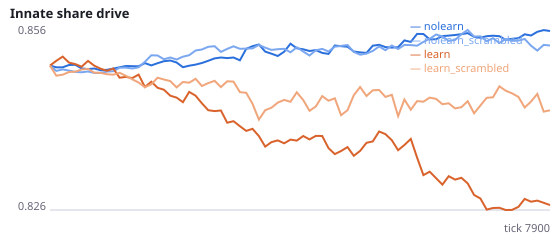
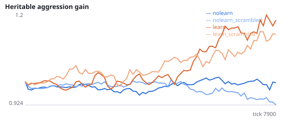
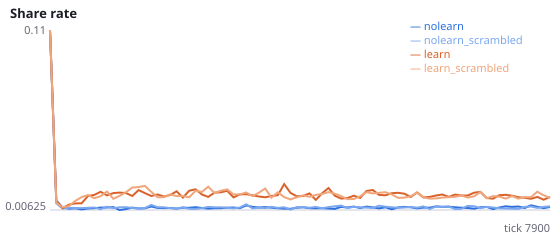
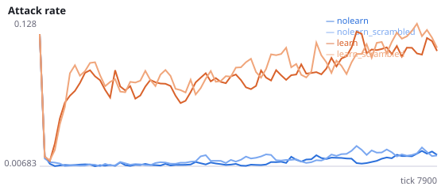
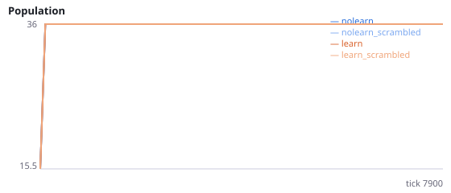
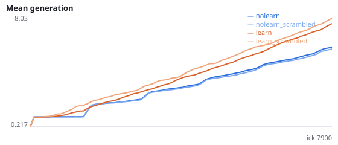

# Do evolving agents use their senses to find food?

**Question.** Three environment-shift tests failed their manipulation checks: swapping left and right (N, N3) or swapping the food and hazard channels (exploratory pilot, 4 seeds) did not lower the foraging of fixed-wiring agents. A probe of two evolved populations (8000 ticks, about 6 generations, no learning) found innate food and hazard weights near the founder value (about 1.2) with no left/right structure. If evolved wiring ignores sensory information, those shifts could not matter, and the innate-foraging gain in E (+5.5) must come from something other than sensing, such as moving more. This study scrambles the food and hazard sensors and asks whether foraging depends on them.

Intervention: scramble_senses=True shuffles the 6 food/hazard sensor values every tick with a dedicated random stream. The total input current is unchanged, but which value comes from which direction and object is lost. Hunger and social sensors are untouched. sense_gain is the innate-foraging assay (each of up to 8 surviving genomes alone in a fresh world for 300 ticks, learning off, as in E) with real senses minus the same genomes with scrambled senses. Positive-control pilot (exploratory, not registered): single agents trained for 40 episodes ate 4.03 food per test episode with real senses vs 2.60 scrambled (6 training seeds x 16 test worlds; lower in 5/6), so scrambling removes information a trained agent uses. In the same pilot untrained random wiring ate 1.0 with real senses vs 2.5 scrambled. Interpretation rule, fixed in advance: if H36a and H36b are both not supported, foraging in evolving populations does not measurably depend on sensory information, and earlier interpretations that assume sensory-guided innate foraging (E, N, N3) must be re-read. Seeds 2000-2011 have never been run.

NeuralMind 0.2.0 · 2026-10-16 22:27 · mean [95% bootstrap CI] over seeds; paired differences use the same seeds.

**Pre-registration:** spec `studies/V_do_agents_use_senses.json` at commit `5e396d5651c27221f76391bf3364c852ef399e45` (2026-10-16T21:00:09+07:00) · unchanged since commit: **True** · preregistered: **True**

## Hypotheses

| id | statement | test (a − b) | result |
|---|---|---|---|
| H36a | Evolved innate wiring uses the senses: its genomes forage better with real than with scrambled senses (no-learning populations) | 0.2708 [-1.657, 2.062] | **not supported** |
| H36b | Evolving populations without learning eat more with real senses than with scrambled senses | 0.001491 [-0.0006656, 0.003796] | **not supported** |
| H36c | Evolving populations with learning eat more with real senses than with scrambled senses | 0.001376 [-0.001609, 0.004125] | **not supported** |
| H36d | Evolving with real senses yields more sense use than evolving with scrambled senses (no learning) | -0.25 [-2.156, 1.615] | **not supported** |

## Conditions

| condition | innate_foraging | share_gene | aggr_gene | share_rate | attack_rate | signal_rate | share_given_encounter | encounter_rate | drift_social_minus_loco | invader_share | final_pop | max_generation |
|---|---|---|---|---|---|---|---|---|---|---|---|---|
| nolearn | 9.583 [7.458, 11.57] | 0.8549 [0.8493, 0.8608] | 0.9985 [0.899, 1.1] | 0.007845 [0.007517, 0.008204] | 0.01466 [0.01131, 0.01882] | 0.007832 [0.007435, 0.008294] | 0.007825 [0.007488, 0.008178] | 0.4822 [0.4761, 0.4893] | 0 [0, 0] | nan [nan, nan] | 36 [36, 36] | 6.833 [6.583, 7] |
| nolearn_scrambled | 10.54 [8.843, 12.29] | 0.8533 [0.8464, 0.8594] | 0.926 [0.828, 1.014] | 0.007736 [0.007569, 0.007918] | 0.01828 [0.01283, 0.02479] | 0.007884 [0.007606, 0.008148] | 0.007418 [0.007187, 0.007614] | 0.4835 [0.4787, 0.4876] | 0 [0, 0] | nan [nan, nan] | 36 [36, 36] | 6.5 [6.25, 6.75] |
| learn | 7.146 [6.083, 8.292] | 0.8268 [0.8096, 0.8435] | 1.194 [1.025, 1.401] | 0.01422 [0.01272, 0.01578] | 0.1073 [0.08703, 0.1313] | 0.0253 [0.0204, 0.03021] | 0.01441 [0.01295, 0.01609] | 0.4907 [0.4838, 0.4979] | 0.03746 [0.03035, 0.04522] | nan [nan, nan] | 36 [36, 36] | 8.833 [8.083, 9.75] |
| learn_scrambled | 6.792 [5.531, 8.105] | 0.8406 [0.8241, 0.8569] | 1.179 [1.071, 1.311] | 0.01392 [0.0126, 0.01545] | 0.1107 [0.09311, 0.1304] | 0.02278 [0.01924, 0.02643] | 0.01407 [0.01286, 0.0154] | 0.4927 [0.487, 0.4984] | 0.03231 [0.02305, 0.04171] | nan [nan, nan] | 36 [36, 36] | 9.333 [8.5, 10.33] |

     

Full per-metric summaries and raw per-run data: `results.json`.