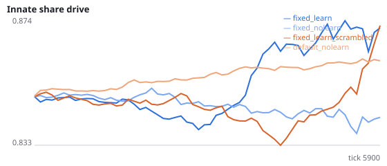
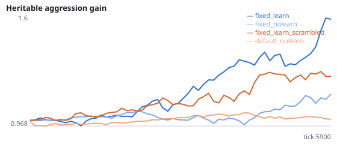
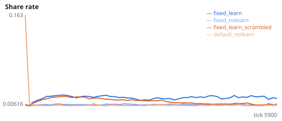
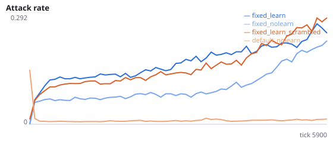
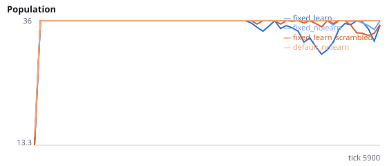
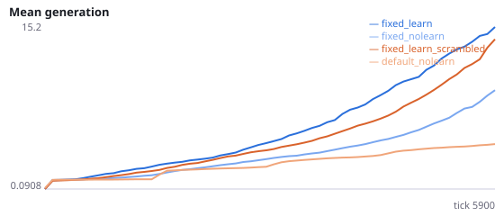

# With the fixed decision dynamics, does lifetime learning pay in evolving social populations?

**Question.** In evolving populations lifetime learning has always lowered foraging (P, R, T, V: about -14% to -31%), and V found that innate wiring does not measurably use the senses. W showed that single agents learn sensory foraging and eat about 5.7x more once decisions last 32 ms, start from a cleared state, and use normalised input weights. In social evolving worlds W's normalisation, which sets every action neuron's input sum to one common budget, erased the weaker innate drive into attack, share and signal, and learning populations died out within 1000 ticks (exploratory pilot). Normalising each neuron to its own innate input sum kept 2/2 pilot populations alive. This study asks whether learning now pays in evolving populations and whether it uses the senses.

All fixed conditions use substeps=32, reset_each_decision=True, normalize=True, normalize_to='innate' on the standard evolution base (12 founders, viscous, 24 food). Pilot (seeds 9200-9201, 3000 ticks, exploratory): food per agent-tick 0.033/0.037 learning vs 0.032/0.030 no learning; attack rate 0.15-0.18 vs 0.06. default_nolearn uses the default dynamics without learning, the best foraging condition in V (0.051). Interpretation rule, fixed in advance: learning pays in evolving populations if H40a is supported; the gain is sensory if H40b is also supported. H40c asks whether the fixed learners beat the best old baseline. Seeds 2300-2309 have never been run.

NeuralMind 0.2.0 · 2026-10-17 02:30 · mean [95% bootstrap CI] over seeds; paired differences use the same seeds.

**Pre-registration:** spec `studies/X_learning_in_evolving_populations.json` at commit `36019d1f30f0846e04233689d95a6aaef98df831` (2026-10-17T00:39:20+07:00) · unchanged since commit: **True** · preregistered: **True**

## Hypotheses

| id | statement | test (a − b) | result |
|---|---|---|---|
| H40a | With the fixed dynamics, learning populations eat more than non-learning ones | 0.001998 [-0.002817, 0.006219] | **not supported** |
| H40b | With the fixed dynamics, learning populations eat more with real than with scrambled senses | 0.0005026 [-0.004612, 0.005155] | **not supported** |
| H40c | Fixed-dynamics learners eat more than default-dynamics non-learners (the best earlier baseline) | -0.01249 [-0.01609, -0.008386] | **not supported** |
| H40d | With the fixed dynamics, learning raises the attack rate | 0.0488 [-0.02646, 0.1304] | **not supported** |
| H40e | With the fixed dynamics, learning populations survive as long as non-learning ones (no difference expected) | 0 [0, 0] | **no difference detected** |

## Conditions

| condition | sense_gain | innate_foraging | share_gene | aggr_gene | share_rate | attack_rate | signal_rate | share_given_encounter | encounter_rate | drift_social_minus_loco | invader_share | final_pop | max_generation |
|---|---|---|---|---|---|---|---|---|---|---|---|---|---|
| fixed_learn | 0.4625 [-0.5753, 1.613] | 6.438 [5.287, 7.825] | 0.8673 [0.8435, 0.8976] | 1.593 [1.056, 2.176] | 0.0201 [0.01364, 0.02688] | 0.2336 [0.1519, 0.3175] | 0.0284 [0.01945, 0.03738] | 0.01819 [0.01219, 0.02442] | 0.496 [0.485, 0.5097] | 2.056e-18 [-1.398e-17, 1.614e-17] | nan [nan, nan] | 34.8 [32.4, 36] | 18.5 [11, 26.8] |
| fixed_nolearn | 0.3625 [-0.4625, 1.175] | 6.75 [5.8, 7.726] | 0.8432 [0.8296, 0.8599] | 1.143 [0.9855, 1.322] | 0.008292 [0.005789, 0.01108] | 0.1848 [0.1391, 0.2403] | 0.01533 [0.009765, 0.02246] | 0.007229 [0.005111, 0.009611] | 0.4914 [0.4815, 0.5015] | 0 [0, 0] | nan [nan, nan] | 34 [30.4, 36] | 11.9 [9.2, 15.2] |
| fixed_learn_scrambled | 0.45 [-0.6003, 1.6] | 6.425 [5.225, 8.1] | 0.8659 [0.8302, 0.905] | 1.253 [0.9684, 1.637] | 0.00924 [0.006481, 0.01277] | 0.2543 [0.1806, 0.3345] | 0.01601 [0.009716, 0.02287] | 0.008408 [0.005847, 0.01137] | 0.5014 [0.4928, 0.5099] | 9.92e-18 [-7.196e-19, 2.005e-17] | nan [nan, nan] | 34.8 [32.4, 36] | 17.1 [11.5, 23.6] |
| default_nolearn | -1.788 [-3.625, 0.125] | 8.775 [7.45, 10.03] | 0.8611 [0.8558, 0.867] | 1.007 [0.9439, 1.071] | 0.007522 [0.007276, 0.007772] | 0.01204 [0.008868, 0.01582] | 0.007793 [0.007467, 0.008065] | 0.00742 [0.007005, 0.007779] | 0.487 [0.4781, 0.5002] | 0 [0, 0] | nan [nan, nan] | 36 [36, 36] | 6.2 [5.7, 6.7] |

     

Full per-metric summaries and raw per-run data: `results.json`.