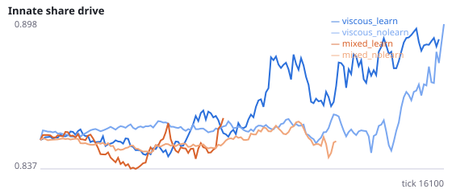
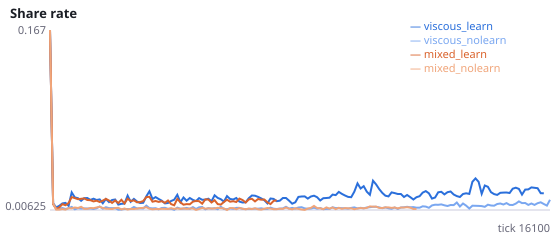
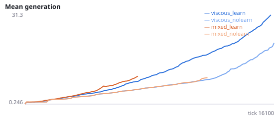
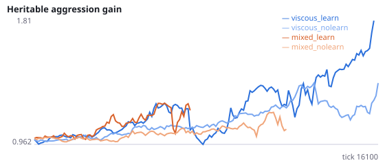
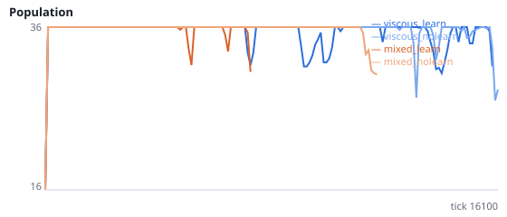

# Experiment C2 — crowding and spatial kin cues

NeuralMind 0.1.0 · 2026-10-12 01:31 · mean [95% bootstrap CI] over seeds, final 25% of each run.

Design: `{"seeds": 6, "ticks": 18000, "base": {"social": true, "evolve": true, "r_prosocial": 0.0, "share_benefit": 2.0, "n_agents": 12, "max_pop": 36, "substeps": 4, "n_food": 24, "food_energy": 0.6, "repro_threshold": 1.1, "repro_cost": 0.45}, "conditions": {"viscous_learn": {"viscous": true, "learning": true}, "viscous_nolearn": {"viscous": true, "learning": false}, "mixed_learn": {"viscous": false, "learning": true}, "mixed_nolearn": {"viscous": false, "learning": false}}}`

| condition | share_rate | share_given_encounter | encounter_rate | share_to_kin | encounter_kin | share_dist | enc_dist | enc_dist_kin | enc_dist_nonkin | share_gene | aggr_gene | max_generation |
|---|---|---|---|---|---|---|---|---|---|---|---|---|
| viscous_learn | 0.0225 [0.0131, 0.0336] | 0.0237 [0.0142, 0.0347] | 0.4985 [0.4928, 0.5053] | 0.4600 [0.3682, 0.5434] | 0.3492 [0.2825, 0.4085] | 0.0468 [0.0457, 0.0480] | 0.0479 [0.0473, 0.0484] | 0.0454 [0.0447, 0.0465] | 0.0493 [0.0490, 0.0495] | 0.9087 [0.8472, 0.9703] | 1.9152 [1.0067, 3.1447] | 38.8333 [16.3333, 59.6750] |
| viscous_nolearn | 0.0116 [0.0086, 0.0161] | 0.0128 [0.0087, 0.0183] | 0.4882 [0.4838, 0.4957] | 0.2673 [0.0834, 0.4693] | 0.1769 [0.0460, 0.3122] | 0.0485 [0.0463, 0.0505] | 0.0485 [0.0479, 0.0491] | 0.0463 [0.0452, 0.0472] | 0.0493 [0.0491, 0.0496] | 0.8622 [0.8366, 0.8846] | 1.8546 [1.1330, 3.1576] | 21.5000 [7.1667, 43.1667] |
| mixed_learn | 0.0190 [0.0138, 0.0242] | 0.0189 [0.0138, 0.0239] | 0.3837 [0.3757, 0.3916] | 0.0877 [0.0753, 0.1002] | 0.0982 [0.0888, 0.1076] | 0.0524 [0.0521, 0.0528] | 0.0517 [0.0515, 0.0520] | 0.0537 [0.0532, 0.0542] | 0.0515 [0.0513, 0.0517] | 0.9289 [0.9289, 0.9289] | 3.2038 [3.2038, 3.2038] | 15.0000 [0.0000, 45.0000] |
| mixed_nolearn | 0.0171 [0.0083, 0.0335] | 0.0161 [0.0079, 0.0313] | 0.4631 [0.4384, 0.4798] | 0.0537 [0.0285, 0.0789] | 0.0541 [0.0299, 0.0784] | 0.0510 [0.0504, 0.0518] | 0.0496 [0.0492, 0.0503] | 0.0495 [0.0486, 0.0507] | 0.0496 [0.0492, 0.0503] | 0.8796 [0.8578, 0.9014] | 0.9994 [0.6875, 1.2671] | 15.0000 [4.6667, 26.1792] |

  
 

## Pre-registered tests

- learning_effect_on_share_rate(viscous): 0.0109 [0.0033, 0.0215]
- H9_learning_effect_on_share_given_encounter(viscous): 0.0109 [0.0033, 0.0222]
- H10a_enc_dist_minus_share_dist(viscous): 0.0005 [-0.0005, 0.0015]
- H10b_nonkin_minus_kin_enc_dist(viscous): 0.0034 [0.0026, 0.0042]
- H5_rerun_viscous_minus_mixed_share_gene: -0.0232 [-0.0607, 0.0155]

Verdict: `{"H9_supported": false, "H9_conditional_effect_fraction": 1.0061456105174809, "H10a_supported": false, "H10b_supported": true, "H5_rerun_supported": false}`