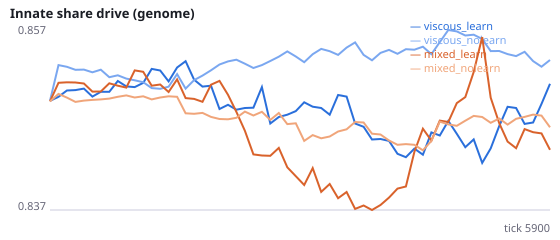
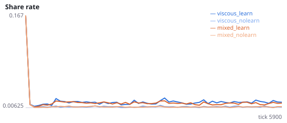
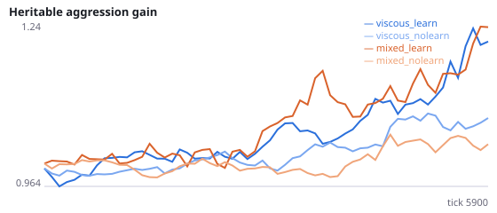
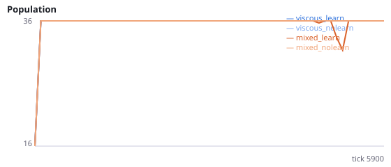

# Experiment C — selfish learning vs kin-selected helping

NeuralMind 0.1.0 · 2026-10-12 00:42 · mean [95% bootstrap CI] over seeds, final 25% of each run.

Design: `{"seeds": 6, "ticks": 6000, "base": {"social": true, "evolve": true, "r_prosocial": 0.0, "share_benefit": 2.0, "n_agents": 12, "max_pop": 36, "substeps": 4, "n_food": 24, "food_energy": 0.6, "repro_threshold": 1.1, "repro_cost": 0.45}, "extra": {}, "conditions": {"viscous_learn": {"viscous": true, "learning": true}, "viscous_nolearn": {"viscous": true, "learning": false}, "mixed_learn": {"viscous": false, "learning": true}, "mixed_nolearn": {"viscous": false, "learning": false}}}`

| condition | innate share drive | share rate | share→kin | encounters with kin | aggression gene | final pop | max gen | extinct |
|---|---|---|---|---|---|---|---|---|
| viscous_learn | 0.854 [0.839, 0.869] | 1.61% [1.50, 1.74] | 21.68% [15.48, 31.66] | 17.02% [13.45, 22.16] | 1.237 [0.957, 1.603] | 36.0 | 7.0 | 0 |
| viscous_nolearn | 0.853 [0.847, 0.861] | 0.78% [0.75, 0.82] | 8.34% [5.90, 10.88] | 5.04% [3.88, 6.28] | 1.075 [0.995, 1.152] | 36.0 | 5.8 | 0 |
| mixed_learn | 0.845 [0.828, 0.859] | 1.36% [1.24, 1.52] | 10.24% [8.95, 11.67] | 10.54% [9.48, 11.63] | 1.236 [1.020, 1.479] | 36.0 | 8.8 | 0 |
| mixed_nolearn | 0.846 [0.839, 0.854] | 0.75% [0.72, 0.79] | 3.97% [2.41, 5.40] | 3.32% [2.62, 4.06] | 1.031 [0.881, 1.171] | 36.0 | 5.7 | 0 |

 
 

## Pre-registered tests

- **H5** viscous − mixed innate share drive (learning off): 0.007 [0.000, 0.014] → supported = **True**
- **H6** learning off − on share rate (viscous): -0.83% [-0.97, -0.70] → supported = **False**
- **H7** share→kin − encounter-kin (viscous): 3.98% [2.06, 6.57] → null retained = **False**

A hypothesis counts as supported only if its 95% CI excludes 0 in the predicted direction.