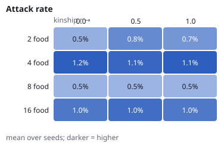
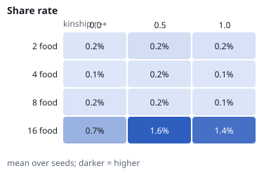
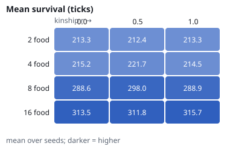

# Social-behaviour experiments — results

NeuralMind 0.1.0 · generated 2026-10-12 00:15 · values are mean [95% bootstrap CI] over seeds.

## A. Does food deprivation make agents more aggressive?

Design: {'seeds': 10, 'ticks': 300, 'deprive_at': 150, 'n_agents': 5, 'conditions': {'intact': {'aggression_gain': 1.0, 'affect_from_primary': True}, 'ablated': {'aggression_gain': 0.0, 'affect_from_primary': True}, 'intact_v1': {'aggression_gain': 1.0, 'affect_from_primary': False}, 'ablated_v1': {'aggression_gain': 0.0, 'affect_from_primary': False}}}

| condition | attack rate (fed) | attack rate (deprived) | change | frustration fed → deprived |
|---|---|---|---|---|
| intact | 0.22% [0.12%, 0.30%] | 0.28% [0.11%, 0.50%] | 0.06% [-0.12%, 0.26%] | 0.08 → 0.04 |
| ablated | 0.19% [0.08%, 0.28%] | 0.10% [0.04%, 0.17%] | -0.09% [-0.21%, 0.05%] | 0.08 → 0.03 |
| intact_v1 | 12.73% [8.06%, 17.16%] | 0.13% [0.00%, 0.31%] | -12.60% [-17.06%, -7.91%] | 0.78 → 0.19 |
| ablated_v1 | 0.19% [0.08%, 0.28%] | 0.10% [0.04%, 0.17%] | -0.09% [-0.21%, 0.05%] | 0.83 → 0.13 |

Encounter-conditioned (only ticks with another agent within reach):

| condition | encounters (fed → deprived) | attack \| encounter (fed) | attack \| encounter (deprived) |
|---|---|---|---|
| intact | 9.54% [5.46%, 15.92%] → 7.61% [2.95%, 13.32%] | 0.15% [0.00%, 0.44%] | 0.00% [0.00%, 0.00%] |
| ablated | 9.85% [5.04%, 16.33%] → 8.85% [4.79%, 13.52%] | 0.11% [0.00%, 0.32%] | 0.00% [0.00%, 0.00%] |

`_v1` rows use the pilot model where shaping noise also drove affect (`affect_from_primary=False`); kept for transparency.

Mediation (intact effect − ablated effect): 0.15% [-0.05%, 0.41%]

Verdict: H1 = **False**, H2 = **False** (true only if the 95% CI excludes zero).

## B. Scarcity × kinship

Design: {'seeds': 10, 'ticks': 400, 'food_levels': [2, 4, 8, 16], 'r_levels': [0.0, 0.5, 1.0], 'n_agents': 5}

  

| food | r | attack rate | share rate | signal rate | encounters | attack \| enc | share \| enc | survival | food/agent |
|---|---|---|---|---|---|---|---|---|---|
| 2 | 0.0 | 0.53% [0.20%, 1.02%] | 0.16% [0.10%, 0.22%] | 0.38% [0.28%, 0.48%] | 7.38% [4.13%, 11.59%] | 3.17% [0.03%, 7.58%] | 0.46% [0.00%, 1.06%] | 213.30 [194.46, 234.60] | 0.38 [0.16, 0.64] |
| 2 | 0.5 | 0.82% [0.23%, 1.61%] | 0.23% [0.13%, 0.34%] | 0.41% [0.31%, 0.53%] | 8.40% [4.88%, 13.27%] | 2.38% [0.03%, 5.77%] | 0.53% [0.00%, 1.32%] | 212.44 [194.36, 232.98] | 0.44 [0.20, 0.72] |
| 2 | 1.0 | 0.73% [0.21%, 1.40%] | 0.19% [0.12%, 0.27%] | 0.37% [0.29%, 0.45%] | 8.68% [4.54%, 14.67%] | 3.69% [0.03%, 8.93%] | 0.51% [0.00%, 1.35%] | 213.26 [193.76, 235.28] | 0.38 [0.18, 0.60] |
| 4 | 0.0 | 1.15% [0.24%, 2.31%] | 0.13% [0.07%, 0.21%] | 0.19% [0.10%, 0.29%] | 7.98% [3.04%, 15.60%] | 0.04% [0.00%, 0.11%] | 0.59% [0.00%, 1.27%] | 215.24 [191.10, 236.46] | 0.60 [0.36, 0.86] |
| 4 | 0.5 | 1.10% [0.22%, 2.24%] | 0.15% [0.07%, 0.26%] | 0.20% [0.12%, 0.29%] | 7.11% [2.88%, 13.48%] | 0.03% [0.00%, 0.10%] | 0.75% [0.00%, 1.65%] | 221.66 [201.96, 241.58] | 0.72 [0.48, 0.96] |
| 4 | 1.0 | 1.15% [0.31%, 2.26%] | 0.14% [0.07%, 0.22%] | 0.21% [0.11%, 0.32%] | 5.90% [2.75%, 10.08%] | 0.06% [0.00%, 0.17%] | 1.11% [0.00%, 2.65%] | 214.54 [197.82, 231.00] | 0.64 [0.38, 0.90] |
| 8 | 0.0 | 0.50% [0.13%, 1.04%] | 0.17% [0.10%, 0.24%] | 0.14% [0.08%, 0.20%] | 9.96% [4.69%, 17.73%] | 0.12% [0.00%, 0.37%] | 0.00% [0.00%, 0.00%] | 288.58 [257.14, 320.02] | 2.30 [1.36, 3.32] |
| 8 | 0.5 | 0.49% [0.12%, 1.04%] | 0.15% [0.08%, 0.22%] | 0.14% [0.07%, 0.20%] | 10.04% [4.72%, 17.75%] | 0.08% [0.00%, 0.23%] | 0.00% [0.00%, 0.00%] | 298.00 [264.16, 331.86] | 2.44 [1.52, 3.44] |
| 8 | 1.0 | 0.50% [0.13%, 1.04%] | 0.15% [0.07%, 0.22%] | 0.13% [0.07%, 0.20%] | 10.53% [5.03%, 18.07%] | 0.06% [0.00%, 0.17%] | 0.00% [0.00%, 0.00%] | 288.88 [258.44, 319.50] | 2.18 [1.28, 3.18] |
| 16 | 0.0 | 0.96% [0.39%, 1.70%] | 0.69% [0.12%, 1.70%] | 1.23% [0.09%, 3.15%] | 6.99% [4.32%, 9.84%] | 0.57% [0.15%, 1.14%] | 0.23% [0.00%, 0.68%] | 313.50 [282.94, 343.04] | 4.46 [3.36, 5.46] |
| 16 | 0.5 | 1.04% [0.44%, 1.79%] | 1.56% [0.16%, 3.58%] | 1.24% [0.10%, 3.15%] | 8.27% [5.08%, 11.64%] | 0.40% [0.09%, 0.79%] | 0.48% [0.00%, 1.12%] | 311.82 [281.68, 342.66] | 4.42 [3.30, 5.48] |
| 16 | 1.0 | 0.96% [0.38%, 1.71%] | 1.37% [0.13%, 3.01%] | 1.24% [0.09%, 3.15%] | 8.72% [5.74%, 11.58%] | 0.24% [0.04%, 0.53%] | 0.05% [0.00%, 0.14%] | 315.74 [284.03, 346.32] | 4.26 [3.20, 5.24] |

Scarcity effect on attacks (scarcest − most abundant): -0.29% [-0.87%, 0.26%]
Kinship effect on sharing (highest r − r=0): 0.18% [-0.01%, 0.53%]
Abundance effect on encounter rate (abundant − scarce): -0.16% [-3.76%, 2.99%]
Scarcity effect on attack | encounter: 2.68% [0.60%, 5.19%]
Kinship effect on share | encounter: 0.10% [-0.12%, 0.41%]

Verdict: H3 = **False**, H4 = **False**.

## Caveats

- Rates are per alive agent-tick; behaviour is chosen by each agent's spiking network.
- Within-lifetime learning only (no evolution); small populations (5 agents).
- The frustration→attack coupling is a modelling hypothesis, not established biology.
- A 'False' verdict means the data did not support the hypothesis at 95% — it is reported, not hidden.